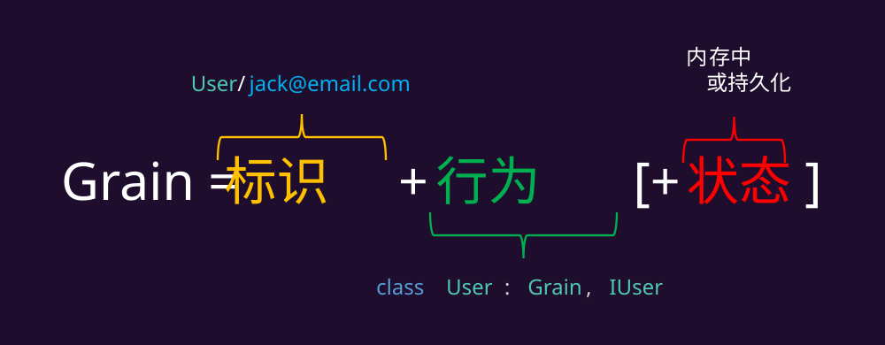

<p align="center">
  <image src="assets/logo_full.png" alt="Orleans 标志" width="600px">
</p>

[](http://www.nuget.org/profiles/Orleans)
[](https://twitter.com/intent/follow?screen_name=msftorleans)

[](https://aka.ms/orleans-discord)

<a id="orleans-is-a-cross-platform-framework-for-building-robust-scalable-distributed-applications"></a>

### Orleans 是用于构建可靠、可伸缩的分布式应用的跨平台框架

Orleans 将 .NET 的开发效率带到云服务等分布式应用中。应用可以从单台本地服务器扩展到在全球云环境中运行的高可用系统。

Orleans 将对象、接口、`async`/`await` 和 `try`/`catch` 等熟悉的概念扩展到多服务器环境。习惯开发单服务器应用的开发者可以借此构建具备弹性和可伸缩性的云服务及其他分布式应用。因此，Orleans 常被称为“分布式 .NET”。

Orleans 由 [Microsoft Research](http://research.microsoft.com/projects/orleans/) 创建，引入了[虚拟 Actor 模型](https://www.microsoft.com/en-us/research/publication/orleans-distributed-virtual-actors-for-programmability-and-scalability/)，为云时代的新一代分布式系统提供了一种构建方法。它的核心贡献是这套编程模型。该模型降低了高并行分布式系统固有的复杂性，同时保留了开发者所需的能力和灵活性。

## Grains



任何 Orleans 应用的基本构建单元都是 *Grain*。每个 Grain 都有用户定义的标识、行为和状态。用户定义的键用作 Grain 的标识，使其始终可以通过该标识被调用。其他 Grain 或 Web 前端等外部客户端可通过强类型通信接口（契约）调用 Grain。每个 Grain 都是实现一个或多个此类接口的类的实例。

Grain 可以拥有易失状态、持久状态，或同时拥有两者。持久状态可以保存在任意存储系统中。Grain 以这种方式隐式地对应用状态分区，支持自动扩展，并简化故障恢复。Grain 激活期间，其状态保留在内存中，从而降低延迟以及存储系统的负载。

<p align="center">
  <image src="assets/managed_lifecycle.svg" alt="Grain 的托管生命周期示意图">
</p>

Orleans 运行时按需创建 Grain 实例，并自动将一段时间未使用的 Grain 从内存中移除以释放资源。由于 Grain 具有稳定的标识，无论实例当前是否在内存中，都可以通过该标识调用它。故障恢复也因此对调用方透明，调用方无需知道 Grain 实例位于哪台服务器。Orleans 运行时负责管理 Grain 的生命周期，按需激活、停用、放置和定位 Grain，让开发者可以像所有 Grain 都驻留在内存中一样编写代码。

稳定的标识、有状态性以及托管生命周期，使基于 Orleans 构建的系统具备可伸缩性、高性能和可靠性，也免去了开发者手写复杂分布式系统代码的负担。

<a id="example-iot-cloud-backend"></a>

### 示例：物联网云后端

以[物联网](https://en.wikipedia.org/wiki/Internet_of_things)系统的云后端为例。该应用接收设备数据，对其进行筛选、聚合和处理，并向设备发送命令。在 Orleans 中，可以为每台设备建模一个 Grain，作为对应实体设备的*数字孪生*。这些 Grain 在内存中保存最新的设备数据，因此无需直接与实体设备通信即可快速查询和处理数据。Grain 可以观察设备发来的时序数据流，检测测量值超过阈值等变化，并触发相应操作。

一个简单的恒温器可以建模如下：

```csharp
public interface IThermostat : IGrainWithStringKey
{
    Task<List<Command>> OnUpdate(ThermostatStatus update);
}
```

Web 前端收到恒温器事件后，可以调用对应 Grain 的 `OnUpdate` 方法。该方法可以返回需要发送给设备的命令。

```csharp
var thermostat = client.GetGrain<IThermostat>(id);
return await thermostat.OnUpdate(update);
```

同一个恒温器 Grain 可以实现独立的接口，供控制系统交互：

```csharp
public interface IThermostatControl : IGrainWithStringKey
{
    Task<ThermostatStatus> GetStatus();

    Task UpdateConfiguration(ThermostatConfiguration config);
}
```

同一个类实现这两个接口（`IThermostat` 和 `IThermostatControl`）：

```csharp
public class ThermostatGrain : Grain, IThermostat, IThermostatControl
{
    private ThermostatStatus _status;
    private List<Command> _commands;

    public Task<List<Command>> OnUpdate(ThermostatStatus status)
    {
        _status = status;
        var result = _commands;
        _commands = new List<Command>();
        return Task.FromResult(result);
    }
    
    public Task<ThermostatStatus> GetStatus() => Task.FromResult(_status);
    
    public Task UpdateConfiguration(ThermostatConfiguration config)
    {
        _commands.Add(new ConfigUpdateCommand(config));
        return Task.CompletedTask;
    }
}
```

上面的 `Grain` 类未持久化状态。完整的状态持久化示例见 [Microsoft Orleans：Grain 持久化](https://dotnet.github.io/orleans/docs/grains/grain-persistence/)。

<a id="orleans-runtime"></a>

## Orleans 运行时

Orleans 运行时实现了应用编程模型。运行时的主要组件是 *Silo*，负责托管 Grain。通常多个 Silo 组成集群，以支持扩展和容错。在集群中，Silo 相互协调以分配工作、检测故障并执行恢复。运行时让集群中的 Grain 能像位于同一个进程中一样通信。

除核心编程模型外，Silo 还向 Grain 提供计时器、提醒（持久化计时器）、持久化、事务和流等运行时服务。详情见下方的[功能](#features)。

Web 前端及其他外部客户端通过客户端库调用集群中的 Grain，由客户端库自动管理网络通信。客户端也可以和 Silo 托管在同一进程中，以简化部署。

Orleans 兼容 .NET Standard 2.0 及以上版本，可在 Windows、Linux 和 macOS 上运行，并支持完整的 .NET Framework 或 .NET Core。

<a id="features"></a>

## 功能

Orleans 提供了一系列用于开发分布式系统的服务，下面逐一介绍。

<a id="persistence"></a>

### 持久化

Orleans 提供简单的持久化模型，确保 Grain 在处理请求前可以读取状态，并维持状态一致性。一个 Grain 可拥有多个具名的持久化数据对象，例如用 “profile” 保存用户资料、用 “inventory” 保存物品清单。这些状态可保存在任意存储系统中，也可分别放在不同的数据库中。Grain 运行期间，状态保存在内存中，读取请求无需访问存储系统。Grain 更新状态后，可以调用 `state.WriteStateAsync()` 来更新后端存储，保证持久性和一致性。详情见 [Microsoft Orleans：Grain 持久化](https://dotnet.github.io/orleans/docs/grains/grain-persistence/)。

<a id="distributed-acid-transactions"></a>

### 分布式 ACID 事务

除了上述简单持久化模型，Grain 还可以拥有*事务状态*。无论状态最终存放在哪里，多个 Grain 均可参与同一个 [ACID](https://en.wikipedia.org/wiki/ACID) 事务。Orleans 事务采用分布式、去中心化设计（没有中央事务管理器或协调器），并提供[可串行化隔离](https://en.wikipedia.org/wiki/Isolation_(database_systems)#Isolation_levels)。详情见 [Microsoft Orleans：事务](https://dotnet.github.io/orleans/docs/grains/transactions/)。

<a id="streams"></a>

### 流

流帮助开发者近实时地处理一系列数据项。Orleans 中的流由运行时*托管*，Grain 或客户端可直接向流发布数据或订阅流，无需预先创建或注册。这样可以进一步解耦生产者、消费者与基础设施。流处理支持可靠恢复，Grain 可以保存检查点（游标），并在激活时或此后的任意时间恢复到该检查点。

流支持批量向消费者投递消息，以提高处理效率和恢复性能。
流由 Azure Event Hubs、Amazon Kinesis 等队列服务提供支持。任意数量的流可以复用到较少的队列上，处理队列的职责均匀分配给集群中的节点。

<a id="timers-amp-reminders"></a>

### 计时器与提醒

提醒是 Grain 的持久化调度机制，可用于在将来的时间点执行操作，即使届时 Grain 尚未激活。计时器是相应的非持久化机制，适用于无需可靠性保证的高频事件。详情见 [Microsoft Orleans：计时器与提醒](https://dotnet.github.io/orleans/docs/grains/timers-and-reminders/)。

<a id="flexible-grain-placement"></a>

### 灵活的 Grain 放置策略

Orleans 激活 Grain 时，运行时会决定在哪台服务器（Silo）上激活它，这称为 Grain 放置。放置过程完全可配置。开发者可使用随机、优先本地、基于负载等内置策略，也可配置自定义逻辑。例如，可以将 Grain 放置在靠近它要访问的资源或要通信的其他 Grain 的服务器上。

<a id="grain-versioning-amp-heterogeneous-clusters"></a>

### Grain 版本控制与异构集群

应用代码会不断演进，如何安全地在运行中的生产系统中部署变更是一个挑战，对有状态系统尤其如此。Orleans 支持按需为 Grain 接口设置版本。集群维护每个 Silo 所提供的 Grain 实现及其版本的映射。运行时在路由调用时结合版本信息和放置策略作出选择。这既支持安全升级带版本的 Grain，也允许异构集群中不同 Silo 提供不同的 Grain 实现。详情见 [Microsoft Orleans：Grain 接口版本控制](https://dotnet.github.io/orleans/docs/grains/grain-versioning/grain-versioning/)。

<a id="elastic-scalability-amp-fault-tolerance"></a>

### 弹性伸缩与容错

Orleans 支持弹性伸缩。Silo 加入集群时即可承接新的激活。Silo 因缩容或机器故障退出集群时，原先在该 Silo 上激活的 Grain 会按需在其他 Silo 上重新激活。Orleans 集群可缩容至单个 Silo。实现弹性伸缩的机制也支持容错，集群能够自动检测故障并快速恢复。

<a id="run-anywhere"></a>

### 运行环境

Orleans 可以在支持 .NET Core 或 .NET Framework 的环境中运行。它可托管在 Linux、Windows 和 macOS 上，也可部署到 Kubernetes、虚拟机或物理机、本地或云环境，以及 Azure Container Apps、Azure App Service 和 Azure Kubernetes Service 等 PaaS 服务。

<a id="stateless-workers"></a>

### 无状态工作 Grain

无状态工作 Grain 带有专门的标记，无关联状态，可以同时在多个 Silo 上激活，从而提高无状态函数的并行度。详情见 [Microsoft Orleans：无状态工作 Grain](https://dotnet.github.io/orleans/docs/grains/stateless-worker-grains/)。

<a id="grain-call-filters"></a>

### Grain 调用筛选器

多个 Grain 共用的逻辑可写成[拦截器，也称 Grain 调用筛选器](https://dotnet.github.io/orleans/docs/grains/interceptors/)。Orleans 支持对传入和传出的调用使用筛选器，常见用途包括授权、日志与遥测以及错误处理。

<a id="request-context"></a>

### 请求上下文

可以使用[请求上下文](https://dotnet.github.io/orleans/docs/grains/request-context/)在一系列请求中传递元数据和其他信息。请求上下文可携带分布式跟踪信息或其他用户定义的值。

<a id="documentation"></a>

## 文档

请参阅 Microsoft Orleans 官方文档 <https://dotnet.github.io/orleans/docs/>。

<a id="samplessamplesreadme"></a>

## [示例](./samples/#readme)

可在官方 [.NET 示例浏览器](https://docs.microsoft.com/samples/browse/?terms=orleans)中查找更多示例。

<a id="get-started"></a>

## 入门

请参阅 [Orleans Hello World 快速入门](https://dotnet.github.io/orleans/docs/tutorials-and-samples/hello-world/)。

<a id="building"></a>

### 构建

参与贡献所需环境、构建、测试以及使用本地源码项目的方法，请参阅[贡献指南](CONTRIBUTING.md)。

要直接构建解决方案，请运行 `dotnet build Orleans.slnx -bl`。在 Windows 上，`Build.cmd` 还会对解决方案打包，并将包放到 `Artifacts/<Configuration>` 中。

<a id="official-builds"></a>

## 官方构建

请在[发布页面](https://github.com/dotnet/orleans/releases/latest)下载可用于生产环境的最新稳定版本。

每夜构建发布在 [NuGet 源](https://pkgs.dev.azure.com/dnceng/public/_packaging/orleans-nightly/nuget/v3/index.json)上。这些构建通过了全部功能测试，测试覆盖的场景少于发布到 NuGet 的稳定版本和预发行版本。

<details>
<summary>
在项目中使用每夜构建包
</summary>

要在项目中使用每夜构建，请通过以下任意一种方法添加包源：

1. 修改 `.csproj` 文件，加入以下内容：

```xml
<ItemGroup>
  <RestoreSources>
    $(RestoreSources);
    https://pkgs.dev.azure.com/dnceng/public/_packaging/orleans-nightly/nuget/v3/index.json
  </RestoreSources>
</ItemGroup>
```

或者

1. 在解决方案目录下创建 `NuGet.config` 文件，内容如下：

```xml
<?xml version="1.0" encoding="utf-8"?>
<configuration>
  <packageSources>
    <clear /> 
    <add key="orleans-nightly" value="https://pkgs.dev.azure.com/dnceng/public/_packaging/orleans-nightly/nuget/v3/index.json" />
    <add key="nuget" value="https://api.nuget.org/v3/index.json" />
  </packageSources>
</configuration>
```

</details>

<a id="community"></a>

## 社区

[](https://aka.ms/orleans-discord)
    
* 可通过[在 GitHub 创建 Issue](https://github.com/dotnet/orleans/issues)或在 [Stack Overflow](https://stackoverflow.com/questions/ask?tags=orleans) 上提问。
* [在 Discord 上交流](https://aka.ms/orleans-discord)。
* 关注 Twitter 账号 [@msftorleans](https://twitter.com/msftorleans) 获取 Orleans 公告。
* [OrleansContrib：Orleans 社区扩展的 GitHub 组织](https://github.com/OrleansContrib/)汇集了监控、设计模式、存储提供程序等社区项目。
* 想参与开发，请参阅[向 Orleans 贡献代码的指南](CONTRIBUTING.md)。
* 也欢迎在 GitHub 上开启新的[讨论](https://github.com/dotnet/orleans/issues)，报告缺陷或交流技术问题。

<a id="license"></a>

## 许可证

本项目采用 [MIT 许可证](LICENSE)。

<a id="quick-links"></a>

## 常用链接

* [Microsoft Research 项目主页](http://research.microsoft.com/projects/orleans/)
* 技术报告：[用于可编程性和可伸缩性的分布式虚拟 Actor](http://research.microsoft.com/apps/pubs/default.aspx?id=210931)
* [Microsoft Orleans 文档](https://dotnet.github.io/orleans/docs/)
* [参与贡献](CONTRIBUTING.md)
