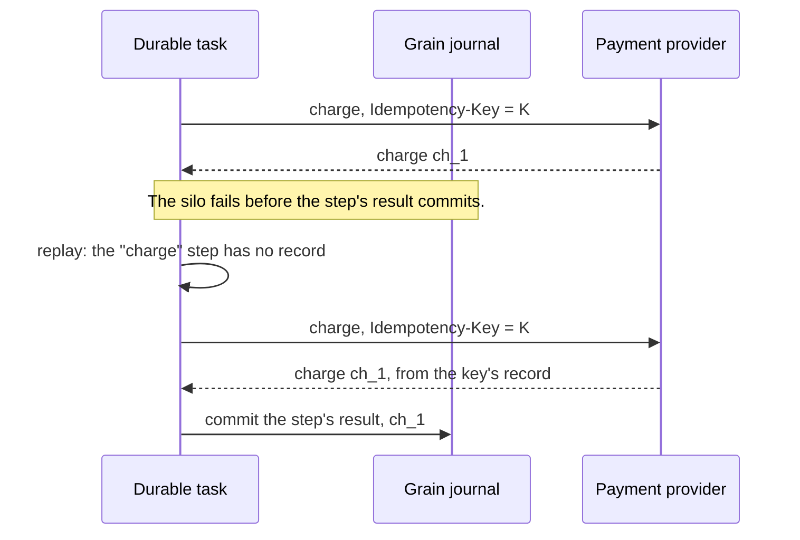

# 持久化任务中的幂等性

持久化任务通过重新执行任务体并返回已记录的结果，从崩溃中恢复。Orleans 记录的工作恰好提交一次。与另一个系统交互的边界上的工作可能执行多次，该系统需要使用任务从自身标识派生的键去重。本文介绍边界两侧的保证。有关重放本身，参见[重放与确定性](durable-tasks.md#replay-and-determinism)。

## 恰好提交一次的效果

Grain 的日志在一次写入中提交任务状态、Grain 的日志持久化状态，以及收件箱和发件箱。以下操作分别与其记录一起原子提交，因此重放时会找到相应记录，而不会再次应用该效果：

| 工作 | 与之一起提交的内容 |
| --- | --- |
| `DurableTask.RunInline` 效果所作的状态变更 | 效果记录，在任务下一次持久化写入时提交。 |
| 本地步骤最后的同步代码 | 步骤的结果。 |
| 任务体末尾的同步代码 | 任务的结果。 |
| 调用另一个 Grain、延迟、发送信号、分离式启动、`Post` | 此次执行对操作的记录，与待发送消息在一次日志写入中提交。 |
| 调用 `Post` 的持久化 Grain 普通方法 | Grain 的状态变更，在其下一次 `WriteStateAsync` 中提交。 |

Grain 之间的消息携带由发送方、接收方、任务和主题派生的标识，因此重新投递或重放的调用、结果、取消操作或信号会定位到先前创建的记录。任务 ID 对启动操作去重：使用已有任务 ID 启动相同方法时，无论参数如何，都会重新关联到该任务；启动不同的方法则会以 `DurableTaskConflictException` 失败。

读取也会被记录。步骤的结果、效果的结果、信号的值，以及逻辑时间 `DurableTask.Current.UtcNow` 在每次重放中都相同，因此任务体基于这些值作出的决策也相同。

## 至少执行一次的效果

调用另一个系统的步骤会在调用返回后记录结果。如果此次运行在调用之后、提交结果的日志写入之前结束（例如 Silo 故障），下一次运行就会再次执行该步骤，而另一个系统会收到两次调用：

同样的情况也适用于：

- `DurableTask.Run` 委托以及等待外部工作的本地步骤。
- 任务体同步尾部中的外部异步等待；任务结果未提交时，这些操作会再次执行。
- 步骤中的普通 Grain 调用；被调用方可能已应用操作，而调用方收到超时。
- 外部系统的读取操作；步骤再次执行时可能返回不同的值。

外部系统识别出重复调用时，只应用一次。可以使用幂等键、插入或更新（upsert）操作匹配的自然键，或者已应用操作的记录来去重。

## 从任务派生幂等键

Grain 的标识、`DurableTask.Current.Id` 和 `DurableTask.Current.Incarnation` 在每次重放、重试及激活时都标识同一次任务运行。因此，从这些值派生的键对同一操作的所有尝试均相同，而与其他操作的键不同。运行世代标识（incarnation）用于区分同一个任务 ID 的后续运行，例如先前运行完成并删除后重新启动，此时其中的操作是新的：

:::code source="../snippets/compiled-durable/Grains/DurableTaskIntegrationSnippets.cs" id="durable_tasks_idempotency_key" language="csharp":::

- 包含 Grain 的标识。任务 ID 在单个 Grain 内唯一：两个 Grain 上的工作流都可以命名为 `checkout`，被调用方在各自调用方的作用域下存储任务。参见[任务标识与引用](durable-tasks-identity.md)。
- 当一次执行发送多个请求时，加入操作名称，并像 `WithId` 的名称一样保持它跨部署稳定。
- 在任务体中根据每次重放都相同的值计算键，并将其传入步骤。在已记录的效果之外使用 `Guid.NewGuid` 生成的键，在每次重放中都不同；参见 [ORLEANS0201](../diagnostics/orleans0201.md)。
- 对同一请求的每次尝试复用相同的键，包括步骤内部的重试及后续步骤的重试；对不同的请求（例如金额不同的请求）使用新键。

从 Orleans 外部启动的任务也可以通过根 ID 获得同样的保证。从业务操作派生根 ID，例如 `place-order-{orderId}`，使客户端在超时后重试时定位到同一个任务，而不是启动第二个任务。

## 在接收方去重

接收方识别重复请求的方式取决于接收方的类型：

- **另一个 Grain 上的持久化任务**按任务 ID 去重：调用方的调用记录已为其指定名称，因此被调用方的任务只运行一次，无需额外的键。
- **普通 Grain 方法**在同一次日志写入中记录已应用的操作 ID 以及这些操作造成的状态变更，并对重复 ID 返回已记录的结果，如下方账本示例所示。应限制记录的范围，例如移除早于最长重试窗口的条目，避免无限增长。
- **数据库**按操作 ID 执行写入，例如使用操作 ID 上的唯一约束执行 upsert，或在应用变更的事务中记录该 ID。参见[写入数据库](durable-tasks-integrations.md#write-to-a-database)。
- **外部 API**若接受幂等键，例如支付提供商，则在其保留窗口内对每次重复的键返回首次请求的响应。

无论调用方重试多少次，账本只对每个操作入账一次：

:::code source="../snippets/compiled-durable/Grains/DurableTaskIntegrationSnippets.cs" id="durable_tasks_deduplicating_receiver" language="csharp":::

不支持幂等键的 API 需要在执行变更前查询：步骤根据任务提供的引用（例如请求中的订单号）查询操作结果；如果找到已有结果，就跳过变更。

## 各项保证的适用范围

| 保证 | 范围 |
| --- | --- |
| 恰好一次 | 已记录效果、步骤末尾代码及任务体尾部对日志持久化状态的变更；操作记录；Grain 之间的消息；Grain 保留任务期间，同一 ID 下的任务启动。 |
| 每次重放中的值相同 | 已记录的结果、信号值、逻辑时间、取消状态和原因，以及任务体观察到取消的操作位置。 |
| 至少一次 | 步骤及任务体尾部的外部调用；普通 Grain 调用；未使用重放安全日志记录器的日志。 |
| 由接收方去重 | 接收方定义的键所覆盖的操作：持久化任务使用任务 ID，外部系统使用任务提供的键。 |

任务 ID 仅在 Grain 保留任务期间对启动操作去重。删除任务树之后，以相同 ID 启动会再次执行请求。应设置足够长的 `ResultRetentionPeriod`，覆盖调用方可能重试的时段。参见[保留与删除](durable-tasks-operations.md#retention-and-deletion)。
