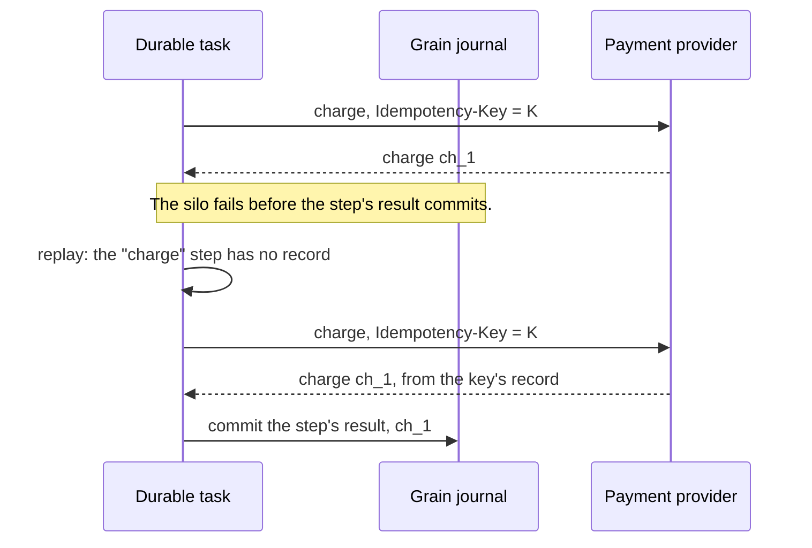

# 持久任务中具有的

一项持久的任务通过再次运行身体和归还记录的结果而幸存下来。
工作 Orleans 记录完全承诺一次。
系统可以运行不止一次, 而这个系统会用一个密钥来复制它
本页面描述边界两侧。 for
重放本身,见 [重弹和确定论](durable-tasks.md#replay-and-determinism)。

## 精确执行一次效果

grain日记本承诺任务状态、 grain日记状态及其收件箱和
发件箱以一个字的形式发送。以下每个字的每一个都以原子形式 使用其记录,所以
重放找到记录, 不再应用效果 :

| 工作 工作 | 提交 |
| --- | --- |
| A `DurableTask.RunInline` 效果的状态变化 | 效果记录, 在任务下下一个耐久的写作中。 |
| 本地步骤最后同步代码 | 步骤的结果。 |
| 身体的同步尾巴 | 任务的结果 |
| 呼叫另一个 grain、延迟、信号发送、独立启动 `Post` | 执行操作的记录, 在一份日记里写出发出的信息。 |
| 耐久 grain的普通方法,调用 `Post` | grain的状态变化, 在其下一个 `WriteStateAsync`中。 |

grains 之间电文带有发件人、接收人和
和主题,所以一个重新交付或重弹的 援引、结果、取消
信号到达它已经创建的记录。任务编号重复开始:a
在现有任务编号下,将同一方法的起始点重新连接到该任务中,不管它是什么
参数,而不同方法的起始点在 `DurableTaskConflictException`中失败。

读数也记录下来。一个步骤的结果, 一个效果的结果, 一个信号的价值,
逻辑时间 `DurableTask.Current.UtcNow` 在每次重放中都是相同的, 所以决定
身体从它们身上产生的是相同的。

## 效果至少运行一次

调用另一个系统的一个步骤, 它在调用返回后记录其结果。 当
运行在调用和日记写中进行结果的日记笔记之间的端,例如
这是因为,该 silo 失败,下一运行再次运行该步骤,而另一系统则接收
两次通话:

同样的情况也适用于:

- `DurableTask.Run` 代表和地方步骤等待外部工作。
- 外在的正等待着身体的同步尾尾巴, 当任务结果时会再次运行
  并没有犯。
- 普通普通 grain 电话从一个步骤打过来,在被调来的人应用后可以暂停。
- 外部系统读数, 当一步步再次运行时返回其它值 。

外部系统在确认重复时,即使用电话:
使用自然键,该键与高升升相匹配,或记录
已经应用的操作。

## 任务产生的衍生的不合格关键

grain的身份、 `DurableTask.Current.Id`和 `DurableTask.Current.Incarnation` 的名称
在每个重放、每重复和每次激活中运行, 所以从它们产生的钥匙就是
每一次试图一次行动都是同样的情况,而每次行动则不同。
后一行的同一任务标识符,例如从
早期运行已完成并删除,其操作是新的:

:::code source="../snippets/compiled-durable/Grains/DurableTaskIntegrationSnippets.cs" id="durable_tasks_idempotency_key" language="csharp":::

- 包含 grain的身份。每个 grain都有独有的任务编号:两个 grains 的工作流程
  两者都取名 `checkout`,而且一个被调用者将每个打电话者的任务都存放在该调用者的
  范围。见 [任务身份和参考](durable-tasks-identity.md)。
- 当执行发送不止一个请求时添加操作的名称, 并保留它
  跨部署的稳定线,如 `WithId` 名称。
- 计算身体中的键, 从每个重放中相同的值中计算到键, 然后通过
  键, `Guid.NewGuid` 在记录效果之外产生的键不同
  在每个重放中,请见 [ORLEANS0201](../diagnostics/orleans0201.md)。
- 重复使用同一请求的每一次尝试的关键,包括步骤内重试
  并重试后的步骤,对不同的请求使用新的密钥,例如
  不同数额。

任务从外部 Orleans 开始, 从根 ID 获得相同的保证。
业务操作的根 ID, 例如 `place-order-{orderId}`客户
超时完成相同任务后重试,而不是启动第二个任务。

## 接收方的重复

接收人如何承认反复提出的请求取决于接收人:

- **另一项持久任务 grain** 任务编号:来电记录
  调用名称,所以被调用者的任务只运行一次。不需要按键。
- **普通 grain 法** 记录对状态适用的操作识别码
  以同一日记写,它们更改了这些文字,并返回
  检查记录,例如删除
  超过最长重试窗口的条目, 所以它不会无限制地成长 。
- **数据库** 应用操作 ID 键入的写字键,例如加
  使用
  修改。见 [写入数据库](durable-tasks-integrations.md#write-to-a-database)。
- **外部 API** ,接受一应急钥匙,例如付款提供人,
  返回第一个请求中对其保留中的每个重复键的响应
  窗口中。

分类账将每个业务一次入帐,但经常是打电话者重试:

:::code source="../snippets/compiled-durable/Grains/DurableTaskIntegrationSnippets.cs" id="durable_tasks_deduplicating_receiver" language="csharp":::

不带应急关键键的 API 需要先查一查才能修改:这是查询的一个步骤
任务提供的参照,例如命令
中,在请求的编号中,当发现时跳过更改。

## 每项保证所涵盖的内容

| 保证 | 范围范围范围 |
| --- | --- |
| 一次 | 发布关于效果、步骤最终代码和尾料、业务记录等变动的日报状态; grain- 来...grain 消息; 任务在 grain 保留任务。 |
| 每次重放中相同值 | 记录的结果、信号值、逻辑时间、取消状况和理由以及该机构观察其取消的操作。 |
| 至少一次 | 外部电话,以步骤和尾巴打;普通 grain 电话;重播安全记录器以外的日志。 |
| 接收器复制 | 无论接收器的钥匙是:任务编号为耐久的任务,任务提供的关键是外部系统。 |

任务 ID 重复只从 grain 保留任务时开始。任务
删除树, 以同一ID开始再次运行请求; 大小
`ResultRetentionPeriod` 涵盖调用者重试的期间。
[保留和删除](durable-tasks-operations.md#retention-and-deletion).
