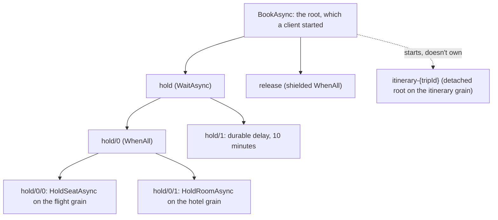
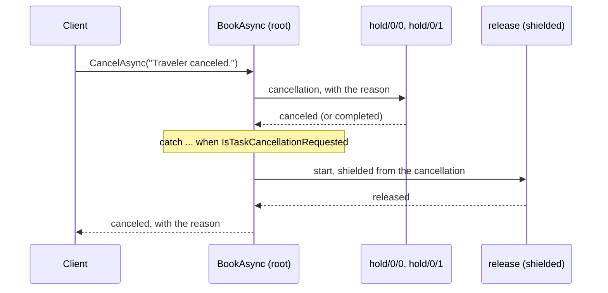

# 持久化任务中的结构化并发

持久化任务遵循*结构化并发*：工作流启动的每个任务都有所有者，所有者的生命周期不短于它所拥有的工作，并且所有者的结果会考虑这些工作的结果。因此，工作流中的并发工作形成一棵与代码块结构对应的树，运行时将这棵树持久化到 Grain 的日志中。本文介绍这棵树、其中生命周期和取消的传播，以及用于构造树的各项操作。[持久化任务](durable-tasks.md)介绍编程模型，[任务标识与引用](durable-tasks-identity.md)介绍标识每个节点的 ID。

## 任务形成一棵树

由客户端、普通 Grain 方法或另一个 Grain 的分离启动调用的任务是*根任务*。其任务体执行的每个操作都成为根任务之下的子任务；子任务也可以有自己的子任务，继续嵌套：

下面的旅行预订示例会生成这棵树。它并发预留座位和客房，为预留操作设置超时，在行程取消或超时时释放两项预留，并将行程安排作为独立任务启动：

:::code source="../snippets/compiled-durable/Grains/DurableTaskConcurrencySnippets.cs" id="durable_tasks_trip_grain" language="csharp":::

每类节点都有所有者和生命周期：

| 启动方式 | 所有者 | 生命周期 |
| --- | --- | --- |
| `await call`、`call.ScheduleAsync()`、`call.Post()`、组合器 | 当前运行的执行实例 | 以自身结果结束，最迟在根任务树删除时结束。 |
| `.Shielded()` | 当前运行的执行实例 | 与附接任务相同，但所有者的持久化取消不会传播到它。 |
| `.Detached()` | 无：在目标上创建新的根任务 | 具有独立生命周期。它运行期间，启动方可以完成、失败、被取消或被删除。 |

根任务进入终态，并且结果已投递或保留了足够长的时间之后，根任务所属 Grain 会删除整棵任务树；参见[生命周期与保留](durable-tasks.md#lifecycle-and-retention)。删除任务树会取消仍在运行的所有子任务，因此附接子任务的生命周期不会超过其根任务。

## 所有者等待自己拥有的工作

组合器按照各自契约，只有在输入均已进入相应终态后才返回：

- `DurableTask.WhenAll` 等待每个输入，包括收到取消请求的输入，随后按输入顺序报告第一个失败。
- `DurableTask.WhenAllCompleted` 等待每个输入，并报告各自结果，不抛出异常。
- `DurableTask.Race` 选取最先完成的输入，使用原因 `Another task won the race.` 请求取消其他输入，并等待所有输入进入终态。
- `WaitAsync(TimeSpan)` 和 `WaitUntilAsync(DateTimeOffset)` 让实际工作与持久化延迟进行竞速。如果延迟获胜，它们请求取消工作并等待其结果；如果工作以取消结束，则抛出 <xref:System.TimeoutException>。

`Race` 或超时操作返回之后，没有输入仍在运行，因此后续代码看到的是各项工作都已结束的状态：补偿可以观察每个结果，不会再有操作代表竞速失败方写入 Grain。

`DurableTask.WhenAny` 和 `ScheduleAll` 是例外：它们可以在其他输入仍在运行时返回。这些输入仍是执行实例的子任务，执行实例之后通过句柄观察它们，或由运行时在删除任务树时取消它们。不需要其他输入的结果时，优先使用 `Race`。

## 取消沿任务树向下传播

持久化取消请求在任务上提交，并传播到其后代：

- 尚未启动的子任务，以及被取消任务之后启动的子任务，都会直接进入已取消状态，而不实际运行。
- 正在运行的子任务通过 <xref:Orleans.Durable.Tasks.DurableTaskContext.CancellationToken?displayProperty=nameWithType> 观察取消请求；对其他 Grain 的调用将取消请求传递给被调用方，由被调用方取消自己的任务树。
- 任务体决定任务的结果。等待已取消的子任务会抛出 `OperationCanceledException`；当该异常传播出任务体时，任务以取消状态结束。
- 第一次取消请求的原因会持久化，<xref:Orleans.Durable.Tasks.DurableTaskContext.TaskCancellationReason?displayProperty=nameWithType> 在该任务、其后代及每次重放中返回这个原因。

执行取消补偿的处理程序使用 `DurableTask.Current.IsTaskCancellationRequested` 进行筛选，以便仅针对任务取消执行，而不针对执行尝试的取消执行。参见[任务取消与执行尝试取消](#task-cancellation-and-attempt-cancellation)及 [ORLEANS0212](../diagnostics/orleans0212.md)。

### 对必须完成的工作启用取消屏蔽

`.Shielded()` 启动一个不受所有者持久化取消传播影响的子任务。所有者仍然等待它，其失败仍会传播，删除任务树或中止任务也仍会使它停止。补偿是典型的取消屏蔽工作：在旅行预订示例中，`release` 组合器对其两个输入都启用了取消屏蔽，因此即使行程已取消，也能释放预留。受屏蔽的组合器会屏蔽它启动的每个输入。

取消屏蔽对每个被等待的持久化操作具有相同含义，无论操作作为子任务运行，还是作为所有者的一部分运行：受屏蔽的信号等待、`TryWaitAsync`、延迟、`GetDurableTask` 订阅、`Race`、`WhenAny` 或 `WaitAsync` 可以在所有者取消之后完成，只有执行尝试取消才能使它们提前结束。等待支付的工作流可以屏蔽等待操作，使取消后到达的付款仍能被它接收：

:::code source="../snippets/compiled-durable/Grains/DurableTaskConcurrencySnippets.cs" id="durable_tasks_shielded_wait" language="csharp":::

## 任务取消与执行尝试取消

持久化任务区分两种取消：

| | 任务取消 | 执行尝试取消 |
| --- | --- | --- |
| 停止对象 | 任务：取消异常传播出任务体时，其结果变为已取消 | 当前在内存中运行的任务体，即本次*执行尝试* |
| 触发原因 | `CancelAsync`、所有者取消、`Race` 或超时 | Grain 激活实例停止、[中止](durable-tasks-operations.md)或删除任务树 |
| 是否记录 | 是：记录请求、原因、任务体首次观察到取消的点（每次重放均在该点观察到取消）及任务体执行的清理 | 否：本次尝试的后续持久化操作抛出异常，而其日志化状态变更（例如清理）会提交 |
| 后续行为 | 任务体执行补偿并提交 | 激活实例停止时，任务将在新的尝试中重放；已中止或删除的任务已有最终结果 |
| `IsTaskCancellationRequested` | `true` | 不变 |
| `CancellationToken` | 已取消 | 已取消 |
| `AttemptCancellationToken` | 不变 | 已取消 |
| 持久化操作抛出的异常 | 被取消的工作抛出的 `OperationCanceledException` | <xref:Orleans.Durable.Tasks.DurableTaskAttemptCanceledException>，包含 `Reason` |

执行尝试一旦取消，其代码中的每项持久化操作都会抛出 `DurableTaskAttemptCanceledException`：`DurableTask.RunInline`、启动或等待子任务（包括受屏蔽及分离的子任务）、`Post`、`ScheduleAsync`、发送和等待信号、延迟、订阅及组合器。该异常继承自 `OperationCanceledException`，因此本次尝试的代码与其他被取消的 .NET 代码一样进行堆栈展开。代码在退出过程中对 Grain 日志化状态所做的变更（例如清理）会随 Grain 的下一次日志写入提交。激活实例停止时，其中的任务将在下一次激活中从记录重放，并再次执行相应补偿。

推荐模式是：向任务体发起的调用传入 `CancellationToken`，在使用 `IsTaskCancellationRequested` 筛选的 `catch` 中执行持久化清理，向清理操作发起的调用传入 `AttemptCancellationToken`，并在 `finally` 块及 `using` 语句中释放进程内资源，例如信号量和可释放对象；这两类语句对两种取消都会执行：

:::code source="../snippets/compiled-durable/Grains/DurableTaskConcurrencySnippets.cs" id="durable_tasks_attempt_cancellation" language="csharp":::

日志化状态变更通过状态 API 进行，每次变更都会被记录。对持久化值所持有的可变对象就地修改会绕过该 API，因此应存储不可变值（例如 record），并通过赋予新值来修改状态。[ORLEANS0217](../diagnostics/orleans0217.md) 会报告清理操作传入已经取消的 `CancellationToken` 的情况。

## 将生命周期独立于启动方的工作分离

`.Detached()` 将 Grain 调用作为目标上的新根任务启动。启动方记录自己已经启动该任务，因此重放不会重复启动它，启动方也可以等待它的结果。分离任务具有独立的生命周期：

- 启动方可以先于分离任务完成。
- 对启动方任务树的取消、中止或删除不会传播到它；需要使用它自己的 ID 取消或中止它。
- 其所属 Grain 在 `ResultRetentionPeriod` 内保留其结果，其他参与方可以使用根 ID 寻址它。

后续工作（例如旅行的行程安排）以及需要其他参与方按名称跟踪的工作，适合使用分离任务。通过 `WithId` 使用从业务标识派生的名称，以便重试和其他参与方到达同一任务。

## 与 Task 及即发即弃任务的比较

| | Grain 内的 `Task` | 即发即弃的 `Task` | 附接的持久化任务 | 分离的持久化任务 |
| --- | --- | --- | --- | --- |
| 所有者 | 在激活实例存活期间，等待该任务的方法 | 无 | 当前运行的执行实例 | 无：它是根任务 |
| 在停用与 Silo 故障后继续运行 | 否 | 否 | 是：从记录恢复 | 是 |
| 取消 | 代码传递的 `CancellationToken` | 无 | 持久化、向后代传播并携带原因；停止的执行尝试将重放 | 独立的取消机制 |
| 失败 | 由等待方观察 | 丢失，或报告为未观察到的异常 | 已记录，每次重放均向所有者重新抛出 | 已记录，并返回给订阅者 |
| 标识 | 无 | 无 | 所有者任务树中的子任务 ID | 所属 Grain 上的根 ID |

持久化任务永远不是即发即弃的：附接子任务有所有者，由所有者观察其结果，或在删除所有者任务树时取消；分离任务是根任务，所属 Grain 保留它，其他参与方可以寻址它。工作开始运行之前，每次启动都会在启动方日志中提交，因此即使在决定启动工作与实际启动之间发生崩溃，也不会丢失启动决策或工作。

## 选择操作

| 目的 | 使用方式 |
| --- | --- |
| 运行工作并使用其结果继续执行 | `await call.WithId(name)` |
| 并发运行工作，待所有输入进入终态后继续执行 | `DurableTask.WhenAll(...).WithId(name)` 或 `WhenAllCompleted` |
| 取第一个结果并停止其他工作 | `DurableTask.Race(...).WithId(name)` |
| 为工作设置截止时间 | `call.WaitAsync(timeout)` 或 `WaitUntilAsync(dueTime)` |
| 立即启动工作，稍后在同一工作流中观察它 | `ScheduleAsync`、`Post` 或 `ScheduleAll` |
| 取消之后完成补偿 | `.Shielded()` |
| 启动生命周期独立于工作流的工作 | `.Detached(name)` |

[持久化任务实践示例](durable-tasks-recipes.md)在完整工作流中展示了上述各种操作。
