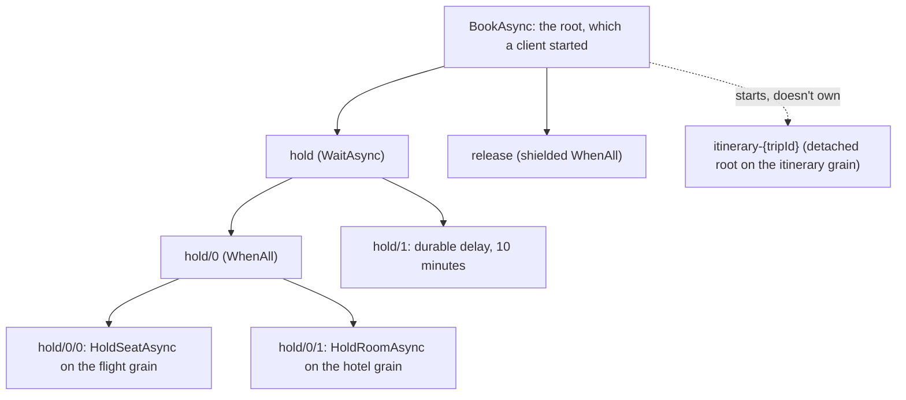
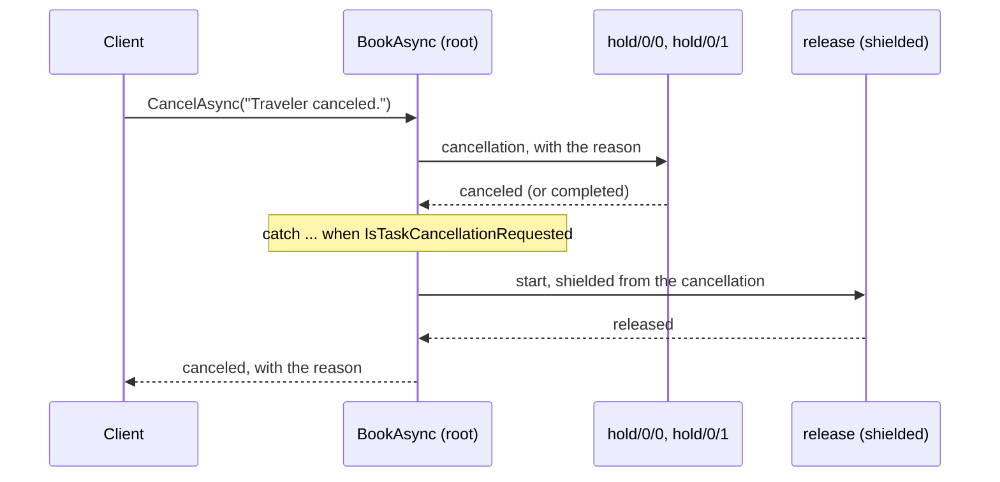

# 长期任务的结构汇合

长期任务遵循 *结构化同汇通*:工作流程开始的每一任务都有
业主的寿命超过所有企业的经营价值 业主的产值说明
工作。工作流程同时开展的工作因此形成了一棵树,其形状与代码的形状相符
字符串结构,而运行时间维持了 grain日记中的树。此页
描述树木,生命期和注销 通过它流出,
用于形状它的操作。 [持久任务](durable-tasks.md) 描述编程
模型,并且 [任务身份和参考](durable-tasks-identity.md) 描述ID
指定每个节点的名称。

## 任务对树进行窗体

客户端的任务、普通 grain 方法或另一个 grain的分离启动
引用是根 *根*。其身体运行的每个操作都变成下面的一个儿童,
儿童窝巢:

下一棵订票的树 生产出这棵树 它同时拥有一个座位和一个房间
将持片限制为超时,当行程取消或取消时释放,
并开始行程作为独立任务:

:::code source="../snippets/compiled-durable/Grains/DurableTaskConcurrencySnippets.cs" id="durable_tasks_trip_grain" language="csharp":::

每个节点都有拥有者 和一生

| 以 | 所有人 | 寿命 |
| --- | --- | --- |
| `await call`, `call.ScheduleAsync()`, `call.Post()`组合器 | 执行中运行的行 | 最终结果自有尽头, 并且不晚于删除其根树。 |
| `.Shielded()` | 执行中运行的行 | 后附:永久取消业主的产权,不在此列。 |
| `.Detached()` | 无:目标上的新根 | 启动器可以完成、失败、取消或删除。 |

根根 grain 一旦根根是终端,结果为结果时删除整个树
交付或保留足够长的时间;见
[生命周期和保留](durable-tasks.md#lifecycle-and-retention). 砍掉树
取消所有仍在运行中的孩子, 所以没有附加的小孩比其根长寿 。

## 业主等待他们拥有的工作

组合器投入一旦结算, 其合同规定只能返回:

- `DurableTask.WhenAll` 等待每项输入,包括注销的输入
  到达后, 然后报告输入顺序的第一个失败 。
- `DurableTask.WhenAllCompleted` 等待每项投入并报告每个结果,而不
  扔弃
- `DurableTask.Race` 需要第一个输入完成,请求取消
  其原因 `Another task won the race.`,等待直到每一个都结束。
- `WaitAsync(TimeSpan)` 和 `WaitUntilAsync(DateTimeOffset)` 与工作种族
  拖延持续拖延。当延迟获胜时,他们要求取消工程并等待
  其结果,然后抛下 <xref:System.TimeoutException> 之后,它被取消了。

`Race` 或超时返回后,没有输入仍在运行,因此以下代码
一种固定的世界:补偿是一切结果,没有东西写给
grain 之后代表一个失败者

`DurableTask.WhenAny` 和 `ScheduleAll` 是例外:它们返回而其他
输入量运行。 这些输入量仍然是执行过程中的孩子,执行观察
或剪除树木的时候,勾销它。
优 `Race` 当不需要其他投入的结果时

## 取消的流水从树下流

一项持久的取消申请承诺执行这项任务并向后代宣传:

- 儿童还没开始, 和孩子们 被取消的任务开始后,
  结束未运行而取消 。
- 办理手续的儿童通过
  <xref:Orleans.Durable.Tasks.DurableTaskContext.CancellationToken?displayProperty=nameWithType>,
  和调用电话 grains 牲畜把牛驼带去,送到被召者那里,那些被召者,自己得夺去自己的树木。
- 身体决定任务结果。等待一个取消的孩子扔
  `OperationCanceledException`,当例外逃脱时任务结束时取消
  身体。
- 第一项请求的理由是持久的,而且
  <xref:Orleans.Durable.Tasks.DurableTaskContext.TaskCancellationReason?displayProperty=nameWithType>
  它将返回任务、其子孙和每一次重播。

用于补偿注销过滤器的处理器
`DurableTask.Current.IsTaskCancellationRequested`,因此它运行用于取消任务而不是
取消企图;见
[任务取消和任务取消](#task-cancellation-and-attempt-cancellation)
和 [ORLEANS0212](../diagnostics/orleans0212.md)。

### 盾牌必须完成的工作

`.Shielded()` 开始一个孩子,孩子的主人将永久取消该孩子的主人跳过。
等待它,它的失败仍然在传播, 并删除树或中止
补偿是典型的屏蔽工作:在旅行预订中,
`release` 组合盾及其两个输入的混合盾,所以在旅行之后释放了扣押
取消。 每个输入开始, 都有一个屏蔽组合保护罩

盾盾牌对于每一个等待的持久行动,无论在童年或儿童时期,还是儿童时期,都意味着同样的意思。
作为所有者的一部分:屏蔽信号等待、 `TryWaitAsync`、延迟、 `GetDurableTask`
所有人取消后完成订阅、 `Race`、 `WhenAny`或 `WaitAsync` ,
并且只有取消尝试的取消才终止。等待付款的工作流程
等待者,在吊销之后的给付,仍能达到它。

:::code source="../snippets/compiled-durable/Grains/DurableTaskConcurrencySnippets.cs" id="durable_tasks_shielded_wait" language="csharp":::

## 任务取消和任务取消

长期任务区分两种取消:

| | 取消任务取消 | 取消企图 |
| --- | --- | --- |
| 停止什么 | 任务:一旦取消后,其结果就被取消 | 身体当前在记忆中的运行, 其 *尝试* |
| 由 | `CancelAsync`, 所有人取消、 `Race`或超时 | grain 激活停止、一个 [中止中断](durable-tasks-operations.md)或任务树的删除 |
| 录音 录音 | 是:请求、理由、机构首先观察的时间点、每个重弹都再次观察的请求以及身体的清理 | 否:尝试的后来持久行动 和它的日记状态变化,如清理,承诺 |
| 内容如下 | 该机构负责赔偿,并承诺 | 停止激活的任务在新尝试中重放;中止或删除的任务已经产生结果 |
| `IsTaskCancellationRequested` | `true` | 未修改 |
| `CancellationToken` | 取消 | 取消 |
| `AttemptCancellationToken` | 未修改 | 取消 |
| 持久作业所投出的例外 |  取消工作 `OperationCanceledException` | <xref:Orleans.Durable.Tasks.DurableTaskAttemptCanceledException>,加上 `Reason` |

一旦尝试取消 代码的每个持久操作都会被扔出
`DurableTaskAttemptCanceledException`: `DurableTask.RunInline`儿童开始或等待,
包括屏蔽和分离的, `Post`, `ScheduleAsync`,信号发送和等待,
例外情况来自
`OperationCanceledException`,所以尝试的代码解开 任何取消的 .NET 代码。
该代码对 grain日记状态在出去时所做的修改,例如
清理, 以 grain的下个日记写入方式承诺。 下次激活时停止激活的任务重放记录中, 运行任何
赔偿再次。

开卡模式通过 `CancellationToken` 来接听身体发出的呼声,运行
以下列方式进行持久清除: `catch` 过滤于 `IsTaskCancellationRequested`,通过
`AttemptCancellationToken` 与清理工作发出的呼声和释放过程
`finally` 区块和 `using`
两种注销的语句:

:::code source="../snippets/compiled-durable/Grains/DurableTaskConcurrencySnippets.cs" id="durable_tasks_attempt_cancellation" language="csharp":::

州政府通过国家官方网站 API改变具有耐久值的可变物体
API,所以存储记录等不可变值并指定新的数值以更改
已经是 [ORLEANS0217](../diagnostics/orleans0217.md) 上表的清理报告通过
already-canceled `CancellationToken`.

## 将比其开始阶段活的工程分离出来

`.Detached()` 开始以新根线在目标上调 grain 。启动记录显示它
任务开始, 所以重播不会重新开始, 它可以等待任务的结果 。
独立的任务的一生是它自己的:

- 启动器可以在独立任务完成之前完成 。
- 取消、中止和删除启动器树的树, 取消、 中止和删除未达到; 取消或中止
  透过自己的身份证
- 其 grain 保留其 `ResultRetentionPeriod`结果,其他当事方处理
  以其根标识 。

利用单独的任务开展后续工作,如旅行行程等,以及从事以下工作:
其它当事人跟踪名称。 从商业身份中以 `WithId` 命名, 所以重试
其他各方也承担同样的任务。

## 与任务和火与火相比

| | `Task` a 中 grain | Fire-and-forget `Task` | 随附的持久任务 | 过时的持久任务 |
| --- | --- | --- | --- | --- |
| 所有人 | 等待的方法,启动生命 | 无无无无 | 执行中运行的行 | 无: 它是一个根 |
| 幸存者停用和 silo 故障 | 无 | 无 | 是:它从记录中恢复 | 是 是 |
| 注销 | 密码通过后的一个 `CancellationToken` | 无无无无 | 持久、流向后代,有其原因;停止了尝试重播 | 其本身 |
| 失败 | 等待者观察 | 丢失或报告为未观察 | 在每个重放中记录并重新投给所有者 | 已录音并退还订户 |
| 身份特征 | 无无无无 | 无无无无 | 屋主树上的孩子身份证 | 其 grain 上的根标识符  |

持久的任务绝不是火和忘记:随子子女有看管的业主
或被删除而取消者, grain 保留保留
其它人可以上网。每个启动程序在工作前都承诺在开业日记中
运行, 因此在决定开始工作与开始工作之间发生崩溃, 也不会失去任何结果 。

## 选择操作

| 将 | 使用 |
| --- | --- |
| 运行并继续开展工作,结果 | `await call.WithId(name)` |
| 同时运行工作,并在每次输入结算后继续 | `DurableTask.WhenAll(...).WithId(name)` 或 `WhenAllCompleted` |
| 取第一个结果,停止其余 | `DurableTask.Race(...).WithId(name)` |
| 最后期限的整期工作 | `call.WaitAsync(timeout)` 或 `WaitUntilAsync(dueTime)` |
| 现在开始工作,稍后在同一工作流程中观察 | `ScheduleAsync`、 `Post`或 `ScheduleAll` |
| 注销后完成赔偿 | `.Shielded()` |
| 启动比工作流程活过的工作 | `.Detached(name)` |

[持久任务配方](durable-tasks-recipes.md) 每个以上都以完整的方式显示
工作流程。
