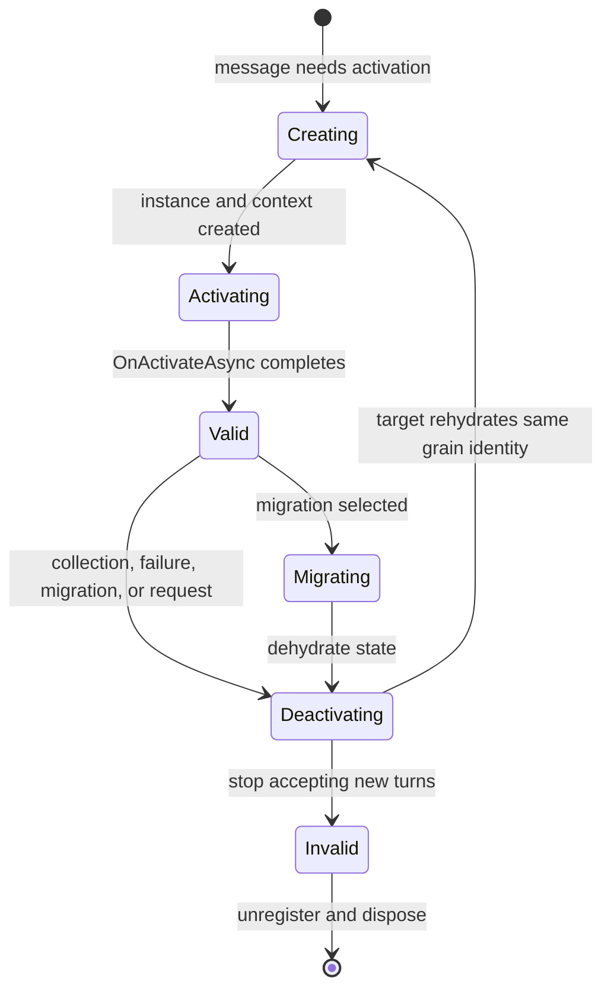
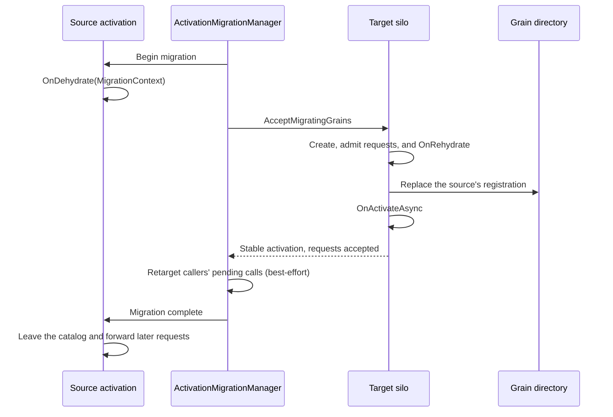

# 激活生命周期与迁移

Grain 标识的生命周期可以超过集群内所有进程的生命周期。激活实例是此标识在一个 Silo 上临时的内存中实现。`ActivationData` 是运行时状态机，拥有 Grain 实例、请求队列、调度器、目录注册记录、生命周期及停用原因。

## 创建与激活

路由无法找到有效激活实例时，目标 Silo 的 `Catalog.GetOrCreateActivation` 创建或获取 `ActivationData`。创建包含几个不同的步骤：

1. 解析 Grain 类型、实现、共享类型元数据、存储功能面（facet）及激活配置器。
1. 创建 Grain 上下文、每个激活实例的 `WorkItemGroup` 以及 Grain 实例。
1. 注册本地激活实例，并在 Grain 目录策略要求时注册其地址。
1. 通知 `IActivationLifecycleObserver.OnCreateActivation`。
1. 在激活实例调度器上运行 Grain 生命周期的启动流程及 <xref:Orleans.IGrainBase.OnActivateAsync*>。
1. 将激活实例标记为有效，允许排队请求进入执行轮次调度。

激活是异步的。激活过程中到达的请求继续排队。如果激活失败，运行时拒绝或重新路由请求，并拆除未完成的激活实例，而不是暴露仅部分初始化的实例。

源码：[`Catalog`](https://github.com/dotnet/orleans/blob/main/src/Orleans.Runtime/Catalog/Catalog.cs) 和 [`ActivationData`](https://github.com/dotnet/orleans/blob/main/src/Orleans.Runtime/Catalog/ActivationData.cs)。

## 工作集与回收

`ActivationWorkingSet` 跟踪最近执行过工作的激活实例。`ActivationCollector` 在时间桶中安排回收票据并扫描陈旧时间桶。重要的不变量是，被选中回收的激活实例在开始回收时必须仍处于空闲状态。新工作可以取消或重新安排其回收票据。

回收并非持久化。回收释放空闲激活实例。持久化 Grain 状态只有在配置存储提供程序并由 Grain 代码写入该状态的情况下才能保留。运行环境的回收设置参见[激活实例回收配置](../host/configuration-guide/activation-collection.md)。

具体实现及边缘情况由 [`ActivationCollector`](https://github.com/dotnet/orleans/blob/main/src/Orleans.Runtime/Catalog/ActivationCollector.cs) 和 [`ActivationCollectorTests`](https://github.com/dotnet/orleans/blob/main/test/Orleans.Runtime.Internal.Tests/ActivationsLifeCycleTests/ActivationCollectorTests.cs) 覆盖。

## 停用

停用首先阻止新的应用执行轮次开始，再根据停用原因排空或拒绝待处理工作。停用在激活实例调度器上运行 <xref:Orleans.IGrainBase.OnDeactivateAsync*> 和生命周期的停止流程。最后，运行时注销目录地址、移除本地激活实例、释放资源并发布停用事件。

停用原因区分正常回收、应用请求停用、Silo 关闭、故障及迁移。Grain 代码应将停用视为尽力而为的清理。进程终止可能跳过停用流程，因此正确性不得依赖 `OnDeactivateAsync` 总能执行。

## 激活实例迁移

迁移在保留 Grain 标识的同时移动激活实例。`ActivationMigrationManager` 通过创建 `MigrationContext`、要求已注册的迁移参与者导出状态，并以 `Migrating` 为原因进行停用，从而启动迁移。目标创建激活实例，恢复参与者的状态，执行激活并等待激活实例达到稳定状态。

迁移数据包还携带已为源激活实例排队的请求。激活目录通过激活实例的常规请求准入流程投递它们，逐个检查请求是否导致过载，并按 FIFO 顺序排队。新的激活实例在状态恢复和目录注册之前接收这些请求。已有的激活实例在激活目录释放未使用的迁移上下文之前接收它们。目标端已排队的请求保留原位置。目标接受迁移后，源尽力将这些请求的调用方所持有的待完成调用重定向到目标，使调用能够在源 Silo 离开后继续。数据包使用与 Silo 连接相同的消息分帧格式序列化请求列表，保留已接收请求的序列化消息体。目标在调用请求时解码各消息体，并丢弃在准入前剩余生存时间已耗尽的请求。源只向清单中声明 `IActivationMigrationManagerSystemTarget` 版本为 1 或更高的 Silo 发送排队请求。迁移完成之前，源激活实例仍留在激活目录中，因此发往源 Silo 上该 Grain 的请求仍会到达它。如果调用方在调用被重定向之前取消调用，则在完成重定向时也向目标发送取消信号。如果迁移失败或结果未知，源拒绝迁移所携带的请求，使其调用方能够重试；同时转发迁移期间到达的请求。

序列化器在持有迁移完成锁时认领迁移上下文及请求消息体，并在序列化结束时释放它们（包括失败时）。完成操作释放尚未被序列化认领的有效载荷；之后到达的写入方将丢弃已完成的迁移。一旦序列化取得有效载荷的所有权，完成操作即可独立推进，同时序列化器维持其缓冲区有效。源保留路由标头用于报告失败。传输重试复用已序列化的 RPC 消息体。在目标端，嵌入的消息共享接收缓冲区，并保留各自的消息体切片直至调用。RPC 解码器要求存在上下文对象，且所携带的请求列表条目均非 null。格式错误的数据包在准入之前失败；被放弃的部分解码对象图变得不可达后由 GC 回收。迁移上下文保持现有传输格式。

迁移泵使用消息传递时钟，通过 <xref:Orleans.Configuration.SiloMessagingOptions.SystemResponseTimeout> 限制接受调用的时间。这一预算同时覆盖异步传出调用筛选器和目标端的响应。超时时，源将迁移标记为失败并完成迁移操作，因而能够结束停用流程。之后恢复执行的筛选器遵循与其他延迟写入方相同的有效载荷所有权规则。

状态导出后，请求通过一次移交进入迁移流程，数据包保留这一固定请求集合。之后到达的请求仍留在源激活实例的队列中。源离开激活目录后，先完成初始移交批次的处置，再通过普通转发或拒绝流程处理剩余队列。

每条嵌入消息在序列化时保留请求的剩余生存时间。目标端解码其标头时恢复本地过期跟踪，并逐个丢弃已过期请求。传输耗时（包括重试）使过期时间的计算只能尽力而为。调用方的响应超时独立推进；延迟的迁移可能在调用方已超时后才投递请求。

激活目录通过常规激活准入流程移交请求，并在验证或创建失败时释放仍未被接纳的请求及上下文。创建激活实例即意味着必须安排状态恢复并调用 `Activate`，即使后续准入操作失败也如此。状态恢复期间，新激活实例读取先前的注册记录，并向排队消息添加缓存更新。响应携带这些更新；单向调用方的路由在下一次发送时通过正常的转发和缓存修复收敛。已有激活实例通过普通准入接收请求，并使用正常缓存修复。各激活实例拥有提交给它的每个请求，并通过正常拒绝及拆除流程处理激活失败。取消尚未发送的源迁移会释放其状态导出上下文，但保留请求以便正常转发。

在批处理之前，源将本地请求消息体保留为自己拥有的序列化字节，并限制各请求当前标头的大小，包括先前迁移产生的缓存更新。对任意请求上下文值，采用配置的最大标头大小作为保守上界，因此估算大小时无需访问这些值。无法与迁移状态一同装入数据包的请求，使用保留的消息体字节逐个转发。

迁移状态不同于持久化 Grain 状态。<xref:Orleans.Runtime.IGrainMigrationParticipant> 面向需要使内存状态随实时迁移一同转移的运行时或应用组件。参与者将可进行版本演进的数据写入迁移上下文，并且必须能够容忍在另一个 Silo 上恢复状态。

源码：[`ActivationMigrationManager`](https://github.com/dotnet/orleans/blob/main/src/Orleans.Runtime/Catalog/ActivationMigrationManager.cs) 和 [`ActivationDataMigrationTests`](https://github.com/dotnet/orleans/blob/main/test/Orleans.Runtime.Internal.Tests/ActivationsLifeCycleTests/ActivationDataMigrationTests.cs)。

## 哪些机制发起迁移

迁移是一种机制，而非策略。策略选择候选实例：

- 显式迁移 API 可以请求移动；
- 激活实例再均衡器移动随机选取的激活实例，以减少资源不均衡；
- 激活实例再分区器观察通信边并移动激活实例，以改善局部性。

两种集群级策略都需要显式启用。相关协议与配置参见[放置与激活实例均衡](load-balancing.md)。

## 扩展不变量

参与激活实例创建或迁移的组件应遵循以下规则：

- 激活完成之前永不暴露 Grain 实例；
- 在激活实例调度上下文中执行 Grain 生命周期回调；
- 停用开始后不接纳新的执行轮次；
- 即使清理失败，也注销陈旧地址；
- 保持迁移有效载荷在滚动升级期间向后兼容；以及
- 假定源或目标故障可能中断迁移。
