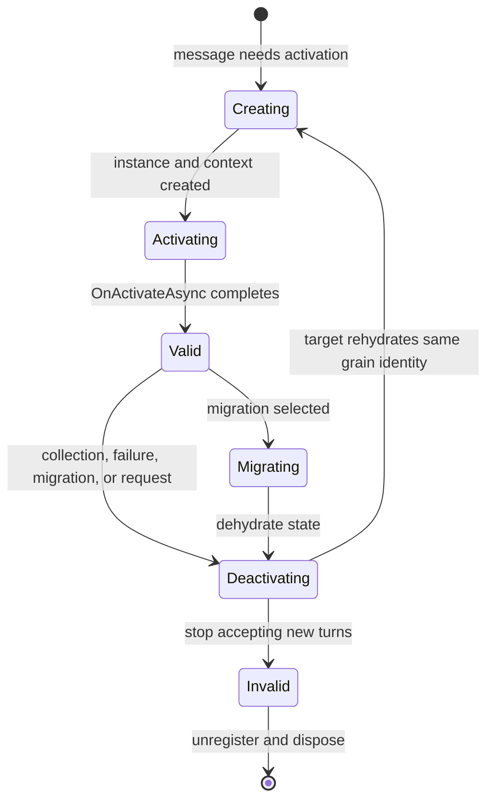
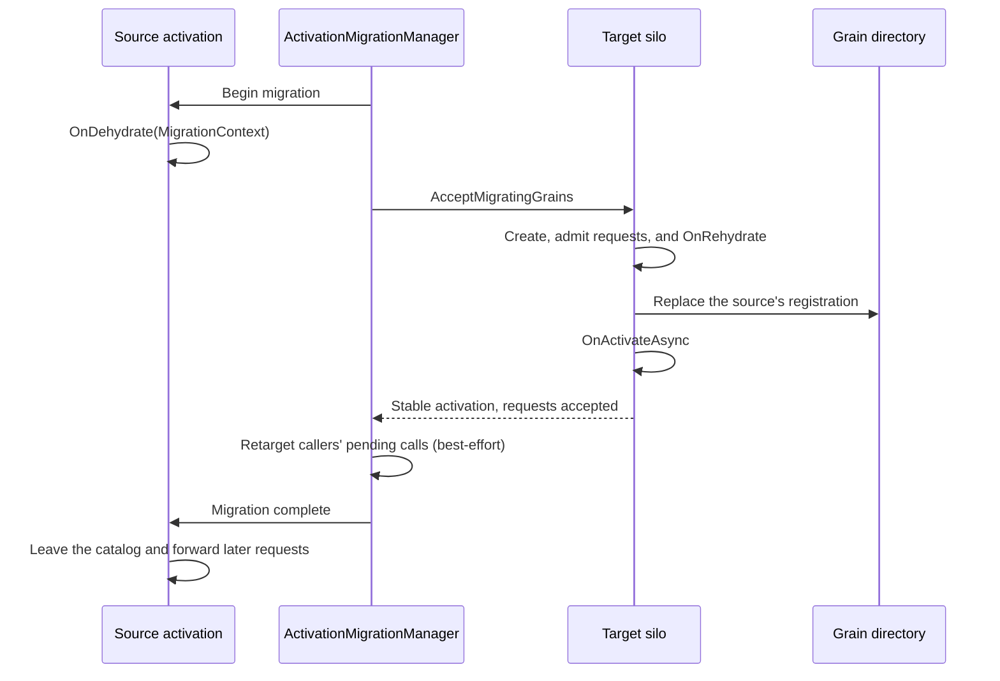

# 激活生命周期和移徙

grain 身份可以比组群中每个过程都长。激活是指在一个 silo上临时、即时地实现该身份。 `ActivationData` 是运行时状态机器,它拥有 grain 实例、请求队列、排程器、目录登记、生命周期和停用理由。

## 创建和启动

当路由找不到有效的激活,目标 silo `Catalog.GetOrCreateActivation` 创建或获取一个 `ActivationData`。

1. 确定 grain 类型、实施、共享的元数据类型、存储元数据和激活配置器。
1. 创建 grain 上下文、 半起动 `WorkItemGroup`和 grain 实例。
1. 登记本地激活,并在 grain 目录政策要求时登记地址。
1. 通知 `IActivationLifecycleObserver.OnCreateActivation`。
1. 运行 grain 生命周期启动和在激活调度器上运行 <xref:Orleans.IGrainBase.OnActivateAsync*> 。
1. 标记激活的有效和释放的排队请求转弯调度。

激活是无同步的。 在运行过程中收到的请求仍然排队。 如果启动失败, 运行时间会拒绝或改变程序请求, 并让未完全启动的启动过程倒掉, 而不是暴露部分初始化的实例 。

来源: [`Catalog`](https://github.com/dotnet/orleans/blob/main/src/Orleans.Runtime/Catalog/Catalog.cs) 和 [`ActivationData`](https://github.com/dotnet/orleans/blob/main/src/Orleans.Runtime/Catalog/ActivationData.cs)。

## 工作集成和收集

`ActivationWorkingSet` 跟踪最近完成的激活。 `ActivationCollector` 时间表中的时间桶收集票,扫描废桶。重要的变数是,选择要采集的激活必须在收藏开始时闲置。 新的工程可以取消或重新安排其票。

收藏不是持久性。 它释放了闲置激活。 耐久 grain 状态只能通过配置的存储提供者和 grain 代码生存, 代码写着该状态。 运行中的收集设置属于 [激活收藏收藏配置](../host/configuration-guide/activation-collection.md)。

[`ActivationCollector`](https://github.com/dotnet/orleans/blob/main/src/Orleans.Runtime/Catalog/ActivationCollector.cs) 和 [`ActivationCollectorTests`](https://github.com/dotnet/orleans/blob/main/test/Orleans.Runtime.Internal.Tests/ActivationsLifeCycleTests/ActivationCollectorTests.cs)涵盖执行及其边缘情况。

## 解除活动

禁用首先防止新的应用程序从启动开始, 然后排水或拒绝根据原因进行待定的工作。 它运行 <xref:Orleans.IGrainBase.OnDeactivateAsync*> 和激活调度器的生命周期停止。 最后, 运行时间取消目录地址, 删除本地激活、 处置资源并发布停用事件 。

禁用原因区分了正常收集、应用程序请求的禁用、 silo 关闭、故障和迁移。 Grain 代码应将禁用视为最佳清理方法。 程序终止可以绕过它, 因此正确性不能总是依赖 `OnDeactivateAsync` 运行。

## 激活移徙

移民在保持其 grain 身份的同时,会移动动能。 `ActivationMigrationManager` 开始迁徙时,先创建了 `MigrationContext`,要求注册的移民参与者脱水状态,并按 `Migrating` 理由解除活动。目标创造了激活、补水参与者、运行启动和等待到启动稳定状态。

迁移软件包还包含为启动源码而排队的请求。 目录通过激活的普通请求接收程序发送这些请求, 并按每个请求进行超载检查和 FIFO 队列。 在补水和目录登记之前, 新激活会收到它们。 现有的激活会在目录处理未使用的迁移背景之前收到。 已经在目的地排队的申请保留着他们的位置 。 一旦目标接受迁移, 源头会以最佳方式重新瞄准其呼叫对象的待拨电话, 因此通话会维持在源头 silo软件包使用与 silo 目标在各机构援引请求时解码,并放弃其剩余寿命已过而进入前仍未结束的请求。 silos 其清单第1版或 `IActivationMigrationManagerSystemTarget`源的激活仍然在目录中,直到迁移完成,因此,向源端提出的请求 silo 排排 grain 呼叫者在重新定位前取消其通话,然后在重新定位时将取消信号通知目标,一旦重新定位,也向目标发出。当移民失败或结果不明时,源头拒绝其提出的申请,以便他们可以重新检查,同时转发已到的申请。

序列器声称在迁移完成后锁下有移民背景和请求机构,并在序列完成时释放它们,包括故障。完成后释放了一个没有连续进行申报的有效载荷;后来的作家则抛弃了已完成的迁移。一旦序列器拥有了有效载荷,完成过程将独立进行,而序列器保持其缓冲的有效性。源保留了路径头,以报告失败。运输重新使用序列式RPC体。在目的地,嵌入的信息共享接收缓冲并保留自己的切片直到援引。 RPC 解码器要求在随附的请求清单上有一个上下文对象和非中标条目。入门前错误的包件失效,GC在无法到达时收回部分解码图。移徙环境保持现有的电线格式。

移民泵将接受的援引限制在 <xref:Orleans.Configuration.SiloMessagingOptions.SystemResponseTimeout> 使用发短信时钟。 此预算覆盖非同步的离线过滤器以及目的地的反应。 在超时时, 源头会完成迁移失败后, 并可以完成停止操作 。 之后恢复的过滤器将遵循与任何延迟写入者相同的有效载荷所有权规则 。

申请在脱水后一次性合并, 且包保留固定的请求。 后到者仍留在源启动队列中。 一旦源端离开目录, 它会完成原始的应答处理, 然后通过普通转发或拒绝处理剩余排队 。

每一个嵌入式信件保留请求的剩余时间, 并保持序列化。 当目的地解码信头和过期请求被逐个删除时, 本地到期跟踪会恢复。 在运输中花费的时间( 包括回溯) 最努力地计算过期信息。 呼叫者的响应超时继续独立持续; 延迟迁移可以在拨号者超时后提交请求 。

启动程序要求通过普通的激活接收和释放请求以及验证或创建失败时仍未被认可的背景,启动程序要求进行重新补充水中安排和呼叫 `Activate`,包括随后的入网工作失败。在再补充水中,新启动程序读过以前的登记,并在队列信件中添加缓存更新信息。答复载有这些更新;单向电话人路线通过正常转发和缓存维修而汇合到下一个发送上。现有的启动程序通过普通接收请求并使用正常缓存修理。每个启动程序都拥有向其提交的请求,并通过正常拒绝和拆解路径处理启动失败。取消未同意源移民释放脱水情况,同时保留其一般转发请求。

在批量前,源头保留本地请求机构,作为拥有的序列式字节,并约束每个请求当前页眉,包括先前迁移的缓存更新。任意请求-文本值使用所配置的最大信头大小作为保守约束,因此缩放这些数值时没有触及这些数值。 与其迁徙状态不相适应的请求会用保留体字节单独提交。

移民状态与长期的 grain 状态不同。 <xref:Orleans.Runtime.IGrainMigrationParticipant> 是用于运行时间或应用组成部分,其运行状态或应用部分必须伴随现场移动。参与者将可版本的数据写入移民背景,并容忍在另一个 silo进行补液。

来源: [`ActivationMigrationManager`](https://github.com/dotnet/orleans/blob/main/src/Orleans.Runtime/Catalog/ActivationMigrationManager.cs) 和 [`ActivationDataMigrationTests`](https://github.com/dotnet/orleans/blob/main/test/Orleans.Runtime.Internal.Tests/ActivationsLifeCycleTests/ActivationDataMigrationTests.cs)。

## 是什么引发了运动

移徙是一种机制,而不是政策。

- 明确移徙的移民动保单可申请搬迁;
- 启动再平衡器随机移动激活,以减少资源不平衡;
- 启动重新分配器观察通讯边缘,移动激活来改善地点。

两种集群政策都是选入的。见其协议和配置 [位置和启动](load-balancing.md) 。

## 扩展变量

参与启动创造或移徙的各组成部分应保留这些规则:

- 在激活完成之前永远不要暴露 grain 实例;
- 执行已执行 grain 启动时间表背景下的生命周期回调;
- 不再接受在解除功能开始后的新转弯;
- 即使在清理失败时, 也不得使用未登记已发地址;
- 使移徙有效载荷在滚动升级过程中保持后向兼容;
- 假设或目标失败会中断移徙。
