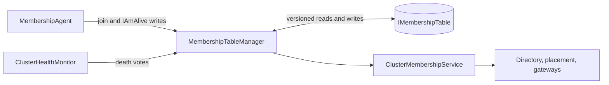
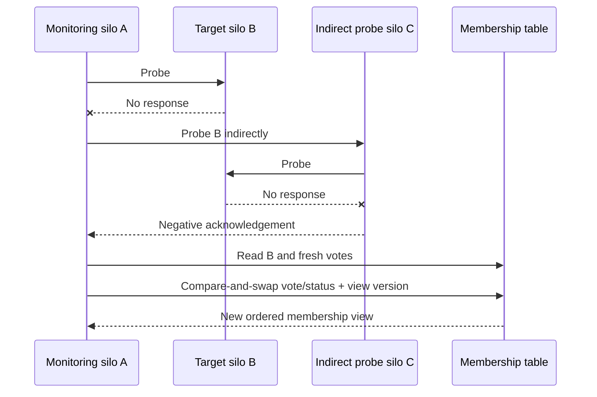

# 集群成员议定书

分组成员在运行期间的剩余时间回答一个问题:哪些 silo 身份是当前观点的成员,每个成员的身份是什么? Orleans 将耐久 <xref:Orleans.IMembershipTable> 与直接对等调查结合起来。表格提供协调和有命令的意见;检测实际使用的通信路径 Orleans 。

## 身份、地位和观点

身份 silo 包括广告公布的终点和生成值,因此在同一端点重新启动的进程是一个新身份。其 <xref:Orleans.Runtime.SiloStatus> 在一个方向上通过 `Created`、 `Joining`、 `Active`和终止状态(`ShuttingDown`、 `Stopping`或 `Dead`取得进展。

会员制提供了 **卡门式会籍观点**:对 silo 身份及其状态的版本视图。每个成功版本的成员表变异都完全将版本推进到一个。一个独特的版本在整个组群中识别其具有卡门式会籍的观点,因此两个观察N的主持人拥有相同的卡门会籍观点。当下次更新发现两个已完成的突变时,东道方可以直接从N向N+2前进。

`MembershipTableManager` 通过 `ClusterMembershipService` 发布图片,并用单调推进的加入卡门观点。目录所有权、网关发现和故障回收都依赖于这一保证。

与会籍观点无关,每个silo `IAmAliveTime` 都被跟踪。周期 <xref:Orleans.IMembershipTable.UpdateIAmAliveAsync*> 写着,使视图版本保持不变。“抓图”更新保留了每个 silo的最大观察时间戳,因此,本地活性时间戳是单调的,就像表格读数和对等快照一样。在同一版本中,合并保留了已接受的版本字段。

抓图可以将先前的 `Dead` 行以同一版本进行处理,同时保留每个非死行。 Prewning 保存每个留存条目的已编版字段和最大 `IAmAliveTime` 。

## 构成成员意见

决 定 <xref:Orleans.Runtime.IClusterMembershipService> 由在一 silo- 托管服务或运行时组件需要群集观点。 <xref:Orleans.Runtime.IClusterMembershipService.CurrentSnapshot> 返回当前本地,不可变 <xref:Orleans.Runtime.ClusterMembershipSnapshot> 无需等待储存进入。

<xref:Orleans.Runtime.IClusterMembershipService.MembershipUpdates> is an asynchronous sequence which first yields the current local snapshot and then yields updated snapshots. <xref:Orleans.Runtime.ClusterMembershipSnapshot.Version> advances with canonical membership changes. Updates at the same version can prune dead rows or advance local knowledge of absent silo identities. Consumers can retain and process each snapshot as a complete membership view.

比较快照版本和所需的 <xref:Orleans.Runtime.MembershipVersion>。 当本地视图必须达到最低版本时, 请等待该版本的 <xref:Orleans.Runtime.IClusterMembershipService.Refresh*> ; 在当地快照赶上后完成。 [BasicClustering 样本](https://github.com/dotnet/orleans/tree/main/samples/BasicClustering) 显示使用会员更新的主机服务 。

## 分类不显示 silos

<xref:Orleans.Runtime.ClusterMembershipSnapshot.GetSiloStatus*> 返回现任成员的记录身份, 包括老一代的长期成员。 对于缺席的身份, 会员使用保留的死亡证据、继承的化身和在快照中固定的一代人断开。 版本认知的查勘还可以确定当新观点忽略了先前记录的所有者时死亡。 运行时间路径可以证明以前登记的身份与新会员身份的匹配,可以在年龄截止前确认死亡。

<xref:Orleans.Configuration.ClusterMembershipOptions.SiloGenerationRetirementAge?displayProperty=nameWithType> 控制基于年龄的分类和默认值为1小时。 在发布视图时, 每位同行都会从本地统一时钟和时间戳得出的正数 silo 一代中得出截断点。 截断点先先先发制人, 所以按倒回后可以保存先前退休知识。 每个保留快照都给出固定身份答案。 零退休的代数比出版时间长; 负值是配置错误。 设定选择权为 `null` 将基于年龄的退休设为禁用, 同时保留观察到的死亡证据 。

会员身份最近与卡通行分开, 被截断时覆盖了身份, 它取代了个人记录。 由于退休和正常的时间戳生成的几代人, 保留的历史沿一代人窗口和最新的轮廓而不是集组的寿命; 配置的年龄是时间窗框而不是字节盖。 在退休人员有残疾的情况下, 观察的死亡记录将留到观察员的一生中。

查禁和保留身份记录是当地观察国。 新观察员获得了现有行,并自己计算了截留。 最近没有登记证据的身份不明,直到进一步确认或截留证实死亡为止。

选择一个适合主机钟扭曲、程序暂停和会籍存储延迟的年龄。 超过此年龄的登记书可以在另一个同侪将其不存在的身份归类为已死亡后生效。 执笔行将提供身份的真实状态 。

## 加入

起始 silo 写下其行, 成为 `Joining`, 并验证在成为 `Active`之前与活跃成员双向连接。 这样可以防止分割过程静默地加入集的一侧 。

在首次登记之前,当地生命周期仍为 `Created` ,直到会员写成成功或记录的死亡、搬迁或继承证据确定最终结果。 这也适用于零退休年龄;其他观察员的即时检查继续使用固定截断。

`IAmAliveTime` 是一个成员-成员行活度时间戳,用于诊断和启动灾后恢复。 silo 监测怀疑和陈旧的同侪,重新评价候选人 <xref:Orleans.Configuration.ClusterMembershipOptions.TableRefreshTimeout?displayProperty=nameWithType> 间距。它比较了最新快照的时间戳与当前时间,这样一个在启动时其时间戳变得陈旧的同行即使会员观点保持不变也进入监测阶段。

这些监测员采用通常的失败-概率阈值、连接-寿命检查和死亡投票程序。 初始连接验证重计,最多可到 <xref:Orleans.Configuration.ClusterMembershipOptions.MaxJoinAttemptTime?displayProperty=nameWithType>,每个活跃同侪响应时完成,或成员记录其离开。 这样替换的 silo 可在流程变换退出后恢复,并通过正常会员协议成为 `Active` 。

## 检测失败和死亡表决 

活动 silos 监视hash- 环选择的同侪, 加上疑似和呆滞的同侪。 加入并活跃 silos 重新评价在会籍更新和 `TableRefreshTimeout` 间隔的选择, 保存现有显示器及其探测器对计。 `ClusterHealthMonitor` 发送探针到 silo- 到silo 邮件, 跟踪连续失败, 并且可以使用间接探测来区分一个失败的目标与不健康的观察员。 一个失败的监视器将一个时间戳打印到目标的会籍行中 。

每个观察者都为每个同行保留一个 [Phi 权责发生故障探测器](https://paperhub.s3.amazonaws.com/f516fdfa940caa08c679d3946b273128.pdf) 。 检测模型成功直接探测回圆飞行时间,并估计后期反应概率是否足够低的超时。 超时从 <xref:Orleans.Configuration.ClusterMembershipOptions.ProbeTimeout?displayProperty=nameWithType> 开始,在有足够观测之后进行调整。 失败被排除, 因为它们只显示响应超过当前超时, 而间接结果则被排除在外, 因为它们测量了不同的观察者的网络路径 。

学习的超时还决定了探测的频率。 每个探测器都排在前一个探测器开始的时间, 所以快速响应会等待当前暂停时间的剩余部分, 而当一个耗尽其超时的探测器紧接着下一次尝试。 在将 <xref:Orleans.Configuration.ClusterMembershipOptions.MinProbeTimeout?displayProperty=nameWithType> 和 <xref:Orleans.Configuration.ClusterMembershipOptions.MaxProbeTimeout?displayProperty=nameWithType>之间隔断之前, 对学到的超时应用当地健康和间接希望扩展。 调试器特定扩展程序是在夹子后应用的, 这样不会因为配置的生产约束而指责暂停过程 。

宣布成员死亡需要来自不同观察家的足够未到期选票。 读修改- write受会籍表版本或 Etag 的保护。 冲突更新导致作者重新阅读和重新评估;它决不能覆盖更新的观点。

一旦一行是 `Dead`,该身份便永远不会返回 `Active`。如果进程仅被分割,当它得知组群宣布死亡时就会终止。它的主机可以用新一代重新开始它。

## 默认设置 

默认值由 <xref:Orleans.Configuration.ClusterMembershipOptions>定义 :

| 选项 | 默认默认 | 议定书的作用 |
| --- | ---: | --- |
| <xref:Orleans.Configuration.ClusterMembershipOptions.NumProbedSilos?displayProperty=nameWithType> | 10 | 由每个监测的同行数 silo |
| <xref:Orleans.Configuration.ClusterMembershipOptions.ProbeTimeout?displayProperty=nameWithType> | 5秒5秒 | 同行在同行提供足够证据之前的初始超时和探测期 |
| <xref:Orleans.Configuration.ClusterMembershipOptions.MinProbeTimeout?displayProperty=nameWithType> | 初始超时的一半( 默认情况下2.5秒) | 有效探矿超时的下下限 |
| <xref:Orleans.Configuration.ClusterMembershipOptions.MaxProbeTimeout?displayProperty=nameWithType> | 首度超时(默认为20秒)的四倍 | 有效探测超时的上方航线 |
| <xref:Orleans.Configuration.ClusterMembershipOptions.NumMissedProbesLimit?displayProperty=nameWithType> | 3 | 死亡表决前的失败探测器 |
| <xref:Orleans.Configuration.ClusterMembershipOptions.NumVotesForDeathDeclaration?displayProperty=nameWithType> | 2 | 纪念成员死亡需要的新鲜选票 |
| <xref:Orleans.Configuration.ClusterMembershipOptions.DeathVoteExpirationTimeout?displayProperty=nameWithType> | 2分钟2分钟 | 死亡表决的寿命 |
| <xref:Orleans.Configuration.ClusterMembershipOptions.TableRefreshTimeout?displayProperty=nameWithType> | 1分钟1分 | 成员表更新时期 |
| <xref:Orleans.Configuration.ClusterMembershipOptions.IAmAliveTablePublishTimeout?displayProperty=nameWithType> | 30秒 | 加入-活性行寿命时间戳 |
| <xref:Orleans.Configuration.ClusterMembershipOptions.SiloGenerationRetirementAge?displayProperty=nameWithType> | 1小时1小时 | 将没有正 silo 代数的阳性(Q0Q]代数归类为死亡的截止时间 |

这些数值是协议参数,而不是独立的计时器:间接检测、当地健康、时间安排延误和表格争论都影响观察到的探测时间。 在 [救生员对当地健康的认识原则](https://arxiv.org/abs/1707.00788)之后,运行时间的增加会探究耐受性,当 `LocalSiloHealthMonitor` 发现线索集合延迟、定时延迟或其他本地危难时,减少不健康的观察者提出的虚假指控。

## 成员可参加的合同 

<xref:Orleans.IMembershipTable> 执行协调会成员的变化,具体方式是:

- 插入新的 silo 行;
- 乐观,有条件更新 silo 行;
- 表格版本原子推进,并进行行突变;
- 包含行及其相应版本的原子全表快照;
- 定期 `IAmAlive` 更新;和
- 适合分组协调的可持久使用性。

<xref:Orleans.IMembershipTable.ReadAllAsync*> 获得一致的快照,并且 <xref:Orleans.MembershipTableData.TryGet*> 在该视图中选择一个 silo条目和行ETag。有条件突变返回成功状态。光照更新提供了当前表格状态和ETag,供随后更新。

表格不可用比活性更有利于安全。 现有的 silos 可以继续处理电话,但无法持久地接纳成员或宣布失败成员死亡。 当一个供应商没有备份存储时,它不能对成功更新进行综合。

官方供应商根据本合同调整交易、ETags、轻量级交易或比较和交换原始产品。提供者的选择和运作设置属于 [部署文件](../deployment/index.md);扩展架构由 [提供提供源的作者](provider-authoring.md)涵盖。

## 消费者议定书

成员身份故意与消费该成员的服务分开:

- `LegacyGrainDirectory` 在查看更改后调整了一致的按键所有权。
- 该分布式目录有一个明确的范围转移协议。
- 职位安排排除了无法应聘或超负荷的候选人。
- 客户端刷新网关列表 。
- 长途队列均衡者重新分配队列责任。
- 激活平衡协议停止与失败的成员交换工作。

这种分离使这些服务在不扩大成员可交易的情况下增加了更大的变差。

## 和源及测试

- [`IClusterMembershipService`](https://github.com/dotnet/orleans/blob/main/src/Orleans.Runtime/MembershipService/IClusterMembershipService.cs) 曝光本地快照、有命令的更新和最小版本刷新。
- [`MembershipAgent`](https://github.com/dotnet/orleans/blob/main/src/Orleans.Runtime/MembershipService/MembershipAgent.cs) 驱动加入和主动状态过渡。
- [`MembershipTableManager`](https://github.com/dotnet/orleans/blob/main/src/Orleans.Runtime/MembershipService/MembershipTableManager.cs) 协调表格更新和死亡申报。
- [`ClusterHealthMonitor`](https://github.com/dotnet/orleans/blob/main/src/Orleans.Runtime/MembershipService/ClusterHealthMonitor.cs) 拥有同行监测。
- [`ClusterMembershipSnapshotTests`](https://github.com/dotnet/orleans/blob/main/test/Orleans.Runtime.Internal.Tests/ClusterMembershipSnapshotTests.cs) 封面简况和会籍变化语义。
- 运行启动连接[`MembershipAgentTests`](https://github.com/dotnet/orleans/blob/main/test/Orleans.Core.Tests/Membership/MembershipAgentTests.cs)
- [`MembershipTableManagerTests`](https://github.com/dotnet/orleans/blob/main/test/Orleans.Core.Tests/Membership/MembershipTableManagerTests.cs) 涵盖投票到期和地位变化。
