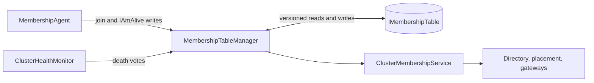
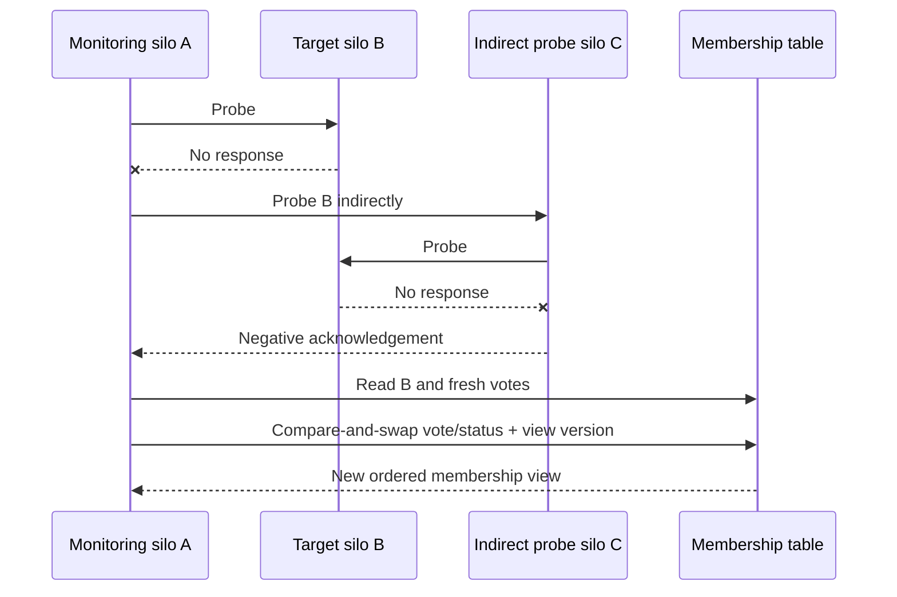

# 集群成员资格协议

成员资格系统为运行时的其余部分回答一个问题：哪些 Silo 标识属于当前视图，各成员分别处于什么状态？Orleans 将持久化的 <xref:Orleans.IMembershipTable> 与直接对等节点探测相结合。成员表提供协调及有序视图，探测则测量 Orleans 实际使用的通信路径。

## 标识、状态与视图

Silo 标识包括其公布的端点及世代值，因此在同一端点重新启动的进程具有新的标识。其 <xref:Orleans.Runtime.SiloStatus> 沿单一方向经过 `Created`、`Joining`、`Active` 以及终止状态（`ShuttingDown`、`Stopping` 或 `Dead`）。

成员资格系统提供**规范成员资格视图**，即带版本的 Silo 标识及其状态的视图。每次成功的带版本成员表修改都将版本恰好递增 1。版本在整个集群内唯一标识其规范成员资格视图，因此观察到版本 N 的两个宿主拥有相同的规范成员资格视图。如果宿主下一次刷新观察到两次已完成的修改，则可直接从 N 推进到 N + 2。

`MembershipTableManager` 通过 `ClusterMembershipService` 发布快照，其中的规范成员资格视图单调推进。目录所有权、网关发现以及故障恢复均依赖此保证。

各 Silo 的 `IAmAliveTime` 独立于规范成员资格视图进行跟踪。周期性 <xref:Orleans.IMembershipTable.UpdateIAmAliveAsync*> 写入不会改变视图版本。快照更新保留各 Silo 已观测到的最大时间戳，因此随着表读取结果及对等节点快照到达，本地存活时间戳单调推进。相同版本下合并时保留已经接受的版本化字段。

快照可以在同一版本下清理此前处于 `Dead` 状态的行，同时保留所有非 Dead 行。清理会保留每个留存条目的版本化字段及最大 `IAmAliveTime`。

## 使用成员资格视图

Silo 托管的服务或运行时组件需要集群视图时，从依赖注入解析 <xref:Orleans.Runtime.IClusterMembershipService>。<xref:Orleans.Runtime.IClusterMembershipService.CurrentSnapshot> 返回当前本地不可变的 <xref:Orleans.Runtime.ClusterMembershipSnapshot>，无需等待存储访问。

<xref:Orleans.Runtime.IClusterMembershipService.MembershipUpdates> 是异步序列，先产生当前本地快照，再产生更新后的快照。<xref:Orleans.Runtime.ClusterMembershipSnapshot.Version> 随规范成员资格变化而推进。同一版本的更新可以清理死亡行，也可以推进对缺失 Silo 标识的本地认知。使用方可以保留各快照，并将其作为完整的成员资格视图处理。

将快照版本与所需的 <xref:Orleans.Runtime.MembershipVersion> 比较。本地视图必须达到某个最低版本时，以该版本等待 <xref:Orleans.Runtime.IClusterMembershipService.Refresh*>；本地快照追上后该操作完成。[BasicClustering 示例](https://github.com/dotnet/orleans/tree/main/samples/BasicClustering) 演示了使用成员资格更新的托管服务。

## 判定缺失的 Silo

<xref:Orleans.Runtime.ClusterMembershipSnapshot.GetSiloStatus*> 返回当前存在的成员记录中的状态，包括具有较旧世代编号但仍长期运行的成员。对于缺失的标识，成员资格系统使用保留的死亡证据、后继世代以及快照中固定的世代截止值。感知版本的查找还可在较新视图省略先前记录的所有者时确定其已死亡。依据最新成员表读取结果验证先前已注册标识的运行时路径，可以在达到年龄截止值之前确定死亡。

<xref:Orleans.Configuration.ClusterMembershipOptions.SiloGenerationRetirementAge?displayProperty=nameWithType> 控制基于年龄的判定，默认为一小时。发布视图时，各对等节点依据本地 UTC 时钟及由时间戳推导的正数 Silo 世代确定截止值。截止值单调推进，因此时钟回拨不会丢失此前的淘汰认知。各个保留快照给出的状态答案固定不变。零值会淘汰早于发布时间的缺失世代；负值属于配置错误。设为 `null` 可禁用基于年龄的淘汰，同时保留已观察到的死亡证据。

成员资格系统独立于规范成员行保留近期被移除的标识。一旦截止值覆盖某个标识，就由截止值取代单独记录。启用淘汰且使用正常的时间戳衍生世代时，保留的历史记录随世代窗口及近期成员变动而变化，而不是随集群整个生命周期增长；配置的年龄限制是时间窗口上界，而非字节容量上限。禁用淘汰时，已观察到的死亡记录在观察者生命周期内始终保留。

截止值及保留的标识记录是观察者的本地状态。新的观察者获取当前行并计算自己的截止值。近期缺失、且没有先前注册证据的标识将保持未知，直到进一步验证或截止值确定其已死亡。

选择的年龄应能容纳宿主之间的时钟偏差、进程暂停及成员存储延迟。停滞超过此年龄的注册写入，可能在另一个对等节点已经判定其缺失标识死亡后提交。此时已提交的行提供该标识的实际状态。

## 加入集群

正在启动的 Silo 写入自身的行，进入 `Joining`，在进入 `Active` 之前验证与活跃成员的双向连接。这可避免网络分区中的进程在不被察觉的情况下加入集群的一侧。

在首次注册之前，本地生命周期保持 `Created`，直到成员表写入成功，或已记录的死亡、移除、后继标识证据确定了终止结果。淘汰年龄为零时同样如此；其他观察者的快照查询仍使用其固定截止值。

`IAmAliveTime` 是成员行中的存活时间戳，用于诊断和启动时灾难恢复。正在加入的 Silo 监控被怀疑及陈旧的对等节点，并按 <xref:Orleans.Configuration.ClusterMembershipOptions.TableRefreshTimeout?displayProperty=nameWithType> 间隔重新评估监控候选节点。它将最新快照中的时间戳与当前时间比较，因此在启动期间时间戳变陈旧的对等节点，即使成员资格视图未变化，也会纳入监控。

这些监控器应用常规探测失败阈值、连接存活检查和死亡投票协议。初始连接验证最多重试 <xref:Orleans.Configuration.ClusterMembershipOptions.MaxJoinAttemptTime?displayProperty=nameWithType>，当每个活跃对等节点作出响应或成员资格系统记录其离开时完成。这样，替代 Silo 能在进程非正常退出后恢复，并通过正常成员资格协议进入 `Active` 状态。

## 故障检测与死亡投票 

活跃 Silo 监控根据哈希环选出的对等节点，以及被怀疑和陈旧的对等节点。正在加入及活跃的 Silo 在成员资格更新时以及每隔 `TableRefreshTimeout` 重新评估选择，保留已有监控器及其探测计数。`ClusterHealthMonitor` 通过 Silo 间消息传递发送探测、跟踪连续失败，并可借助间接探测区分故障目标和不健康的观察者。监控失败时向目标成员行写入带时间戳的投票。

各观察者为每个对等节点维护一个 [Phi Accrual 故障检测器](https://paperhub.s3.amazonaws.com/f516fdfa940caa08c679d3946b273128.pdf)。检测器对成功的直接探测往返时间建模，并估计使延迟响应的概率足够低的超时时间。超时从 <xref:Orleans.Configuration.ClusterMembershipOptions.ProbeTimeout?displayProperty=nameWithType> 开始，在获得足够观测后进行自适应调整。失败结果不纳入，因为它们仅表明响应超出当前超时；间接结果也不纳入，因为它们测量的是其他观察者的网络路径。

学到的超时时间也决定探测节奏。每次探测相对于前一次探测的开始时间进行调度，因此响应很快时等待当前超时时间的剩余部分，而耗尽超时时间的探测之后立即进行下一次尝试。先根据本地健康状况及间接探测跳数延长学到的超时时间，再将其限制在 <xref:Orleans.Configuration.ClusterMembershipOptions.MinProbeTimeout?displayProperty=nameWithType> 与 <xref:Orleans.Configuration.ClusterMembershipOptions.MaxProbeTimeout?displayProperty=nameWithType> 之间。调试器专用的延长值在限制之后应用，以避免暂停的进程因生产环境所配置的上限而受到错误怀疑。

宣告成员死亡需要来自不同观察者的足够多未过期投票。读-改-写操作由成员表的版本或 ETag 保护。更新冲突时，写入方必须重新读取及评估，不得覆盖较新视图。

一旦某行进入 `Dead`，该标识永远不会回到 `Active`。如果进程仅发生网络分区，它会在得知集群已宣告其死亡时终止。宿主可以用新世代重新启动它。

## 默认设置 

默认值由 <xref:Orleans.Configuration.ClusterMembershipOptions> 定义：

| 选项 | 默认值 | 协议作用 |
| --- | ---: | --- |
| <xref:Orleans.Configuration.ClusterMembershipOptions.NumProbedSilos?displayProperty=nameWithType> | 10 | 每个 Silo 监控的对等节点数 |
| <xref:Orleans.Configuration.ClusterMembershipOptions.ProbeTimeout?displayProperty=nameWithType> | 5 秒 | 对等节点提供足够证据之前的初始超时和探测周期 |
| <xref:Orleans.Configuration.ClusterMembershipOptions.MinProbeTimeout?displayProperty=nameWithType> | 初始超时的一半（默认 2.5 秒） | 实际探测超时的下限 |
| <xref:Orleans.Configuration.ClusterMembershipOptions.MaxProbeTimeout?displayProperty=nameWithType> | 初始超时的四倍（默认 20 秒） | 实际探测超时的上限 |
| <xref:Orleans.Configuration.ClusterMembershipOptions.NumMissedProbesLimit?displayProperty=nameWithType> | 3 | 投出死亡票前的探测失败次数 |
| <xref:Orleans.Configuration.ClusterMembershipOptions.NumVotesForDeathDeclaration?displayProperty=nameWithType> | 2 | 将成员标记为死亡所需的未过期票数 |
| <xref:Orleans.Configuration.ClusterMembershipOptions.DeathVoteExpirationTimeout?displayProperty=nameWithType> | 2 分钟 | 死亡投票有效期 |
| <xref:Orleans.Configuration.ClusterMembershipOptions.TableRefreshTimeout?displayProperty=nameWithType> | 1 分钟 | 成员表后备刷新周期 |
| <xref:Orleans.Configuration.ClusterMembershipOptions.IAmAliveTablePublishTimeout?displayProperty=nameWithType> | 30 秒 | 成员行存活时间戳更新周期 |
| <xref:Orleans.Configuration.ClusterMembershipOptions.SiloGenerationRetirementAge?displayProperty=nameWithType> | 1 小时 | 将缺失的正数 Silo 世代判定为死亡的年龄截止值 |

这些值是协议参数，而非彼此独立的定时器：间接探测、本地健康状况、调度延迟及成员表争用均影响观测到的检测时间。遵循 [Lifeguard 的本地健康感知原则](https://arxiv.org/abs/1707.00788)，当 `LocalSiloHealthMonitor` 检测到线程池延迟、定时器延迟或其他本地异常状况时，运行时会提高探测容忍度，从而减少不健康观察者造成的错误怀疑。

## 成员表契约 

<xref:Orleans.IMembershipTable> 的实现通过以下方式协调规范成员资格变化：

- 插入新的 Silo 行；
- 对 Silo 行执行乐观的条件更新；
- 在修改行的同时原子推进表版本；
- 获取包含行及其对应版本的原子全表快照；
- 周期性更新 `IAmAlive`；以及
- 提供适合协调集群的持久化可用性保证。

<xref:Orleans.IMembershipTable.ReadAllAsync*> 获取一致的快照，<xref:Orleans.MembershipTableData.TryGet*> 在该视图内选取某个 Silo 的条目及行 ETag。条件修改返回成功状态。刷新快照可获得当前表状态及 ETag，供后续更新使用。

成员表不可用时优先保证安全性而非活性。现有 Silo 可以继续处理调用，但无法持久地接纳新成员或宣告故障成员死亡。底层存储不可用时，提供程序不得伪造成功更新。

官方提供程序将事务、ETag、轻量级事务或比较并交换原语适配到该契约。提供程序选择及运维设置参见[部署文档](../deployment/index.md)；扩展架构参见[编写提供程序](provider-authoring.md)。

## 协议使用方

成员资格系统有意与使用它的各项服务分离：

- `LegacyGrainDirectory` 在视图变更后调整一致性哈希所有权。
- 分布式目录执行显式范围转移协议。
- 放置服务移除不可用或过载的候选节点。
- 客户端刷新网关列表。
- 持久化流队列均衡器重新分配队列职责。
- 激活实例均衡协议停止与故障成员交换工作。

这种分离让各项服务能够增加更强的不变量，而无需扩大成员表事务的范围。

## 源码与测试

- [`IClusterMembershipService`](https://github.com/dotnet/orleans/blob/main/src/Orleans.Runtime/MembershipService/IClusterMembershipService.cs) 提供本地快照、有序更新及最低版本刷新。
- [`MembershipAgent`](https://github.com/dotnet/orleans/blob/main/src/Orleans.Runtime/MembershipService/MembershipAgent.cs) 驱动加入与活跃状态转换。
- [`MembershipTableManager`](https://github.com/dotnet/orleans/blob/main/src/Orleans.Runtime/MembershipService/MembershipTableManager.cs) 协调成员表更新及死亡宣告。
- [`ClusterHealthMonitor`](https://github.com/dotnet/orleans/blob/main/src/Orleans.Runtime/MembershipService/ClusterHealthMonitor.cs) 负责对等节点监控。
- [`ClusterMembershipSnapshotTests`](https://github.com/dotnet/orleans/blob/main/test/Orleans.Runtime.Internal.Tests/ClusterMembershipSnapshotTests.cs) 覆盖快照版本及成员资格变更语义。
- [`MembershipAgentTests`](https://github.com/dotnet/orleans/blob/main/test/Orleans.Core.Tests/Membership/MembershipAgentTests.cs) 测试启动时的连接性。
- [`MembershipTableManagerTests`](https://github.com/dotnet/orleans/blob/main/test/Orleans.Core.Tests/Membership/MembershipTableManagerTests.cs) 覆盖投票过期及状态变更。
