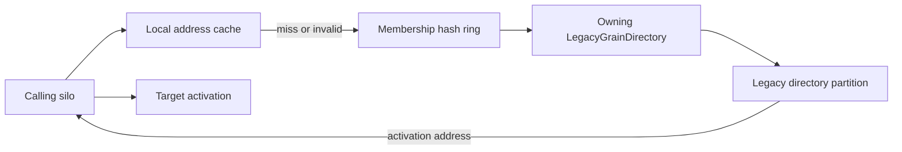
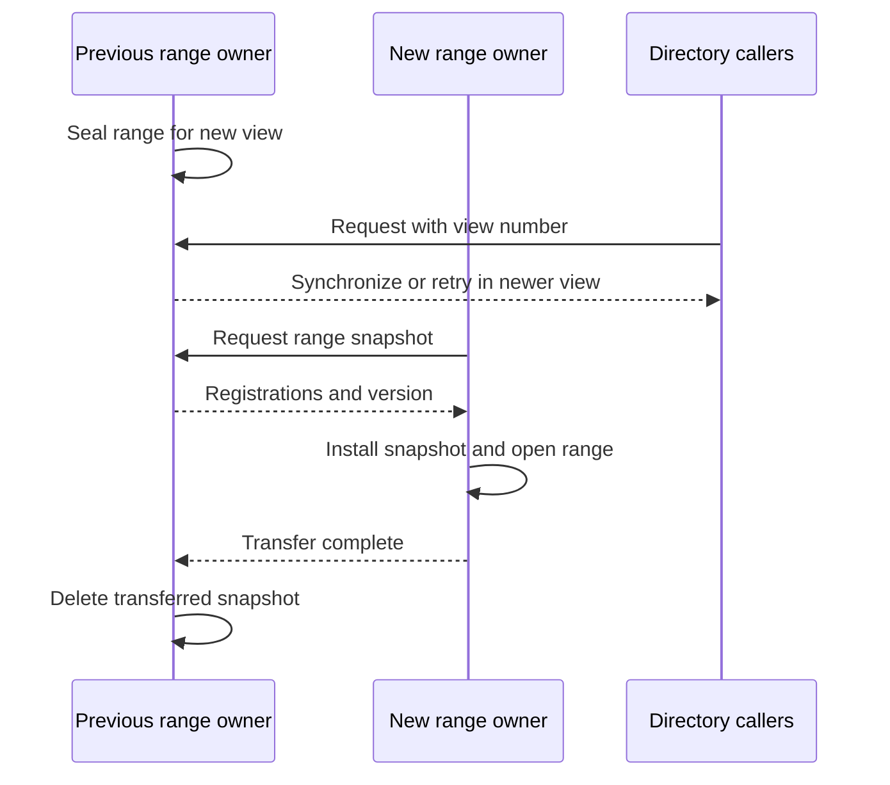

# Grain 目录结构

下 grain 地图a grain 激活地址的身份。当调用器没有可用的缓存地址,运行时间创建、移动或删除激活时,它就会在关键路径上。 silo;激活地址所在的目录坐标是权威的。

Orleans 默认使用 `DistributedGrainDirectory` ,使用版本版版版范围所有权和协调会籍视图过渡。选择 `LegacyGrainDirectory` 和 <xref:Orleans.Hosting.CoreHostingExtensions.UseLegacyGrainDirectory*>。

## `LegacyGrainDirectory` 

`LegacyGrainDirectory` 分区登记在会籍圈上。 拼凑 grain 身份选择 silo 的遗留目录分割对这个密钥具有权威性。 这遵循了 [弦和弦](https://pdos.csail.mit.edu/papers/chord:sigcomm01/chord_sigcomm.pdf)描述的广泛一致的分布式散列(hash- hash)模式,该模式适应 Orleans 成员构成并激活语义。 每个 silo 还保留非授权缓存条目以避免重复远程查看。

遗留目录保存这些变量:

- 目录密钥来自 grain 身份,而不是其当前位置;
- 成员观点决定了权威所有人;
- 本地缓存条目是提示, 可以失效;
- 登记发现相互竞争的单一活动地址;
- a 失败或停止使用的 silo地址被删除或拒绝;和
- 随着成员环的变化,所有权分配转移。

信件转发和无效修复已失效的缓存。 转发是连接的, 而不是应用程序级别重试策略 。

来源: [遗留目录实施](https://github.com/dotnet/orleans/blob/main/src/Orleans.Runtime/GrainDirectory/LocalGrainDirectory.cs) 和 [执行遗留子子分区](https://github.com/dotnet/orleans/blob/main/src/Orleans.Runtime/GrainDirectory/LocalGrainDirectoryPartition.cs)。

## 目录选择

运行时解决了每个 grain 类型目录。 未命名的默认解析到 `DistributedGrainDirectory` , 除非 silo 已经明确替换它。 <xref:Orleans.GrainDirectory.IGrainDirectory> 的指定执行程序可以使用 grain- 类元数据注册和选择。

自定义目录拥有一致性、可用性和清理行为。 它们应该确定同时注册的含义, 如何删除失败 silos , 以及是否可读缩写。 周围的信息路由器无法将最终一致的自定义目录转换为非常一致的目录 。

## 默认: `DistributedGrainDirectory` 

默认目录为同步视图, 版本版版版域所有制和协调会籍视图过渡。 <xref:Orleans.Hosting.CoreHostingExtensions.AddDistributedGrainDirectory*?displayProperty=nameWithType> 明确选择它或登记一个别名。 Aliases 共享一个目录实例和一个生命周期参与者的 silo。

执行时将散圈分割为可配置的幅度,类似于 [迪纳摩](https://www.allthingsdistributed.com/files/amazon-dynamo-sosp2007.pdf)描述的虚拟节点分隔。 <xref:Orleans.Configuration.GrainDirectoryOptions.PartitionsPerSilo?displayProperty=nameWithType> 默认值为 **1**。一个分割区通常在当地满足请求。在成员视图变更中,新旧所有人协调范围锁、快照和所有权转让。设计应用了 [动态服务复制几乎同步的方法](https://www.microsoft.com/en-us/research/publication/virtually-synchronous-methodology-for-dynamic-service-replication/) ,并与 [垂直和平和初级备份复制](https://www.microsoft.com/en-us/research/publication/vertical-paxos-and-primary-backup-replication/)相似。

请求和答复含有查看信息。 范围不能以不相容的所有权观点满足请求。 如果无法有序转让,新所有人通过询问主动 silos 而不是假设失败的所有人状态来恢复登记。

API: <xref:Orleans.Hosting.CoreHostingExtensions.AddDistributedGrainDirectory*?displayProperty=nameWithType> 和 <xref:Orleans.Configuration.GrainDirectoryOptions>。履行: [托管登记](https://github.com/dotnet/orleans/blob/main/src/Orleans.Runtime/Hosting/CoreHostingExtensions.cs) 和 [`DistributedGrainDirectory`](https://github.com/dotnet/orleans/blob/main/src/Orleans.Runtime/GrainDirectory/DistributedGrainDirectory.cs)。

## 权衡取舍

| 财产 | `LegacyGrainDirectory` | 默认 `DistributedGrainDirectory` |
| --- | --- | --- |
| 选择 | <xref:Orleans.Hosting.CoreHostingExtensions.UseLegacyGrainDirectory*?displayProperty=nameWithType> | 默认运行时缺省 |
| 所有权所有权所有权 | 成员一贯任期 | 成员观点的变通幅度 |
| 正常调查 | 所有者分区加上每个silo 缓存 | 所有者分区加视图协调 |
| 视图变化视图 | 分割分割/合并和缓存修理 | 密封幅度和快光传输 |
| 恢复强调恢复 | 重复检测和无效 | 明确范围的回收 |
| 配置 | 明确选择目录 | <xref:Orleans.Configuration.GrainDirectoryOptions.PartitionsPerSilo?displayProperty=nameWithType>,缺省1 |

更多的分割可以改善所有权颗粒性,但能增加转让和协调。 生产推出应该包括兼容性、故障和负荷测试。

对于版本升级过程中的目录改动,请在 [Grain 目录迁移](../migration/grain-directory.md#legacy-to-distributed-directory-upgrade)之后。
