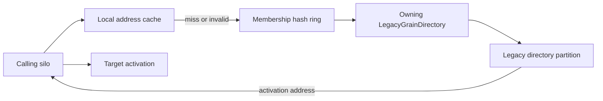
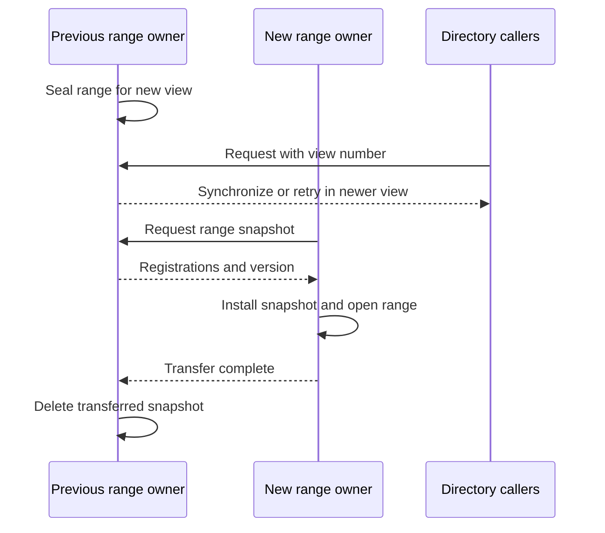

# Grain 目录架构

Grain 目录将 Grain 标识映射至激活实例地址。调用方没有可用的缓存地址，或运行时创建、移动、移除激活实例时，目录位于关键路径上。放置负责选择 Silo；目录协调哪个激活实例地址具有权威性。

Orleans 默认使用 `DistributedGrainDirectory`，通过带版本的范围所有权及协调一致的成员资格视图切换实现目录管理。要选择 `LegacyGrainDirectory`，请使用 <xref:Orleans.Hosting.CoreHostingExtensions.UseLegacyGrainDirectory*>。

## `LegacyGrainDirectory` 

`LegacyGrainDirectory` 将注册记录划分到成员资格环上。对 Grain 标识计算哈希，选出其旧版目录分区对该键具有权威性的 Silo。这遵循 [Chord](https://pdos.csail.mit.edu/papers/chord:sigcomm01/chord_sigcomm.pdf) 所描述的一般一致性哈希分布式哈希表模型，并根据 Orleans 成员资格和激活语义进行了调整。各 Silo 还保存非权威缓存条目，以避免重复远程查找。

旧版目录维持以下不变量：

- 目录键源自 Grain 标识，而非其当前位置；
- 成员资格视图决定权威所有者；
- 本地缓存条目仅供参考，可以失效；
- 注册时检测相互竞争的单激活实例地址；
- 失效或已停用 Silo 的地址被移除或拒绝；以及
- 分区所有权随成员资格环变化而转移。

消息转发和失效通知修复陈旧缓存。转发次数有限，并非应用级重试策略。

源码：[旧版目录实现](https://github.com/dotnet/orleans/blob/main/src/Orleans.Runtime/GrainDirectory/LocalGrainDirectory.cs) 和 [旧版分区实现](https://github.com/dotnet/orleans/blob/main/src/Orleans.Runtime/GrainDirectory/LocalGrainDirectoryPartition.cs)。

## 目录选择

运行时按 Grain 类型解析目录。除非 Silo 显式替换默认目录，否则未命名的默认目录解析为 `DistributedGrainDirectory`。可以注册 <xref:Orleans.GrainDirectory.IGrainDirectory> 的命名实现，并使用 Grain 类型元数据进行选择。

自定义目录自行负责一致性、可用性和清理行为。它们应定义并发注册的含义、如何移除故障 Silo，以及是否可能发生陈旧读取。周围的消息路由器无法将最终一致的自定义目录变成强一致的目录。

## 默认目录：`DistributedGrainDirectory` 

默认目录采用视图同步机制，具有带版本的范围所有权及协调一致的成员资格视图切换。<xref:Orleans.Hosting.CoreHostingExtensions.AddDistributedGrainDirectory*?displayProperty=nameWithType> 可以显式选择该目录或注册命名别名。别名在每个 Silo 中共享一个目录实例及一个生命周期参与者。

实现将哈希环划分为可配置的范围，类似 [Dynamo](https://www.allthingsdistributed.com/files/amazon-dynamo-sosp2007.pdf) 所描述的虚拟节点分区。<xref:Orleans.Configuration.GrainDirectoryOptions.PartitionsPerSilo?displayProperty=nameWithType> 默认为 **1**。分区通常在本地处理请求。成员资格视图发生变化期间，旧所有者与新所有者协调范围锁、快照及所有权转移。该设计采用[动态服务复制的虚拟同步方法](https://www.microsoft.com/en-us/research/publication/virtually-synchronous-methodology-for-dynamic-service-replication/)，并与 [Vertical Paxos 和主备复制](https://www.microsoft.com/en-us/research/publication/vertical-paxos-and-primary-backup-replication/) 存在相似之处。

请求和响应携带视图信息。范围不能在不兼容的所有权视图下处理请求。如果无法进行有序转移，新所有者通过查询活跃 Silo 恢复注册记录，而不是假定故障所有者的状态。

API：<xref:Orleans.Hosting.CoreHostingExtensions.AddDistributedGrainDirectory*?displayProperty=nameWithType> 和 <xref:Orleans.Configuration.GrainDirectoryOptions>。实现：[宿主注册](https://github.com/dotnet/orleans/blob/main/src/Orleans.Runtime/Hosting/CoreHostingExtensions.cs) 和 [`DistributedGrainDirectory`](https://github.com/dotnet/orleans/blob/main/src/Orleans.Runtime/GrainDirectory/DistributedGrainDirectory.cs)。

## 权衡

| 属性 | `LegacyGrainDirectory` | 默认的 `DistributedGrainDirectory` |
| --- | --- | --- |
| 选择方式 | <xref:Orleans.Hosting.CoreHostingExtensions.UseLegacyGrainDirectory*?displayProperty=nameWithType> | 运行时默认 |
| 所有权 | 成员资格一致性哈希环 | 基于成员资格视图的带版本范围 |
| 正常查找 | 所有者分区加每个 Silo 的缓存 | 所有者分区加视图协调 |
| 视图变化 | 分区拆分/合并及缓存修复 | 封闭范围及快照转移 |
| 恢复重点 | 重复实例检测及失效 | 显式范围恢复 |
| 配置 | 显式选择目录 | <xref:Orleans.Configuration.GrainDirectoryOptions.PartitionsPerSilo?displayProperty=nameWithType>，默认 1 |

更多分区可以提高所有权粒度，但会增加转移及协调工作量。生产环境发布应包含兼容性、故障和负载测试。

版本升级期间变更目录时，请遵循 [Grain 目录迁移](../migration/grain-directory.md#legacy-to-distributed-directory-upgrade)。
