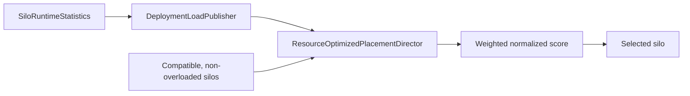

# 安置和启动平衡

选择 silo 何时 Orleans 需要新的激活。 平衡可以以后移动现有的激活。 这些是分别的决定, 信息与成本不同 。

默认安插策略是 <xref:Orleans.Runtime.ResourceOptimizedPlacement>。

有关扩大、采用比额表、持久性和配置的应用和业务观点,见 [Grain 安置和移徙](../grains/grain-placement.md)。

## 优化资源配置

`ResourceOptimizedPlacementDirector` 在整个集群接收 <xref:Orleans.Runtime.SiloRuntimeStatistics> 调自 `DeploymentLoadPublisher`排除不兼容和超载的内容 silos,应用 a 的 [多重选择能力-平衡负负平战略](https://www.eecs.harvard.edu/~michaelm/postscripts/handbook2001.pdf) 通过对可供选用的候选人的平根进行大约取样,使其信号正常化,增加紧张性以避免确定性的放牧,并选择最低利用率分。

默认相对权重为:

| 信号信号 | 重量 |
| --- | ---: |
| <xref:Orleans.Configuration.ResourceOptimizedPlacementOptions.CpuUsageWeight?displayProperty=nameWithType> | 40 |
| <xref:Orleans.Configuration.ResourceOptimizedPlacementOptions.MemoryUsageWeight?displayProperty=nameWithType> | 20 |
| <xref:Orleans.Configuration.ResourceOptimizedPlacementOptions.AvailableMemoryWeight?displayProperty=nameWithType> | 20 |
| <xref:Orleans.Configuration.ResourceOptimizedPlacementOptions.MaxAvailableMemoryWeight?displayProperty=nameWithType> | 5 |
| <xref:Orleans.Configuration.ResourceOptimizedPlacementOptions.ActivationCountWeight?displayProperty=nameWithType> | 15 |

<xref:Orleans.Configuration.ResourceOptimizedPlacementOptions.LocalSiloPreferenceMargin?displayProperty=nameWithType> 默认为5。如果本地 silo分数在最佳候选人的这一幅度内,职位安排可以保留地点。在获得可用统计数据之前,主任选择一个兼容的 silo。

公共选项: <xref:Orleans.Configuration.ResourceOptimizedPlacementOptions>。执行: [`ResourceOptimizedPlacementDirector`](https://github.com/dotnet/orleans/blob/main/src/Orleans.Runtime/Placement/ResourceOptimizedPlacementDirector.cs) 和在 [`DefaultSiloServices`](https://github.com/dotnet/orleans/blob/main/src/Orleans.Runtime/Hosting/DefaultSiloServices.cs)的默认登记。

启用 <xref:Orleans.Configuration.LoadSheddingOptions.LoadSheddingEnabled> 设置了在CPU或内存阈值超过其 CPU 或内存阈值时的 `IsOverloaded` 统计。当未加载兼容 silos 发布统计数据时,使用 CPU、内存、容量和激活计数设定的资源优化配置分数。当每个兼容 silo 都超载或缺少当前统计时,职位安排选择一个兼容的 silo ,因此启动可以进行。

## 装入套装

设定 <xref:Orleans.Configuration.LoadSheddingOptions.LoadSheddingEnabled> 至 `true` 激活装载层叠置。 <xref:Orleans.Configuration.LoadSheddingOptions.CpuThreshold> 默认值为95%, <xref:Orleans.Configuration.LoadSheddingOptions.MemoryThreshold> 客户- 开关请求拒绝对两个阈值都进行评估。 `LoadShedQueueFlowController` 对照从 <xref:Orleans.Configuration.LoadSheddingOptions.CpuThreshold> 并在此限制处读取暂停队列。 silo出版的运行时间统计 超负荷, 资源优化配置优于兼容 silos 具有未加载的统计数据。

使用主机平台自动标尺来创建能力,激活重新平衡或再分配以移动符合资格的启动程序,并 [基于内存的激活停止](../host/configuration-guide/activation-collection.md#enable-memory-based-activation-shedding) 在记忆压力下启动解除引爆程序。

## 安置分辨率和延长期

<xref:Orleans.Runtime.Placement.PlacementStrategyResolver> selects a grain-specific strategy when one is declared; otherwise it uses the default. `PlacementService` applies placement filters before calling the strategy's keyed <xref:Orleans.Runtime.Placement.IPlacementDirector>.

自定义策略包括:

1. a 年 <xref:Orleans.Runtime.PlacementStrategy> 与 grain 类型;
1. a <xref:Orleans.Runtime.Placement.IPlacementDirector> ,从兼容的 silos中选择;
1. 通过 <xref:Orleans.Hosting.PlacementStrategyExtensions.AddPlacementDirector*?displayProperty=nameWithType>登记。

职位布局过滤器是正方限制。 它们可以在董事评分之前根据元数据或其他政策将候选人除名。 主任应该使用职位布局提供的候选人,而不是重建集群成员。

API: <xref:Orleans.Runtime.Placement.PlacementStrategyResolver> 和 <xref:Orleans.Hosting.PlacementStrategyExtensions.AddPlacementDirector*?displayProperty=nameWithType>。履行: [`PlacementService`](https://github.com/dotnet/orleans/blob/main/src/Orleans.Runtime/Placement/PlacementService.cs)、 [战略解决](https://github.com/dotnet/orleans/blob/main/src/Orleans.Runtime/Placement/PlacementStrategyResolver.cs)和 [登记延期](https://github.com/dotnet/orleans/blob/main/src/Orleans.Runtime/Hosting/PlacementStrategyExtensions.cs)。

## 平衡兼顾长寿命启动

资源优化的安置只影响新的激活。 长期启动在以下原因之后会变得不平衡:

- a silo 加入或离开;
- 激活活动保持生命时,交通流量会发生变化;
- 激活内存使用差异;
- 职位安排限制改变候选人的一套办法;或
- 通信 grains 分布在 silos之间。

移动启动成本很高:脱水和补水工作、目录更新、冷藏缓存和临时中断。 因此, Orleans 暴露了选择加入协议,而不是不断移动所有激活。

有效激活继续运行于当前 silos 成员变化。加入 silo 后通过创建或选择迁移获得启动。在宽放关闭期间,退出的 silo 停止使用时通常启动;以后的呼叫在剩余兼容 silos上创建替换。

## 激活再平衡器

<xref:Orleans.Hosting.ActivationRebalancerExtensions.AddActivationRebalancer*?displayProperty=nameWithType> 使资源再平衡者得以。工人在会话中观察分组统计数据,使用酶值估计不平衡,并要求源 silos 将随机启动转移到装载不足的 silos。一个监测器可以在工作失败后唤醒或迁移工人。

协议优化了激活计数和内存使用的分布。 启动重新分割器通过优化通信图和交叉silo 热路来补充它。

业务上最重要的 <xref:Orleans.Configuration.ActivationRebalancerOptions> 它们是:

| 选项 | 默认默认 | 效果效果 |
| --- | ---: | --- |
| <xref:Orleans.Configuration.ActivationRebalancerOptions.RebalancerDueTime> | 60秒 | 第一次平衡会议之前的延迟。 |
| <xref:Orleans.Configuration.ActivationRebalancerOptions.SessionCyclePeriod> | 15秒 | 周期间间隔。 它必须是部署-统计更新期的至少两倍。 |
| <xref:Orleans.Configuration.ActivationRebalancerOptions.MaxStagnantCycles> | 3 | 连续周期后停止届会,其改进仍然低于星体量。 |
| <xref:Orleans.Configuration.ActivationRebalancerOptions.ActivationMigrationCountLimit> | `int.MaxValue` | 要求每个周期的最大迁移次数。 在评价特性时设定约束的首个限制值 。 |

环子量、允许偏差和循环 silo 保持默认值,直到有代表性的测量证明有必要改变。 <xref:Orleans.Placement.Rebalancing.IActivationRebalancer> 调自 silo 服务处的暂停或恢复会议, <xref:Orleans.Placement.Rebalancing.RebalancingReport>报告包含大约的组群不平衡和每个silo 观察移民率、活动潜伏期、国家转让失败、记忆和交叉silo 电话

执行: [`ActivationRebalancerWorker`](https://github.com/dotnet/orleans/blob/main/src/Orleans.Runtime/Placement/Rebalancing/ActivationRebalancerWorker.cs)。

## 重新开发

<xref:Orleans.Hosting.ActivationRepartitioningExtensions.AddActivationRepartitioner*?displayProperty=nameWithType> 使通信意识重新分配成为可能。

- 脊椎代表偏差活化;
- 边缘重量代表观察到的呼唤;
- 锁定或非移动 grains 限制可能的移动。

定期,同行再分配者交换图表信息并谈判启动动作,既改善地点又尊重不平衡容忍规则。 默认状态 `RebalancerCompatibleRule` 可以纳入资源再平衡者的集群平衡报告。

业务上最重要的 <xref:Orleans.Configuration.ActivationRepartitionerOptions> 它们是:

| 选项 | 默认默认 | 效果效果 |
| --- | ---: | --- |
| <xref:Orleans.Configuration.ActivationRepartitionerOptions.MaxEdgeCount> | 10,000 | 绕过圆形波纹顶端通讯边缘 |
| <xref:Orleans.Configuration.ActivationRepartitionerOptions.MaxUnprocessedEdges> | 100,000 | 绕过未定边缘缓冲;最老的条目在满时被丢弃。 |
| <xref:Orleans.Configuration.ActivationRepartitionerOptions.MinRoundPeriod> / <xref:Orleans.Configuration.ActivationRepartitionerOptions.MaxRoundPeriod> | 1分/ 2分钟 | 定义各轮之间的随机间隔。 |
| <xref:Orleans.Configuration.ActivationRepartitionerOptions.RecoveryPeriod> | 1分钟1分 | 防止 silo 立即进入另一回合。 |
| <xref:Orleans.Configuration.ActivationRepartitionerOptions.AnchoringFilterEnabled> | `true` | 以概率降低图形大小, 并按分散式的本地脊椎进行崩溃。 |

较大的边缘和缓冲限制提高了保留有用通信数据的机会,但消耗了更多的内存。更短的圆周期和恢复期反应更快,但增加了协调和移徙量。对于大型集群而言,允许有足够的时间进行回合交流;选项指南建议,在最长轮周期中每个预期增加大约10秒 silo 。使用跨silo 调用量和延绳以及迁移率和重新分配记录来评估有效性。

执行: [`ActivationRepartitioner`](https://github.com/dotnet/orleans/blob/main/src/Orleans.Runtime/Placement/Repartitioning/ActivationRepartitioner.cs) 和 [`RepartitionerMessageFilter`](https://github.com/dotnet/orleans/blob/main/src/Orleans.Runtime/Placement/Repartitioning/RepartitionerMessageFilter.cs)。

## 选择机制

| 机制机制机制 | 其行为时 | 初级信号 | 效果效果 |
| --- | --- | --- | --- |
| 优化资源配置 | 创建启动 | CPU、内存、容量、激活计数 | 放置新激活 |
| 激活再平衡器 | 选择适用平衡会议 | 分组资源不平衡 | 随机符合资格的激活 |
| 重新开发 | 选择交换回合 | Grain 调用图表和容忍规则 | 通信-意识启动 |
| 装入套装 | CPU或内存阈值超过 | 本地CPU和内存使用 | 拒绝网关请求、控制流队列使用 CPU 读取,并标记已超载的 silo |

资源优化配置是默认的,通常是第一个调和机制。添加用于持续计数或记忆折叠的激活再平衡器,并在测量工作量后加入呼叫地点问题的重新分配器。允许卸载超负荷保护。调度协议使用 [启动移徙](activation-lifecycle.md)。在运行时间机制的同时应用能力规划、录入控制和部署健康监测。操作指导属于 [部署科](../deployment/index.md)。
