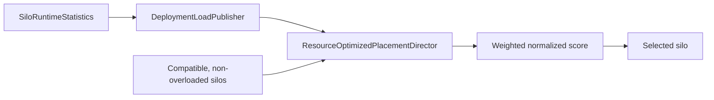

# 放置与激活实例负载均衡

当 Orleans 需要新的激活实例时，放置机制选择一个 Silo。均衡机制随后可以迁移现有激活实例。这是两个独立的决策过程，所依据的信息和承担的成本各不相同。

默认放置策略为 <xref:Orleans.Runtime.ResourceOptimizedPlacement>。

有关横向扩展、缩容、持久化和配置的应用及运维视角，请参阅 [Grain 放置与迁移](../grains/grain-placement.md)。

## 资源优化放置

`ResourceOptimizedPlacementDirector` 从 `DeploymentLoadPublisher` 接收整个集群的 <xref:Orleans.Runtime.SiloRuntimeStatistics>。它排除不兼容或过载的 Silo，采用 [多候选选择负载均衡策略](https://www.eecs.harvard.edu/~michaelm/postscripts/handbook2001.pdf)，采样数量约为可用候选数的平方根，对这些候选的信号进行归一化，加入随机抖动以避免确定性的请求聚集，然后选择利用率评分最低的 Silo。

默认相对权重为：

| 信号 | 权重 |
| --- | ---: |
| <xref:Orleans.Configuration.ResourceOptimizedPlacementOptions.CpuUsageWeight?displayProperty=nameWithType> | 40 |
| <xref:Orleans.Configuration.ResourceOptimizedPlacementOptions.MemoryUsageWeight?displayProperty=nameWithType> | 20 |
| <xref:Orleans.Configuration.ResourceOptimizedPlacementOptions.AvailableMemoryWeight?displayProperty=nameWithType> | 20 |
| <xref:Orleans.Configuration.ResourceOptimizedPlacementOptions.MaxAvailableMemoryWeight?displayProperty=nameWithType> | 5 |
| <xref:Orleans.Configuration.ResourceOptimizedPlacementOptions.ActivationCountWeight?displayProperty=nameWithType> | 15 |

<xref:Orleans.Configuration.ResourceOptimizedPlacementOptions.LocalSiloPreferenceMargin?displayProperty=nameWithType> 默认为 5。如果本地 Silo 的评分与最佳候选的差距在此容差范围内，放置过程可以保留局部性。在可用统计信息出现之前，放置决策器选择一个兼容的 Silo。

公共选项：<xref:Orleans.Configuration.ResourceOptimizedPlacementOptions>。实现：[`ResourceOptimizedPlacementDirector`](https://github.com/dotnet/orleans/blob/main/src/Orleans.Runtime/Placement/ResourceOptimizedPlacementDirector.cs) 以及 [`DefaultSiloServices`](https://github.com/dotnet/orleans/blob/main/src/Orleans.Runtime/Hosting/DefaultSiloServices.cs) 中的默认注册。

启用 <xref:Orleans.Configuration.LoadSheddingOptions.LoadSheddingEnabled> 后，只要 CPU 或内存之一超过阈值，就会设置 `IsOverloaded` 统计值。当非过载的兼容 Silo 已发布统计信息时，资源优化放置根据 CPU、内存、容量及激活实例数量对该候选集合评分。如果所有兼容 Silo 均过载或缺少当前统计信息，放置仍会选择一个兼容 Silo，使激活得以继续。

## 负载削减

将 <xref:Orleans.Configuration.LoadSheddingOptions.LoadSheddingEnabled> 设置为 `true` 以启用负载削减。<xref:Orleans.Configuration.LoadSheddingOptions.CpuThreshold> 默认为 95%，<xref:Orleans.Configuration.LoadSheddingOptions.MemoryThreshold> 默认为 90%。客户端网关拒绝请求时会评估这两个阈值。使用 `LoadShedQueueFlowController` 的流提供程序将 CPU 使用率与根据 <xref:Orleans.Configuration.LoadSheddingOptions.CpuThreshold> 得出的限制进行比较，并在达到限制时暂停队列读取。超过任一配置阈值都会使 Silo 发布的运行时统计信息标记为过载，资源优化放置会优先选择统计信息显示未过载的兼容 Silo。

将负载削减作为准入控制的一层，与有界工作和截止时间配合使用。使用托管平台的自动扩缩容组件增加容量，使用激活实例再均衡或重新分区迁移符合条件的激活实例，并使用 [基于内存的激活实例卸载](../host/configuration-guide/activation-collection.md#enable-memory-based-activation-shedding) 在内存压力下停用激活实例。

## 放置策略解析和扩展

<xref:Orleans.Runtime.Placement.PlacementStrategyResolver> 在声明了 Grain 专用策略时选择该策略，否则使用默认策略。`PlacementService` 在调用该策略的带键 <xref:Orleans.Runtime.Placement.IPlacementDirector> 前应用放置筛选器。

自定义策略包括：

1. 与 Grain 类型关联的 <xref:Orleans.Runtime.PlacementStrategy> 值；
1. 从兼容 Silo 中进行选择的 <xref:Orleans.Runtime.Placement.IPlacementDirector>；以及
1. 通过 <xref:Orleans.Hosting.PlacementStrategyExtensions.AddPlacementDirector*?displayProperty=nameWithType> 进行注册。

放置筛选器是独立于放置策略的约束。它们可以在放置决策器评分前，根据元数据或其他策略移除候选。放置决策器应使用放置上下文提供的候选，而不是自行重建集群成员关系。

API：<xref:Orleans.Runtime.Placement.PlacementStrategyResolver> 和 <xref:Orleans.Hosting.PlacementStrategyExtensions.AddPlacementDirector*?displayProperty=nameWithType>。实现：[`PlacementService`](https://github.com/dotnet/orleans/blob/main/src/Orleans.Runtime/Placement/PlacementService.cs)、[策略解析](https://github.com/dotnet/orleans/blob/main/src/Orleans.Runtime/Placement/PlacementStrategyResolver.cs) 和 [注册扩展方法](https://github.com/dotnet/orleans/blob/main/src/Orleans.Runtime/Hosting/PlacementStrategyExtensions.cs)。

## 均衡长期存续的激活实例

资源优化放置只影响新的激活实例。在以下情况发生后，长期存续的激活实例可能失去均衡：

- Silo 加入或离开；
- 激活实例存续期间流量发生变化；
- 各激活实例的内存使用量出现差异；
- 放置约束改变候选集合；或
- 互相通信的 Grain 分散在不同 Silo 上。

迁移激活实例需要付出成本，包括提取状态和恢复状态工作、目录更新、冷缓存及暂时中断。因此，Orleans 提供按需启用的协议，而不是持续迁移所有激活实例。

在成员关系变更期间，有效的激活实例继续在当前 Silo 上运行。新加入的 Silo 通过之后的激活创建或按需启用的迁移获得激活实例。在正常关闭期间，离开集群的 Silo 上的普通激活实例将停用；之后的调用在其余兼容 Silo 上创建替代实例。

## 激活实例再均衡器

<xref:Orleans.Hosting.ActivationRebalancerExtensions.AddActivationRebalancer*?displayProperty=nameWithType> 启用资源再均衡器。工作器在会话中观察集群统计信息，利用熵估算不均衡程度，并请求源 Silo 将随机选取的激活实例迁移到负载较低的 Silo。发生故障后，监视器可以唤醒工作器或将其重新放置。

该协议优化激活实例数量和内存使用量的分布。激活实例重新分区器通过优化通信图和跨 Silo 热点路径，与该协议形成互补。

对运维最重要的 <xref:Orleans.Configuration.ActivationRebalancerOptions> 如下：

| 选项 | 默认值 | 效果 |
| --- | ---: | --- |
| <xref:Orleans.Configuration.ActivationRebalancerOptions.RebalancerDueTime> | 60 秒 | 第一次均衡会话开始前的延迟。 |
| <xref:Orleans.Configuration.ActivationRebalancerOptions.SessionCyclePeriod> | 15 秒 | 会话内各周期之间的时间间隔。必须至少为部署统计信息刷新周期的两倍。 |
| <xref:Orleans.Configuration.ActivationRebalancerOptions.MaxStagnantCycles> | 3 | 连续多个周期的改善程度低于熵量子阈值时停止会话。 |
| <xref:Orleans.Configuration.ActivationRebalancerOptions.ActivationMigrationCountLimit> | `int.MaxValue` | 每个周期请求的最大迁移次数。评估此功能时，设置有限的初始上限以控制频繁迁移。 |

熵量子、允许偏差及周期和 Silo 权重控制收敛和迁移速率。保持默认值，直到具有代表性的测量结果表明需要更改。从 Silo 服务中解析 <xref:Orleans.Placement.Rebalancing.IActivationRebalancer>，可暂停或恢复会话、请求 <xref:Orleans.Placement.Rebalancing.RebalancingReport> 或订阅报告。报告包含集群不均衡程度的估计值，以及各 Silo 接收和迁出的激活实例数量。还应观察迁移速率、激活延迟、状态传输失败、内存及跨 Silo 调用。

实现：[`ActivationRebalancerWorker`](https://github.com/dotnet/orleans/blob/main/src/Orleans.Runtime/Placement/Rebalancing/ActivationRebalancerWorker.cs)。

## 激活实例重新分区器

<xref:Orleans.Hosting.ActivationRepartitioningExtensions.AddActivationRepartitioner*?displayProperty=nameWithType> 启用感知通信的重新分区机制。重新分区器对地址信息完整的请求消息进行采样，并构建加权图：

- 顶点表示可迁移的激活实例；
- 边的权重表示观察到的调用；
- 已锚定或不可迁移的 Grain 限制可执行的迁移。

各对等重新分区器定期交换图信息，协商能够改善局部性且满足不均衡容差规则的激活实例迁移。默认的 `RebalancerCompatibleRule` 可以纳入资源再均衡器的集群不均衡报告。

对运维最重要的 <xref:Orleans.Configuration.ActivationRepartitionerOptions> 如下：

| 选项 | 默认值 | 效果 |
| --- | ---: | --- |
| <xref:Orleans.Configuration.ActivationRepartitionerOptions.MaxEdgeCount> | 10,000 | 限制一轮中通过概率算法保留的主要通信边数量。 |
| <xref:Orleans.Configuration.ActivationRepartitionerOptions.MaxUnprocessedEdges> | 100,000 | 限制待处理边的缓冲区；缓冲区满时丢弃最旧的条目。 |
| <xref:Orleans.Configuration.ActivationRepartitionerOptions.MinRoundPeriod> / <xref:Orleans.Configuration.ActivationRepartitionerOptions.MaxRoundPeriod> | 1 / 2 分钟 | 定义各轮之间的随机时间间隔。 |
| <xref:Orleans.Configuration.ActivationRepartitionerOptions.RecoveryPeriod> | 1 分钟 | 防止 Silo 立即进入下一轮。 |
| <xref:Orleans.Configuration.ActivationRepartitionerOptions.AnchoringFilterEnabled> | `true` | 通过概率性折叠分区良好的本地顶点来减小图规模。 |

较大的边数及缓冲区限制提高保留有用通信数据的概率，但消耗更多内存。较短的轮次间隔及恢复时间能更快响应，但会增加协调开销和频繁迁移。对于大型集群，应为轮次中的交换留出足够时间；选项指南建议最大轮次间隔按预期 Silo 数量每个增加约 10 秒。结合迁移速率和重新分区器日志，使用跨 Silo 调用量及延迟评估效果。

实现：[`ActivationRepartitioner`](https://github.com/dotnet/orleans/blob/main/src/Orleans.Runtime/Placement/Repartitioning/ActivationRepartitioner.cs) 和 [`RepartitionerMessageFilter`](https://github.com/dotnet/orleans/blob/main/src/Orleans.Runtime/Placement/Repartitioning/RepartitionerMessageFilter.cs)。

## 选择机制

| 机制 | 何时执行 | 主要信号 | 效果 |
| --- | --- | --- | --- |
| 资源优化放置 | 创建激活实例时 | CPU、内存、容量、激活实例数量 | 放置新的激活实例 |
| 激活实例再均衡器 | 按需启用的均衡会话 | 集群资源不均衡程度 | 迁移随机选取且符合条件的激活实例 |
| 激活实例重新分区器 | 按需启用的交换轮次 | Grain 调用图及容差规则 | 按通信关系迁移激活实例 |
| 负载削减 | 超过 CPU 或内存阈值时 | 本地 CPU 和内存使用量 | 拒绝网关请求、根据 CPU 控制流队列读取，并将 Silo 标记为过载 |

资源优化放置是默认策略，通常也是首先应调整的机制。在测量工作负载后，针对持续的实例数量或内存分布偏斜添加激活实例再均衡器，针对调用局部性问题添加重新分区器。启用负载削减以防止过载。迁移协议使用 [激活实例迁移](activation-lifecycle.md)。在使用这些运行时机制的同时，应实施容量规划、准入控制及部署健康监控。有关运维指导，请参阅 [部署部分](../deployment/index.md)。
