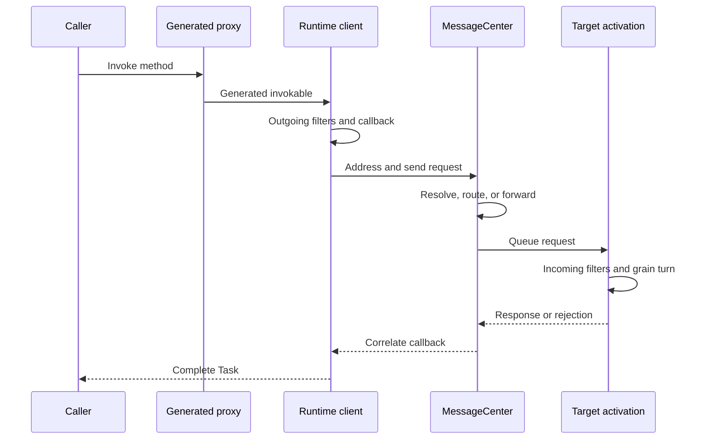

# 管道和输送路路路传递语义

Orleans 呼叫是一个不同步的请求- 响应交换。 生成代码、 路径、 grain 目录、 激活时间表和回调都参与其中。 API 类似本地方法的呼叫,但失败保留了分布式系统模糊性。

## 请求和响应管道

源生成器发出代理服务器和可置疑的请求类型。 `GrainReferenceRuntime` 运行离线呼叫过滤器,并通过 `IRuntimeClient`提交请求。 `MessageFactory` 创建消息和关联身份。 `MessageCenter` 解决启动地址并选择本地发送、 silo 连接或客户端关口。在目标上, `InsideRuntimeClient` 运行接收的过滤器并引用生成的方法调度器。

来源: [`GrainReferenceRuntime`](https://github.com/dotnet/orleans/blob/main/src/Orleans.Core/Runtime/GrainReferenceRuntime.cs)、 [`MessageFactory`](https://github.com/dotnet/orleans/blob/main/src/Orleans.Core/Messaging/MessageFactory.cs)、 [`MessageCenter`](https://github.com/dotnet/orleans/blob/main/src/Orleans.Runtime/Messaging/MessageCenter.cs)和 [`InsideRuntimeClient`](https://github.com/dotnet/orleans/blob/main/src/Orleans.Runtime/Core/InsideRuntimeClient.cs)。

## 地址修理和发送边界线

目标 grain 地址是一个路由提示,其有效性 `Catalog` 和 `ActivationData` 在发送前确认。 `MessageCenter` 检查本地交货、代理客户、可用的远程连接和已知的死点。目标 `Catalog` 和 `ActivationData` 在接受请求之前验证了 grain 地址和接口版本。因此,可以撤销一个标定激活,并在保存其逻辑信件身份的同时转发或更改请求的路径。

发送边界也是适用关闭政策的地方。 当申请信息被封时,回复和会员流量仍然符合资格条件,而新的申请请求被拒绝或撤销。 这样会让生命周期协议的耗尽,而停止 silo 则接受回复和加入流量,并拒绝新的申请工作。

## 路途修理不是呼叫重试

信件可能遇到一个已停止激活的地址, 因为启动已禁用、 已移动或其 silo 失败。 运行时间可以拒绝、 无效、 转发或改变同一逻辑请求的路径, 同时确定当前激活的位置 。 转发受 silo 邮件选项的约束 。

内部地址修理不得与在响应超时后重新尝试申请电话混为一谈。 Orleans 是否 **否** 自动重新发回一个电话, 因为呼叫者的响应计时器已过 。

运输代码也可以重试一个失败的套接字发送。 使用相同的电文身份修复一次运输尝试; 这不是一项新的应用援引政策 。

## 反应超时意味着未知结果

<xref:Orleans.Configuration.MessagingOptions.ResponseTimeout?displayProperty=nameWithType> 默认为30秒, 或连接调试器时为30分钟。 `CallbackData` 在没有回复及时到达调试回调时用 <xref:System.TimeoutException> 来填充调试器。

至此,其中任何一种情况都可能属实:

- 请求从未达到目标;
- 请求排队,但尚未启动;
- grain 方法仍在运行;
- 已完成的 grain 方法及其答复丢失或延误;或
- 调回后将回复已删除。

因此,报告的时间间隔 **未知结果**,而不是执行失败。 <xref:Orleans.Configuration.MessagingOptions.CancelRequestOnTimeout?displayProperty=nameWithType> 是 `false`授权取消请求合作取消;仍然无法证明没有产生任何副作用。

API: <xref:Orleans.Configuration.MessagingOptions>。履行: [信息短信选项](https://github.com/dotnet/orleans/blob/main/src/Orleans.Core/Configuration/Options/MessagingOptions.cs)、 [`CallbackData`](https://github.com/dotnet/orleans/blob/main/src/Orleans.Core/Runtime/CallbackData.cs)和 [`TimeoutTests`](https://github.com/dotnet/orleans/blob/main/test/Orleans.Runtime.Internal.Tests/TimeoutTests.cs)。

## 交付模式

不进行重新申请, Orleans 提交一项符合逻辑的要求,在答复超时后,不会故意援引。 **最即一次交付**。它不是一个耐久的一经交易即发生的交易:

- 电话人无法区分未交付货物与超时后完成的执行;
- 过程崩溃可以消除不稳定的重复跟踪和回调状态;
- 即使未观察到反应,也可能产生副作用;
- 单向信息不提供完成结果。

如果应用代码重试一个超时调,两种尝试都可以执行。 Orleans 不会持久地重复任意请求。重新审理的操作应该是自然的无能或带有应用操作识别码,并具有副作用,以原子方式记录。

重复重试只能使集和目标最终恢复时在最不晚交付时接近一次。 它并不确切意味着一次性,通过重试订购或约束完成时间。

## 拒绝和到期

运行时间可以返回拒绝, 当它知道无法处理请求时, 例如因为无效的路径或超载而不能进行拒绝。 拒绝比超时更能证明拒绝更有力, 但应用程序代码仍然必须解释拒绝类型 。

信件有来自回复超时的过期元数据。 如果 <xref:Orleans.Configuration.MessagingOptions.DropExpiredMessages?displayProperty=nameWithType> 设为 `true` (默认), 过期请求或回复可以被撤销, 而不是消耗无法继续完成原回调的工作 。

拒绝的传递信息多于超时,因为运行时间对当前处理尝试做出了明确决定,先前转发或运输的尝试仍不确定结果。 将拒绝类型视为路由或可用信号。

## 设计呼叫员

在应用程序边界选择语义 :

- 使用无主命令进行安全重试;
- 包括无法接受重复副作用时的操作代号;
- 在可能的情况下,在结果不明后提出可持久查询;
- 使用交易或存储对业务变量的比较和交换;以及
- 使用较长的超时,不取代超载处理。

运行超时和连接调试属于 [配置指南](../host/configuration-guide/index.md)。
