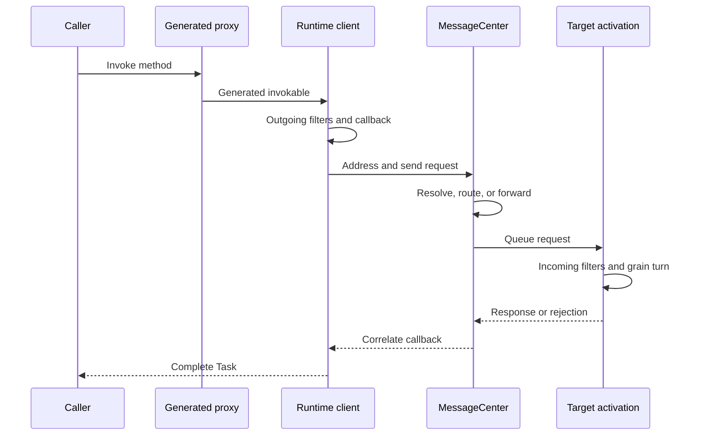

# 消息传递管道与投递语义

Orleans 调用是异步的请求-响应交互。生成的代码、路由、Grain 目录、激活实例调度及回调均参与其中。API 类似于本地方法调用，但发生故障时仍存在分布式系统固有的不确定性。

## 请求与响应管道

源代码生成器生成代理及可调用请求类型。`GrainReferenceRuntime` 执行传出调用筛选器，并通过 `IRuntimeClient` 提交请求。`MessageFactory` 创建消息及关联标识。`MessageCenter` 解析激活实例地址，并选择本地分派、Silo 连接或客户端网关。在目标端，`InsideRuntimeClient` 执行传入筛选器并调用生成的方法分派器。

源码：[`GrainReferenceRuntime`](https://github.com/dotnet/orleans/blob/main/src/Orleans.Core/Runtime/GrainReferenceRuntime.cs)、[`MessageFactory`](https://github.com/dotnet/orleans/blob/main/src/Orleans.Core/Messaging/MessageFactory.cs)、[`MessageCenter`](https://github.com/dotnet/orleans/blob/main/src/Orleans.Runtime/Messaging/MessageCenter.cs) 和 [`InsideRuntimeClient`](https://github.com/dotnet/orleans/blob/main/src/Orleans.Runtime/Core/InsideRuntimeClient.cs)。

## 地址修复与分派边界

目标 Grain 地址是一个路由提示，在分派前由 `Catalog` 和 `ActivationData` 确认其有效性。`MessageCenter` 检查是否可本地投递、是否为代理客户端、是否存在可用远程连接以及目标是否已知死亡。在目标端，`Catalog` 和 `ActivationData` 在接纳请求之前验证 Grain 地址及接口版本。因此，可以使陈旧激活实例地址失效，转发或重新路由请求，同时保持逻辑消息标识不变。

分派边界也是关闭策略的应用位置。当应用消息被阻止时，响应和成员资格流量仍可通过，而新的应用请求被拒绝或丢弃。这样，在正在停止的 Silo 接收响应及成员资格流量并拒绝新应用工作的同时，生命周期协议能够完成排空。

## 路由修复不是调用重试

激活实例停用、移动或其所在 Silo 发生故障时，消息可能遇到陈旧的激活实例地址。运行时可以在定位当前激活实例的过程中拒绝、使地址失效、转发或重新路由同一逻辑请求。转发受 Silo 消息传递选项限制。

不得将内部地址修复与响应超时后重试应用调用混淆。Orleans **不会**因为调用方的响应定时器已到期而自动重新提交调用。

传输代码也可以重试失败的套接字发送操作。这是使用同一消息标识修复传输尝试，而非发起新的应用调用的策略。

## 响应超时意味着结果未知

<xref:Orleans.Configuration.MessagingOptions.ResponseTimeout?displayProperty=nameWithType> 默认为 30 秒；附加调试器时为 30 分钟。响应未能及时到达回调时，`CallbackData` 通过 <xref:System.TimeoutException> 使调用方结束等待。

此时以下任一种情况都可能为真：

- 请求从未到达目标；
- 请求已排队但尚未开始执行；
- Grain 方法仍在运行；
- Grain 方法已完成，但其响应丢失或延迟；或者
- 响应将在回调已被移除之后到达。

因此，超时报告的是**结果未知**，而不是执行失败。默认情况下，<xref:Orleans.Configuration.MessagingOptions.CancelRequestOnTimeout?displayProperty=nameWithType> 为 `false`。启用取消会请求协作式取消，但仍无法证明未发生任何副作用。

API：<xref:Orleans.Configuration.MessagingOptions>。实现：[消息传递选项](https://github.com/dotnet/orleans/blob/main/src/Orleans.Core/Configuration/Options/MessagingOptions.cs)、[`CallbackData`](https://github.com/dotnet/orleans/blob/main/src/Orleans.Core/Runtime/CallbackData.cs) 和 [`TimeoutTests`](https://github.com/dotnet/orleans/blob/main/test/Orleans.Runtime.Internal.Tests/TimeoutTests.cs)。

## 投递模型

在应用不进行重试时，Orleans 提交一次逻辑请求，并不会在响应超时后有意再次调用它。这通常被描述为**至多一次投递**。它不是持久化的恰好一次事务：

- 超时之后，调用方无法区分请求未投递与已执行完成；
- 进程崩溃可能清除易失的重复请求跟踪及回调状态；
- 即使未观察到响应，副作用也可能已提交；以及
- 单向消息不提供完成结果。

如果应用代码重试已超时的调用，两次尝试都可能执行。Orleans 不会对任意请求进行持久化去重。被重试的操作应天然幂等，或携带与副作用原子记录的应用操作标识符。

只有在集群及目标最终能够恢复时，反复重试才可能近似至少一次投递。它不意味着恰好一次、跨重试的顺序保证或有界的完成时间。

## 拒绝与过期

当运行时知道无法处理请求时（例如路由无效或过载），可以返回拒绝。拒绝比超时提供了更强的证据，但应用代码仍必须解释具体拒绝类型。

消息具有由响应超时派生的过期元数据。将 <xref:Orleans.Configuration.MessagingOptions.DropExpiredMessages?displayProperty=nameWithType> 设置为 `true`（默认值）时，可丢弃已过期的请求或响应，避免消耗资源处理已无法完成原始回调的工作。

拒绝比超时包含更多信息，因为运行时已对当前处理尝试作出明确决定。先前转发或传输的尝试仍然结果未知。将拒绝类型视为路由或可用性信号。

## 调用方设计

在应用边界选择语义：

- 使用幂等命令实现安全重试；
- 无法接受重复副作用时携带操作 ID；
- 出现未知结果后尽可能查询持久化状态；
- 使用事务或存储的比较并交换操作保护业务不变量；以及
- 不要用更长的超时时间代替过载处理。

运行环境的超时及连接调优参见[宿主配置指南](../host/configuration-guide/index.md)。
