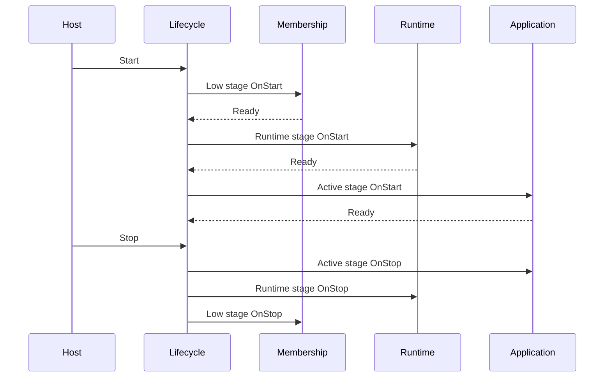

# 生命周期实现

Orleans 将多个独立注册的服务组合到一个 Silo 或客户端中。有些服务必须等到依赖项就绪之后才启动，并在依赖项消失之前停止。生命周期抽象为这些组件提供有序协议，无需将每个依赖项都放入统一的启动方法中。

## 可观察对象与观察者 

<xref:Orleans.ILifecycleObservable> 接受在整数阶段的订阅。启动期间按阶段值升序访问，关闭期间按降序访问。某阶段的所有观察者都完成后，生命周期才进入下一阶段。

<xref:Orleans.ILifecycleObserver> 提供异步 <xref:Orleans.ILifecycleObserver.OnStart*> 和 <xref:Orleans.ILifecycleObserver.OnStop*> 回调。<xref:Orleans.ILifecycleParticipant`1> 是参与者登记契约：参与者获得生命周期并自行订阅。Silo 和客户端宿主通过依赖注入发现已注册的参与者；Grain 作用域服务具有明确的登记责任方。

关闭顺序与启动顺序相反是关键不变量。服务可以继续使用较早阶段启动的依赖项，直到自己的停止回调完成。

## Silo 与客户端生命周期

<xref:Orleans.Runtime.SiloLifecycleSubject> 驱动 Silo 的启动和关闭。成员资格、消息传递、Grain 目录、激活实例回收、统计信息、提供程序及其他运行时组件在命名的 <xref:Orleans.ServiceLifecycleStage> 值对应的阶段参与生命周期。

客户端对网关发现、连接、流提供程序及外部运行时客户端使用同样的模式。通用的 <xref:Orleans.ILifecycleObservable> 还允许提供程序在无需 Silo 专用接口时组合自己的私有生命周期。

面向宿主的阶段列表及配置示例参见 [Silo 生命周期](../host/silo-lifecycle.md)。本页侧重生命周期协议，而不是应用启动代码应注册到何处。

## Grain 激活实例的组成

<xref:Orleans.Runtime.IConfigureGrainTypeComponents> 为某个 Grain 类型配置共享方案。配置器可使用 <xref:Orleans.Metadata.GrainClassMap> 选择实现类，再通过 <xref:Orleans.Runtime.GrainTypeSharedContext.AddActivationSetup*> 添加同步操作。选择与组合在创建共享上下文时发生；激活实例执行缓存的操作。

<xref:Orleans.Runtime.GrainTypeSharedContext> 在配置器完成后封闭设置操作的注册。构造激活实例时，运行时先赋予完整构造的 Grain 对象并记录创建，再按添加顺序调用设置操作。之后登记该 Grain 对象并启动生命周期。此边界同样适用于自定义 Grain 激活器和各个无状态工作者实例。

设置委托由多个激活实例共享，可以并发运行。在操作内部通过 <xref:Orleans.Runtime.IGrainContext.ActivationServices> 解析每个激活实例专属的状态。现有 DI 注册保留显式登记路径。设置失败遵循激活实例构造失败处理：跳过后续设置和生命周期启动，并释放已经赋予的 Grain 对象及其作用域。

参见[共享激活设置](../grains/grain-lifecycle.md#shared-activation-setup)，其中提供了经过编译的接口选择示例。

## 订阅规则 

生命周期参与者应：

- 在组合期间、生命周期启动之前订阅；
- 使用稳定的观察者名称以便诊断；
- 选择满足所有前置条件的最晚阶段；
- 确保在 <xref:Orleans.ILifecycleObserver.OnStop*> 被调用时能够安全处理 <xref:Orleans.ILifecycleObserver.OnStart*> 仅部分完成的情况；
- 遵守提供的取消令牌；以及
- 在较低阶段的依赖项停止之前释放这些依赖项。

避免通过手动解析和启动其他参与者来形成隐式顺序。阶段依赖关系应在生命周期订阅中保持可见。

## 失败行为

启动流程不会跳过失败的观察者并继续进入看似成功的状态。异常将中止生命周期推进，宿主报告启动失败。关闭流程尝试在取消截止时间内逆序撤销已初始化的阶段。

取消限制生命周期等待观察的时长，但不能保证外部资源立即清理完毕。提供程序代码应确保关闭操作幂等，不应吞掉会使持久化所有权不明确的故障。

## 源码

- <xref:Orleans.LifecycleSubject> 实现阶段遍历；参见其[实现](https://github.com/dotnet/orleans/blob/main/src/Orleans.Core/Lifecycle/LifecycleSubject.cs)。
- <xref:Orleans.Runtime.SiloLifecycleSubject> 是 Silo 生命周期；参见其[实现](https://github.com/dotnet/orleans/blob/main/src/Orleans.Runtime/Lifecycle/SiloLifecycleSubject.cs)。
- [`DefaultSiloServices`](https://github.com/dotnet/orleans/blob/main/src/Orleans.Runtime/Hosting/DefaultSiloServices.cs) 展示参与者注册。
- <xref:Orleans.Providers.Streams.Common.PersistentStreamProvider> 是具有独立初始化阶段及活跃阶段的命名提供程序示例；参见其[生命周期参与实现](https://github.com/dotnet/orleans/blob/main/src/Orleans.Streaming/PersistentStreams/PersistentStreamProvider.cs)。
