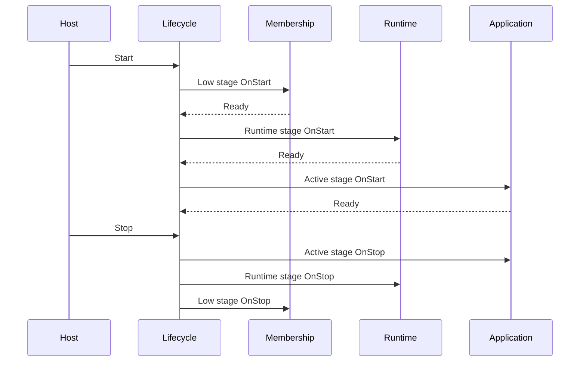

# 生命周期实施

Orleans 将许多独立注册的服务组成一个 silo 或客户。有些服务只有在依赖性已经准备好并在该依赖性消失之前停止后才能启动。生命周期抽象化赋予这些组成部分有序的协议,而没有把每一个依赖性置于核心起始法中。

## 观察和观察员 

<xref:Orleans.ILifecycleObservable> accepts subscriptions at integer stages. During startup it visits stages in ascending order; during shutdown it visits them in descending order. Every observer at a stage completes before the lifecycle advances.

<xref:Orleans.ILifecycleObserver> provides asynchronous <xref:Orleans.ILifecycleObserver.OnStart*> and <xref:Orleans.ILifecycleObserver.OnStop*> callbacks. <xref:Orleans.ILifecycleParticipant`1> is the enrollment contract: a participant receives the lifecycle and subscribes itself. Silo and client hosting discover their registered participants through dependency injection; grain-scoped services have an explicit enrollment owner.

反向关闭令是关键不变性。 服务可以继续使用早期开始的附属关系,直到自己停止回电结束为止。

## Silo 和客户生命周期

<xref:Orleans.Runtime.SiloLifecycleSubject> drives silo startup and shutdown. Membership, messaging, grain directory, activation collection, statistics, providers, and other runtime components participate at named <xref:Orleans.ServiceLifecycleStage> values.

客户对网关发现、连接、流源提供者和外部运行时间客户使用相同的模式。通用 <xref:Orleans.ILifecycleObservable> 也允许供应商在没有必要使用 silo- 特定界面时组成私人生命周期。

[silo 生命周期](../host/silo-lifecycle.md)中记录了以主机为对象的阶段列表和配置示例。本页的重点是协议,而不是应注册应用程序启动代码的地方。

## Grain 启动构成

<xref:Orleans.Runtime.IConfigureGrainTypeComponents> configures a shared plan for a grain type. A configurator can use <xref:Orleans.Metadata.GrainClassMap> to select implementation classes, then add synchronous actions with <xref:Orleans.Runtime.GrainTypeSharedContext.AddActivationSetup*>. Selection and composition occur when creating the shared context; activations execute the cached actions.

<xref:Orleans.Runtime.GrainTypeSharedContext> seals setup registration after the configurators finish. When constructing an activation, the runtime assigns the fully constructed grain object and records creation before invoking setup actions in addition order. It then enrolls the grain object and starts the lifecycle. This boundary also applies to custom grain activators and to individual stateless workers.

设置代表共享, 并可以同时运行于激活中。 在动作中通过 <xref:Orleans.Runtime.IGrainContext.ActivationServices> 解决每个启动状态。 现有的 DI 注册保留明确的输入路径。 安装失败后会发生启动工程故障处理: 随后的设置和生命周期启动被跳过, 指定的 grain 和范围被处置 。

编译的界面选择示例见 [共享激活设置](../grains/grain-lifecycle.md#shared-activation-setup) 。

## 订阅规则 

生命周期参与者应:

- 组成期间、生命周期开始之前的用户;
- 诊断使用稳定观察名;
- 选择其先决条件得到保障的最新阶段;
- 混和 <xref:Orleans.ILifecycleObserver.OnStop*> 部分后安全 <xref:Orleans.ILifecycleObserver.OnStart*>;
- 履行提供的取消标记;
- 释放依赖关系 在他们下阶段停止之前

避免通过手工解决并启动另一位参与者来创建隐藏的订单。 阶段依赖性应该保留在生命周期订阅中。

## 失行为

启动不会跳过失败的观察者,而是继续到成功形状状态。 例外中止了生命周期进度和主机报告启动失败。 关闭尝试在取消期限内松开初始阶段 。

取消合同将观察生命周期;它不能保证立即清理外部资源。 提供商代码应该保持关闭功能,并且不应该吞噬那些让永久所有权模糊不清的失败。

## 来源来源

- <xref:Orleans.LifecycleSubject> implements stage traversal; see its [implementation](https://github.com/dotnet/orleans/blob/main/src/Orleans.Core/Lifecycle/LifecycleSubject.cs).
- <xref:Orleans.Runtime.SiloLifecycleSubject> is the silo lifecycle; see its [implementation](https://github.com/dotnet/orleans/blob/main/src/Orleans.Runtime/Lifecycle/SiloLifecycleSubject.cs).
- [`DefaultSiloServices`](https://github.com/dotnet/orleans/blob/main/src/Orleans.Runtime/Hosting/DefaultSiloServices.cs) 显示参与人登记。
- <xref:Orleans.Providers.Streams.Common.PersistentStreamProvider> is a named-provider example with separate initialize and active stages; see its [lifecycle participation implementation](https://github.com/dotnet/orleans/blob/main/src/Orleans.Streaming/PersistentStreams/PersistentStreamProvider.cs).
