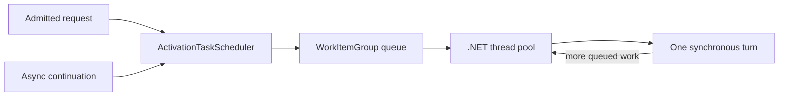

# 调度与执行轮次

Orleans 将**请求调度**与**任务调度**分开：

- 请求调度决定哪些传入调用可以在激活实例上推进；
- 任务调度在该激活实例的上下文中逐个执行同步工作项。

这一区别解释了为什么可重入调用能够交错执行，却不会有两段 Grain 代码在同一激活实例上并行运行。

## `WorkItemGroup` 和 `ActivationTaskScheduler` 

每个激活实例拥有一个 `WorkItemGroup` 和一个 `ActivationTaskScheduler`，后者继承自 .NET 的 <xref:System.Threading.Tasks.TaskScheduler> 抽象。任务调度器将工作排入工作项组。该组实现一个小型状态机（`Waiting`、`Runnable` 和 `Running`），并将自身调度到 [.NET 托管线程池](https://learn.microsoft.com/dotnet/standard/threading/the-managed-thread-pool)。

同一时刻只有一个线程能够执行 `WorkItemGroup`。该线程并非永久绑定：不同执行轮次可以在不同线程池线程上运行。不变量是激活上下文中的排他执行，而非线程亲和性。

源码：[`WorkItemGroup`](https://github.com/dotnet/orleans/blob/main/src/Orleans.Runtime/Scheduler/WorkItemGroup.cs) 和 [`ActivationTaskScheduler`](https://github.com/dotnet/orleans/blob/main/src/Orleans.Runtime/Scheduler/ActivationTaskScheduler.cs)。

## 异步方法分成多个执行轮次

异步 Grain 方法同步执行，直到等待尚未完成的工作。随后，其延续操作被重新排入同一激活实例的调度器。未完成的 await 之前的代码在一个执行轮次中运行，其之后的代码在后续执行轮次中运行。

对不可重入的激活实例，当前请求尚未完成时，其他应用请求通常等待。对于可重入或选择性允许交错执行的调用，另一个请求可以在 await 等待期间运行。它仍作为独立的同步执行轮次运行，不会与正在等待的方法的任一部分并行执行。

因此，调度器保护 Grain 状态免受并行访问，但允许交错执行时，状态仍可能跨越一次 `await` 而发生变化。可重入 Grain 的代码必须在 await 之后重新检查原有假设。

## 请求准入

`ActivationData` 拥有待处理及正在运行的请求。它应用 Grain 的并发策略，分派符合条件的消息，并在请求完成时发出信号，使其他请求能够推进。策略包括：

- 默认不可重入模型；
- Grain 级可重入性；
- 调用链可重入性；
- <xref:Orleans.Concurrency.AlwaysInterleaveAttribute>；以及
- 基于谓词的 <xref:Orleans.Concurrency.MayInterleaveAttribute>。

面向使用者的规则参见[请求调度](../grains/request-scheduling.md)。在内部，请求准入和任务串行执行仍是独立的层次。

准入是在激活实例调度器与共享线程池之上的状态机。`ActivationData` 保存待处理及正在运行的请求，将传入请求与每个活跃请求进行比较，并在当前交错执行策略下每一对请求均兼容时启动它。请求完成时通知准入流程重新评估队列。因此，等待尚未完成任务的请求根据请求策略占用一个逻辑槽位，而执行它的线程则归还线程池。

调用链可重入性的范围比 Grain 级可重入性更窄：它允许当前调用链中的调用推进，同时对无关调用保留默认不交错的规则。`AlwaysInterleave` 和 `MayInterleave` 必须显式选择启用，因为它们以不变量变得更复杂为代价提高吞吐量或避免循环依赖。

## 运行时上下文与内联执行

`ActivationTaskScheduler.TryExecuteTaskInline` 仅在当前 `RuntimeContext` 属于同一个 `WorkItemGroup` 且任务尚未排队时允许内联执行。运行时辅助方法遵循同样的规则：在匹配的 Grain 上下文中内联执行，否则排队。

这可防止延续操作或运行时回调仅因为发起它的线程已在处理 Orleans 工作，就绕过激活实例的隔离机制。

## 阻塞和脱离调度器

阻塞一个执行轮次会阻止该激活实例的所有排队延续操作和已准入请求继续推进。当等待的完成操作需要使用同一激活实例调度器时，同步等待异步操作可能导致死锁。

<xref:System.Threading.Tasks.Task.Run*> 在激活实例调度器之外执行。它可用于隔离的 CPU 密集型工作，但其中运行的代码不得直接访问可变 Grain 状态，也不得假定 `RuntimeContext.Current` 就是该激活实例。返回不可变结果，并在调度器执行的延续操作中应用结果。

## 公平性与诊断

`WorkItemGroup` 在运行时调度限制下处理队列中的工作，以避免某个繁忙的激活实例永久占用线程池工作线程。长时间同步执行轮次仍会延迟其他工作，并由运行时调度诊断报告。[.NET 诊断工具](https://learn.microsoft.com/dotnet/core/diagnostics/) 提供可配合 Orleans 遥测使用的底层运行时追踪、计数器及转储。

调度保证仅限于单个激活实例。它不会对不同 Grain 的调用排序，不会创建分布式锁，也不提供消息恰好一次执行保证。

激活实例争用整个进程的线程池。长时间的同步执行轮次占用一个工作线程并延迟该实例的请求；多个激活实例同时出现突发工作会加剧这种争用。队列长度及执行轮次时长诊断反映容量压力；诊断死锁还需要其他证据。
