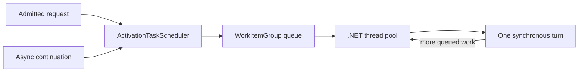

# 排排和转手执行

Orleans 将 **请求的时间安排** 与 **任务时间安排**分开:

- 请求的时间安排决定了收到电话后哪些可以启动程序取得进展;
- 任务调度在激活的上下文中执行每个同步的工作项目。

这种区分解释了重新响应的电话如何可以互接,而没有同时运行同一激活的两片 grain 代码。

## `WorkItemGroup` 和 `ActivationTaskScheduler` 

每个激活都拥有一个 `WorkItemGroup` 和一个 `ActivationTaskScheduler`,它们来自 .NET <xref:System.Threading.Tasks.TaskScheduler> 抽象。任务调度器将工作排入组内。小组使用一个小型国家机器(`Waiting`、 `Runnable`和 `Running`),并排入 [.NET 管理下的线性球](https://learn.microsoft.com/dotnet/standard/threading/the-managed-thread-pool)。

只有一个线索可以一次执行 `WorkItemGroup` 。 该线索没有永久指定: 不同的转可在不同球库线上运行。 变量是激活环境的独家执行, 而不是线亲关系 。

来源: [`WorkItemGroup`](https://github.com/dotnet/orleans/blob/main/src/Orleans.Runtime/Scheduler/WorkItemGroup.cs) 和 [`ActivationTaskScheduler`](https://github.com/dotnet/orleans/blob/main/src/Orleans.Runtime/Scheduler/ActivationTaskScheduler.cs)。

## 自动同步方法变成多转

同步 grain 方法同步运行, 直到等待完成工作。 继续后会排队到相同的激活调度器上。 在不完全前代码会一转等待执行; 稍后再执行之后的代码 。

对于非返回激活, 其他应用程序请求通常等待, 而该请求不完整。 对于重新输入或选择性的中间可传输调用, 另外一个请求可以在等待期间运行。 它仍然作为单独的同步转弯运行; 它与等待方法的任何部分不同时执行 。

因此, grain 状态不受调度器平行访问的保护,但在允许中断时仍然可以在整个 `await` 之间变化。代码必须在等待重试后重新检查假设 grains。

## 请求入境

`ActivationData` 拥有待决和正在运行的请求。 它应用 grain的同值货币政策,发送符合资格的信息并发出完成信号,以便另一个请求能够取得进展。

- 默认的不重新输入模式;
- grain- 全范围重复性;
- 电链回流;
- <xref:Orleans.Concurrency.AlwaysInterleaveAttribute>; and
- predicate-based <xref:Orleans.Concurrency.MayInterleaveAttribute>.

用户定位规则记录在 [请求申请时间安排](../grains/request-scheduling.md)中。 内部而言,申请承认和任务序列化仍然是单独的层层。

接收是一台州机器, 分层在激活调度器和共享线条库上。 `ActivationData` 保存待决请求并运行请求, 根据每一项主动请求评估收到的请求, 并在每对对申请都符合当前交接政策时启动。 完成信号允许重新评价队列。 因此, 等待一个不完整任务的请求会按照请求政策占据一个逻辑空档, 而执行线索会返回到集合中 。

呼叫链回存范围小于 grain-- -- 全网回存:它允许属于当前链条的电话取得进展,同时保留不互连的默认不接不连通的通话。 `AlwaysInterleave` 和 `MayInterleave` 是明确的选择,因为它们以较简单的变数交易来吞吐或避免依赖周期。

## 运行时间背景和内联执行

`ActivationTaskScheduler.TryExecuteTaskInline` 只有在当前 `RuntimeContext` 属于同一 `WorkItemGroup` 并且任务尚未排队的情况下才允许内线执行。运行时间助手遵循相同的规则:在匹配 grain 上下文中执行内线,否则将进行排队。

这防止了连续或即时回调,而仅仅因为其起源于已经处理 Orleans 工作的线条,就无法绕过启动隔离。

## 屏蔽和逃出调度器

屏蔽转弯阻止了排队的每次续编,并承认启动请求已停止。 当等待完成时需要相同的激活调度器时,同步超同步可能会陷入僵局。

<xref:System.Threading.Tasks.Task.Run*> 执行在激活调度器之外。 它可用于孤立的 CPU 工作, 但运行该程序代码时不能直接访问可变 grain 状态, 或者假设 `RuntimeContext.Current` 是激活。 返回不可变的结果并在预定的续延中应用它们 。

## 公平和诊断

`WorkItemGroup` 排水工作受到时间紧迫的排泄安排限制,因此一个忙碌的激活活动无法永久拥有一个线性资源库工人。 长同步转折仍然延缓其他工作,并且通过运行时排期诊断报告。 [.NET 诊断工具](https://learn.microsoft.com/dotnet/core/diagnostics/) 提供与 Orleans 遥测

排程保障是本地到激活的。 它们不命令跨 grains调用, 创建分布式锁, 或者提供信息, 或提供完全自动的行为 。

启动活动在全过程的线性球中竞争。 长期同步转折会消耗工人,而激活请求的延迟会耗尽工人;许多启动活动的一连串工作都增加了竞争。 问题在于长度和周期诊断显示能力压力,需要更多证据来判断僵局。
