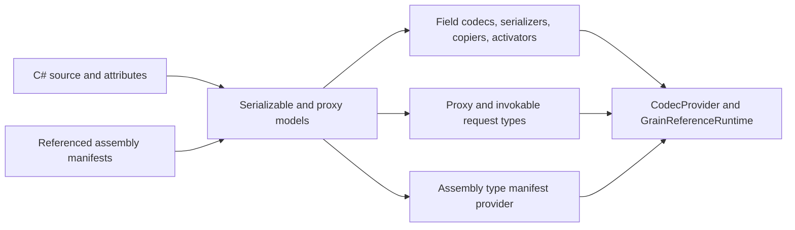
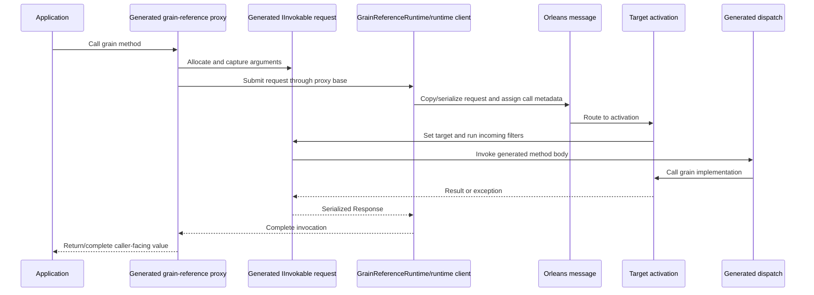

# 序列化与代码生成内部机制

Orleans 的序列化机制服务于两个相互关联的处理流程：

- 为消息和存储有效载荷执行值序列化、深拷贝和对象激活；
- 为 Grain 引用、请求对象、分派和响应生成 RPC 代码。

大多数应用程序代码使用生成的组件。基于反射的发现机制并非默认架构，这是有意为之：生成的类型清单明确列出参与的类型，使运行时分派与[裁剪（trimming）](https://learn.microsoft.com/dotnet/core/deploying/trimming/prepare-libraries-for-trimming)和提前编译（AOT）兼容。

## 增量生成器流水线

Orleans 源代码生成器是一个使用增量生成器 API 实现的 [Roslyn 源代码生成器](https://learn.microsoft.com/dotnet/csharp/roslyn-sdk/#source-generators)。它发现带有 <xref:Orleans.GenerateSerializerAttribute> 标记的类型，以及直接或间接带有 <xref:Orleans.GenerateMethodSerializersAttribute> 标记的接口；同时读取被引用程序集生成的元数据。

生成结果包括序列化器、字段编解码器、深拷贝器、激活器、Grain 代理、可调用方法对象、分派元数据、别名和类型清单提供程序。诊断机制在应用程序启动之前就会拒绝不可访问的类型、存在歧义的字段标识、不受支持的 RPC 形式以及缺失的跨程序集生成元数据。

源码： [`OrleansSourceGenerator`](https://github.com/dotnet/orleans/blob/main/src/Orleans.CodeGenerator/OrleansSourceGenerator.cs) 和 [`ReferenceAssemblyDataProvider`](https://github.com/dotnet/orleans/blob/main/src/Orleans.CodeGenerator/ReferenceAssemblyDataProvider.cs)。

## 字段标识是传输格式契约

<xref:Orleans.IdAttribute> 标识其声明类型中的序列化成员。ID 并不表示字段顺序，编辑源代码时必须保持稳定。

例如，`[Id(0)]` 和 `[Id(1)]` 标识两个不同的成员。对于允许字段缺失的读取器，添加新的 ID 是兼容的。复用现有 ID 或重新编号会改变传输字节的含义，可能破坏滚动升级或已持久化的数据。

<xref:Orleans.GenerateSerializerAttribute.GenerateFieldIds?displayProperty=nameWithType> 默认为 <xref:Orleans.GenerateFieldIds.None?displayProperty=nameWithType>。可以为公共属性自动分配 ID，但显式 ID 使兼容性审查更直观。对于 record 类型，默认包含主构造函数参数；对于其他类型，默认不包含。

当 CLR 类型名称发生变更时，别名可提供稳定的类型标识。类型别名在清单中必须保持唯一。泛型别名和复合别名通过清单的别名树解析。

## 写入器和读取器会话

传输协议通过写入器和读取器会话跟踪整个有效载荷中的引用及类型信息。引用跟踪保留对象标识和循环引用。字段编解码器写入字段头和值，对应的编解码器读取或跳过它能够识别的字段。

深拷贝是一项独立操作，用于 Orleans 需要保持隔离、但不跨越传输边界的情形。不可变值可以跳过复制；可变值需要生成的或自定义的复制器。将可变类型声明为不可变，是以安全性换取速度，必须以该类型的实际行为为依据。

字段头携带 ID 和传输格式类型，因此读取器能够按不同于源代码声明顺序的顺序读取字段。生成的读取器根据已知 ID 进行分派，并为新版写入器引入的字段调用 `ConsumeUnknownField`。通过增加字段实现的类型演进应保持传输格式类型和稳定 ID 不变；改变两者中的任意一项，都会使已有有效载荷获得不兼容的含义。

引用跟踪的作用域为写入器或读取器会话，可保留单个有效载荷中的重复引用与循环引用。跨调用、跨重试的标识维护和请求去重由应用程序负责。深拷贝器使用对应的会话，使复制后的对象图与序列化对象图具有相同的别名引用关系（即多处引用指向同一对象）。

### 序列化构造函数初始化

对于实现 <xref:System.Runtime.Serialization.ISerializable> 的引用类型，反序列化会在读取字段之前分配一个未初始化的对象，并将其记录到读取器会话中。序列化构造函数初始化的就是这一对象，因此从有效载荷读取的引用会解析为最终实例，包括循环引用。`OnDeserializing` 在构造函数初始化之前运行，`OnDeserialized` 和 <xref:System.Runtime.Serialization.IDeserializationCallback.OnDeserialization*> 在之后运行。

Orleans 按所属类型和委托形式缓存构造函数委托，并在托管运行时和 NativeAOT 上使用相同的现有实例初始化路径。在 .NET 10 及更高版本中，基类 <xref:System.Exception> 的序列化构造函数使用静态绑定的访问器，这也包括继承基类序列化契约的异常派生类型的回退路径。在运行时选择的序列化构造函数通过反射初始化现有对象；.NET Standard 目标的程序集也通过反射调用基异常构造函数。请保留这些类型的公共和非公共构造函数，以便本机编译保留构造函数元数据及实现。反射使用 `BindingFlags.DoNotWrapExceptions` 调用构造函数，保留原始异常的标识和构造函数调用栈，包括构造函数自身抛出的 <xref:System.Reflection.TargetInvocationException>。

装箱值类型的委托初始化已有的装箱对象。静态封闭的值类型构造函数委托将调用方的 `ref` 值装箱，初始化该装箱对象，并在 `finally` 块中将其复制回原值，包括构造函数抛出异常前所作的修改。运行时创建的泛型值类型序列化器及带特性的回调委托还存在额外的运行时代码生成要求。NativeAOT 的构造函数支持面向 .NET 10 及更高版本；本机应用程序的支持情况还取决于应用程序使用的类型清单、编解码器工厂和回调路径。

## RPC 代码生成

构造 Grain 引用时，从已注册的类型清单中解析生成的代理，并调用其 `(GrainReferenceShared, IdSpan)` 构造函数。激活器缓存构造函数委托，并在相同 Grain 类型和接口的引用之间共享运行时、接口版本、调用选项及序列化服务。每个引用保留自己的 Grain 键。JIT 运行时使用动态生成的构造函数委托；NativeAOT 使用缓存的反射构造函数调用器。生成的 `AddInterfaceProxy` 注册会在裁剪时保留公共代理构造函数。

对于每个 Grain 接口方法，生成的代码将实参捕获到可调用对象中。生成的代理通过其代理基类提交该对象。在目标端，生成的分派元数据调用具体实现并对响应进行编码。

请求对象可像其他 Orleans 值一样序列化。稳定的方法和接口元数据使调用方与目标程序集能够在受支持的版本控制规则内独立演进。出站和入站调用筛选器对生成的调用进行包装，但不取代序列化或分派。

生成的请求类型和响应信封属于滚动升级的兼容性边界。旧版读取器跳过新引入的字段，新版读取器为缺失字段提供兼容的默认值，每个兼容的接口版本都使用可解码的实参和结果类型。方法标识及接口版本路由仍与值的传输格式标识分开处理。

### 生成的调用路径

各阶段维持以下边界：

1. 增量生成器发现直接或间接带有 <xref:Orleans.GenerateMethodSerializersAttribute> 标记的接口，并解析选定的代理基类。
2. 生成代理方法，以及实现 <xref:Orleans.Serialization.Invocation.IInvokable> 的请求类型。每个实参都对应一个生成的字段。
3. 请求实现 `GetArgumentCount`、`GetArgument` 和 `SetArgument`。[调用筛选器](../grains/interceptors.md)和[请求调度谓词](../grains/request-scheduling.md)使用这些访问器，在分派之前检查或替换实参。
4. 代理基类通过 <xref:Orleans.Runtime.GrainReference> 和 <xref:Orleans.Runtime.IGrainReferenceRuntime> 提交请求。出站筛选器围绕该提交过程运行。
5. 运行时创建消息，其消息体为可调用请求。请求的复合类型标识及消息的接口与版本元数据，使接收方能够解析生成的类型和目标契约。
6. 目标运行时解析激活实例，将目标设置到请求中，运行入站筛选器并调用 <xref:Orleans.Serialization.Invocation.IInvokable.Invoke*>。生成的 `InvokeInner` 代码直接分派到 Grain 实现。
7. 可调用对象的基类将完成状态、结果或异常转换为 <xref:Orleans.Serialization.Invocation.Response>。调用方运行时完成正在等待的操作。

对于通过 <xref:Orleans.Invocation.ReturnValueProxyAttribute> 标记的返回类型，步骤 4 会在代理边界发生变化：生成的代码调用请求上配置的初始化器并返回其值。该初始化器负责提交请求或执行其他适配器协议。目标端仍按照可调用对象基类的契约接收并分派生成的请求。请参阅[自定义 Orleans 序列化代码生成](../grains/code-generation-customization.md)。

### 生成的组件及其职责

| 组件 | 职责 |
| --- | --- |
| 生成的 Grain 引用代理 | 实现 Grain 接口，租用或创建请求，将实参复制到请求中，应用方法选项，并调用选定的代理基类方法或返回值初始化器。 |
| 生成的请求类型 | 携带序列化实参，提供实参检查和修改功能，记录接口与方法元数据，接收目标激活实例，并通过 `InvokeInner` 调用 Grain 实现。 |
| <xref:Orleans.Serialization.Invocation.IInvokable> | 定义目标绑定、分派、实参访问、取消挂钩、方法元数据、响应超时及释放操作。 |
| 代理基类 | 定义每种返回类型如何进入客户端运行时。<xref:Orleans.Runtime.GrainReference> 提供内置的 Task、ValueTask、void 和异步可枚举对象映射。 |
| 可调用对象基类 | 定义目标端的完成操作和响应适配。自定义基类还可通过 <xref:Orleans.Invocation.ReturnValueProxyAttribute> 定义面向调用方的适配器。 |
| 生成的元数据 | 在程序集清单中注册代理实现、Grain 实现、编解码器、激活器以及请求的复合别名。 |

实参和结果值使用常规的 Orleans.Serialization 编解码器和复制器。异常由异常响应表示，并由调用方的完成源重新抛出。带有 `CancellationToken` 的 Grain 调用通过生成的请求提供取消功能，使运行时能够传播协作式取消。返回 void 的方法在其请求基类中设置单向调用选项，因此没有响应完成源等待结果。

### 请求标识与分派

生成的请求名称属于实现细节。其传输格式标识为复合别名，包含以下部分：

- `inv` 标记；
- 代理基类标识；
- Grain 接口类型；
- 对于扩展方法，其声明接口；以及
- 方法标识。

方法标识使用显式 <xref:Orleans.IdAttribute> 值、<xref:Orleans.AliasAttribute> 或方法签名的确定性哈希。当显式标识与生成的哈希不同时，Orleans 为两种标识均生成兼容性别名。这样，清单解析就能独立于生成的 CLR 名称识别请求类型。

消息还携带版本选择所使用的 Grain 接口类型和版本。类型标识用于解析序列化请求体；接口与版本元数据用于选择兼容的分派。这是相互关联、职责不同的兼容性边界。

### 源代码及引用程序集元数据

语法提供程序为源代码中声明的可序列化类型及代理接口创建稳定模型。另一个依赖编译上下文的阶段会扫描源代码和被引用程序集的元数据，查找应用程序部件、别名、复合别名、序列化器注册、代理接口、实现以及程序集级可调用对象映射。

生成器在准备代理输出和类型清单时合并这些模型。如果从语法派生的契约未发生变化，规范化模型上的相等性比较器可保持增量缓存。依赖编译上下文的绑定仍在输出准备阶段进行，因为返回类型映射、可访问性、泛型约束、构造函数和初始化器的重载解析都可能随着引用变化而改变。

这种拆分使不相关的源代码编辑可以复用代理模型，而被引用的适配器或程序集级映射发生变化时，则能正确使生成的代理输出失效。

## 运行时类型清单和类型安全

每个生成的程序集都携带 <xref:Orleans.Serialization.Configuration.TypeManifestProviderAttribute>。<xref:Orleans.Serialization.SerializerBuilderExtensions.AddAssembly*?displayProperty=nameWithType> 查找这些提供程序，并将其组件添加到 <xref:Orleans.Serialization.Configuration.TypeManifestOptions>。

清单记录以下内容：

- 激活器、字段编解码器、序列化器、复制器及转换器；
- RPC 接口、代理和实现；
- 预定义的类型 ID（数字形式）和别名；以及
- 显式允许的类型和程序集。

<xref:Orleans.Serialization.Configuration.TypeManifestOptions.AllowAllTypes?displayProperty=nameWithType> 默认为 `false`。这是类型解析的安全边界：接收到经过格式化的类型名称，并不意味着所有可加载的 CLR 类型都可以作为有效输入。

API：<xref:Orleans.Serialization.Configuration.TypeManifestOptions>、<xref:Orleans.Serialization.ISerializerBuilder> 和 <xref:Orleans.Serialization.SerializerBuilderExtensions.AddAssembly*?displayProperty=nameWithType>。实现：[类型清单选项](https://github.com/dotnet/orleans/blob/main/src/Orleans.Serialization/Configuration/TypeManifestOptions.cs)、[序列化器构建器扩展](https://github.com/dotnet/orleans/blob/main/src/Orleans.Serialization/Hosting/SerializerBuilderExtensions.cs)和[序列化器服务注册](https://github.com/dotnet/orleans/blob/main/src/Orleans.Serialization/Hosting/ServiceCollectionExtensions.cs)。

### 默认对象激活

默认序列化器激活器为每个新实例调用公共无参构造函数，包括显式声明的值类型无参构造函数。对于没有公共无参构造函数的类型，分配一个未初始化的实例，其字段均初始化为零值。已注册的自定义激活器控制目标类型的构造过程。

默认激活器缓存类型是否具有公共无参构造函数，并在托管运行时及 NativeAOT 上通过 <xref:System.Activator.CreateInstance*> 进行泛型构造。运行时提供构造函数和分配器实现。泛型构造将构造函数故障包装到 <xref:System.Reflection.TargetInvocationException> 中；激活器移除这一外层包装并传播原始构造函数异常，保留其标识、内部异常和堆栈跟踪。封闭的默认激活器类型带有构造函数查找及未初始化对象分配所需的构造函数保留注解。

## 扩展点

使用 <xref:Orleans.Serialization.ISerializerBuilder> 公开的注册 API 注册以下组件：

- 当类型需要自定义传输编码时，注册字段编解码器；
- 当生成的逐成员复制方式不适用时，注册深拷贝器；
- 当构造需要特殊处理时，注册激活器；
- 当类型使用外部格式时，注册序列化器；或
- 注册将类型映射到受支持的代理类型的转换器。

保持编解码器与复制器的行为一致。如果自定义序列化器保留对象图，但对应的复制器丢失引用标识，可能导致本地调用与远程调用产生不同的行为。

自定义 <xref:Orleans.Serialization.Cloning.IDeepCopier`1> 对于引用类型接受 null 输入。输入为 null 时返回 null，输入非 null 时返回非 null 的副本。启用了可空性分析的手写实现必须使用可空输入类型和返回类型，并以 <xref:System.Diagnostics.CodeAnalysis.NotNullIfNotNullAttribute> 标注返回值。现有实现若使用不可空的输入类型，则隐式接口实现会报告 CS8767，显式接口实现会报告 CS8769；将可空性警告视为错误时，这会成为构建错误。

RPC 代码生成扩展可注册自定义可调用对象基类及面向调用方的返回值适配器。请参阅[自定义 Orleans 序列化代码生成](../grains/code-generation-customization.md)。

配置示例见[序列化配置指南](../host/configuration-guide/serialization.md)。[源代码生成指南](../grains/code-generation.md)介绍面向应用程序的生成规则。运行时调用行为见[消息传递与投递语义](messaging-delivery-guarantees.md)。实现行为由 [`GeneratedSerializerTests`](https://github.com/dotnet/orleans/blob/main/test/Orleans.Serialization.UnitTests/GeneratedSerializerTests.cs)、[`GeneratedSerializerBitwiseCompatibilityTests`](https://github.com/dotnet/orleans/blob/main/test/Orleans.Serialization.UnitTests/GeneratedSerializerBitwiseCompatibilityTests.cs) 和 [`CustomReturnTypeTests`](https://github.com/dotnet/orleans/blob/main/test/Orleans.CodeGenerator.Tests/CustomReturnTypeTests.cs) 中的测试覆盖。
