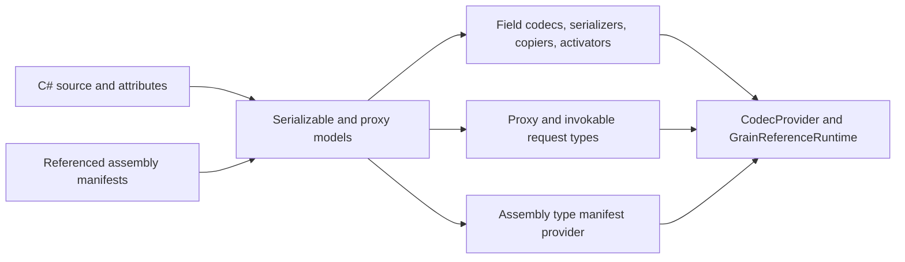
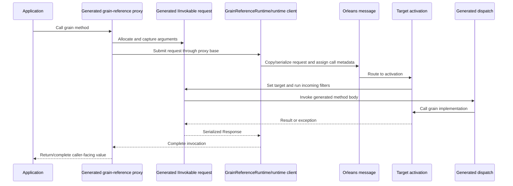

# 内部的序列化和代码生成

Orleans 序列化服务于两个相关的管道:

- 确定序列、深重复制和启动信息及存储有效载荷的价值;
- 用于 grain 参考、请求对象、发送和回复的 RPC 代码生成。

大多数应用代码使用生成的组件。基于反省发现的发现有意不是默认结构:产生的显示器使参与类型明确,并保持运行时间发送与 [修补](https://learn.microsoft.com/dotnet/core/deploying/trimming/prepare-libraries-for-trimming) 和超时编译兼容。

## 递增发电机管道

Orleans 源生成器是使用增量发电机API实施的 [Roslyn源发电机](https://learn.microsoft.com/dotnet/csharp/roslyn-sdk/#source-generators) 。它发现有 <xref:Orleans.GenerateSerializerAttribute> 标记的类型和直接或中转标为 <xref:Orleans.GenerateMethodSerializersAttribute>的接口,还读取引用组件发出的元数据。

生成的产出包括序列器、实地编码器、深复印机、活动程序、 grain 代号、可置疑的方法对象、发送元数据、别名和一个类型识别提供者。诊断拒绝不可获取的类型、模糊的字段身份、不支持的 RPC形状,以及在应用程序启动前缺少交叉组合生成元数据。

来源: [`OrleansSourceGenerator`](https://github.com/dotnet/orleans/blob/main/src/Orleans.CodeGenerator/OrleansSourceGenerator.cs) 和 [`ReferenceAssemblyDataProvider`](https://github.com/dotnet/orleans/blob/main/src/Orleans.CodeGenerator/ReferenceAssemblyDataProvider.cs)。

## 现场身份是铁线合同

<xref:Orleans.IdAttribute> identifies a serialized member within its declaring type. IDs are not field order and must remain stable as source is edited.

例如, `[Id(0)]` 和 `[Id(1)]` 识别两个不同的成员。添加新的ID与容忍遗漏字段的读者兼容。重用或重编号现有的ID会改变线上字节的含义,并可能破坏滚动升级或数据持续更新。

<xref:Orleans.GenerateSerializerAttribute.GenerateFieldIds?displayProperty=nameWithType> 默认值为 <xref:Orleans.GenerateFieldIds.None?displayProperty=nameWithType>。自动公有财产标识是可用的,但明确的身份识别使兼容性审查成为可见的。初级建筑参数被默认地包含在记录中,而默认时排除了其他类型的。

当 CLR 名称移动时, 异名会提供稳定的型号身份。 在 舱单中必须保持一个别名的独特性。 一般化和复合化别名会通过 舱单的别名树解决 。

## 作家和读者会

电线协议使用作者和读者会话跟踪引用,并键入有效载荷的信息。 参考跟踪保存了对象身份和周期。 实地代码程序写出字段页眉和值; 匹配编码程序读取或跳过它所理解的字段。

深复制是单独操作, 当 Orleans 必须保持隔离而不跨越运输边界时使用。 不可变值可以绕过复制; 可变值需要生成或定制复印机。 声明可变型的不可变交易速度安全性, 并且必须依据该类型的实际行为来证明 。

字段页眉带有ID和线型, 这样读者可以以不同的源顺序消耗字段。 生成读者发送已知的 ID 并给新作者引入的域调用 `ConsumeUnknownField` 。 添加进化保存了线型和稳定的 ID; 改变两者中的任何一个会给现有有效载荷分配不相容的含义 。

参考跟踪的范围包括一个作家/阅读者会话,并将重复的引用和周期保留在一个有效载荷内; 应用程序自有身份,要求不同通话和回溯重复; 深复印机使用相应的会话,因此复制的图表与序列图具有相同的别名关系。

### 序号构造器初始化

将 <xref:System.Runtime.Serialization.ISerializable> 参考类型改为:“解除序列化分配未初始化对象,并在阅读其字段之前将其记录在读者会话中。序列化构造器初始化了同一对象,因此引用从有效载荷分辨率读到最后试例,包括周期。 `OnDeserializing` 运行在构建器初始化前; `OnDeserialized` 和 <xref:System.Runtime.Serialization.IDeserializationCallback.OnDeserialization*> 运行后。

Orleans 管理运行时和运行时按所有者类型和代表形状分列的缓存构建器代表,并使用相同的现有设施启动路径 NativeAOT基数 <xref:System.Exception> 使用静态约束存取器 .NET 10年以后,包括继承基本序列化合同的例外子类型退缩。运行时间选择的序列化构造器利用反射来初始化现有物体; .NET 标准资产还利用基本例外建筑师的反射来进行基础例外建筑师的反射。 `BindingFlags.DoNotWrapExceptions`,保留原例外的特性和建造者堆叠,包括建筑者投掷 <xref:System.Reflection.TargetInvocationException>.

框内价值型代表初始化了现有框。 标准封闭值型构建器代表将调用员的 `ref` 值框,初始化该框并将其复制回一个 `finally` 块,包括制造者抛掷前进行的突变。运行时间创建通用价值型序列器和可评回回传代表有额外的运行时间代码生成要求。 NativeAOT 构建器支持目标 .NET 10及以后;本地应用程序支持还取决于类型列表、编码工厂以及应用程序使用的回溯路径。

## 产生RPC

Grain- 参考构建解决了注册类型舱单生成的代理文件,并引用了其 `(GrainReferenceShared, IdSpan)` 构建器。激活者隐藏建筑代表,共享运行时间、界面版本、调用选项和序列服务,且在相同 grain 类型和接口的参考中共享。每个引用都保留自己的 grain 键。JIT运行时使用一个已排放的构建器代表; NativeAOT 使用一个缓存式反射器。生成的 `AddInterfaceProxy` 登记在裁剪期间保护公共代理建构商。

对于每一种 grain 接口方法,生成代码将参数记录在一个可引用对象中。生成的代理服务器通过代理基点显示该对象。在目标上,生成的发送元数据引用具体执行并编码回复。

请求对象可以与任何其他 Orleans 值一样连序。 稳定的方法和接口元数据允许调用者和目标组件在支持的版本规则范围内独立演变。 发送和接收的呼叫过滤器将生成的引用包起来; 它们不会取代序列化或发送。

生成的请求类型和响应信封是滚动升级边界的一部分。 老读者跳过新引入的字段, 省略域的新读者供应默认默认值, 每个兼容的接口版本都使用可解码参数和结果类型。 方法身份和界面格式路径仍然与有价电线身份分离。

### 生成调用路径

保留这些边界的各个阶段:

1. 递增生成器发现直接或中继标记为 <xref:Orleans.GenerateMethodSerializersAttribute> 的接口,并解决选定的代理基数。
2. 它发出一种代用方法和一个执行 <xref:Orleans.Serialization.Invocation.IInvokable>的生成请求类型。每个参数都是生成字段。
3. 请求执行 `GetArgumentCount`、 `GetArgument`和 `SetArgument`。 [调用过滤器](../grains/interceptors.md) 和 [上游活动](../grains/request-scheduling.md) 在发送前使用这些存取器检查或替换参数。
4. 代理基地通过 <xref:Orleans.Runtime.GrainReference> 和 <xref:Orleans.Runtime.IGrainReferenceRuntime>提交请求。外向过滤器围绕该提交文件运行。
5. 运行时间创建信息, 其主体是可置疑的请求。 请求的复合类型身份和该信息的界面/ 版本元数据让接收者解决生成的类型和目标合同 。
6. 目标运行时间解决激活问题,在请求时安装目标,运行进取过滤器,并呼叫 <xref:Orleans.Serialization.Invocation.IInvokable.Invoke*>。生成 `InvokeInner` 代码直接发送到 grain 执行中。
7. 可置换的基数将完成、结果或例外转换为 <xref:Orleans.Serialization.Invocation.Response>。调用员运行时间完成等待操作 。

对于通过 <xref:Orleans.Invocation.ReturnValueProxyAttribute>标记的返回类型,第4步在代理边界上的更改:生成代码根据请求调用配置初始化器并返回其值。初始化器拥有请求提交书或另一个适配程序。目标仍然根据可引用的基本合同接收和发送生成的请求。见 [自定义 Orleans 序列代号生成](../grains/code-generation-customization.md)。

### 生成的构成部分和责任

| 构成部分构成部分构成部分构成部分构成部分 | 责任 |
| --- | --- |
| 生成 grain- 引用代理 | 执行 grain 接口、租赁或创建请求,将参数复制到其中,采用方法选项,并引用选定的代理基方法或返回值初始化器。 |
| 生成请求类型 | 进行系列论证,揭露论据检查和变异、记录接口和方法元数据、接受目标启动并号召 grain 执行通过执行《公约》的 `InvokeInner`. |
| <xref:Orleans.Serialization.Invocation.IInvokable> | 界定目标约束、发送、参数访问、取消钩子、方法元数据、反应超时和处置。 |
| 代理基数 | 定义每个返回的家族如何进入客户端运行时间。 <xref:Orleans.Runtime.GrainReference> 提供内置任务、 价值- 任务、 无效和 等同可数映射 。 |
| 可援引基础 | 定义目标端完成和响应适应。自定义基地还可以通过 <xref:Orleans.Invocation.ReturnValueProxyAttribute>定义一个符合呼声的适配器。 |
| 生成元数据 | 登记代用名称的履行情况、 grain 执行情况、编码、激活器和组装清单中的复合请求别名。 |

参数和结果值使用正常 Orleans.Serialization 例外是指例外情况答复,由电话填写源重新转发。 grain 下调的呼叫 `CancellationToken` 通过生成的请求来显示取消, 允许运行时间传播合作取消。 Void 方法将单程调用选项设置在请求基数中, 因此没有响应完成源等待结果 。

### 请求身份和发出

生成的请求名称是执行细节。

- `inv` 标记;
- (a) 代理基地身份;
- grain 接口类型;
- 宣布扩展方法的接口;以及
- 方法识别。

方法身份使用一种明确的 <xref:Orleans.IdAttribute> 值、一个 <xref:Orleans.AliasAttribute>或方法签名的确定性散列。当明确的身份与产生的散列不同时, Orleans 就为两种身份发出兼容性的别名。这样可以让清晰的分辨率识别请求类型,而独立于生成的 CLR 名称。

信件还包含版本选择所使用的 grain 接口类型和版本。 类型身份解析了序列请求机; 界面/ 版本元数据选择兼容的发送。 这些是相关的兼容性边界, 与不同的职责相关 。

### 来源和引用组装元数据

语法提供者为源宣布的可序列类型和代理界面创建稳定模型。 一个单独的基于编译的级扫描源和参考组装元数据,用于应用部件、别名、复合别名、序列器登记、代理界面、实施以及组装层面可引用绘图。

生成器在制作代理输出和类型显示时结合了这些模型。 在使用通用模式的平等比较者保留了渐进的缓冲,因为从通税衍生的合同保持不变。 依赖汇编的约束性保存在产出准备阶段,因为回归绘图、无障碍、通用限制、构建器和初始化器超载分辨率在参考值变化时可以改变。

此分割允许不相关的源编辑来重新使用代理模型, 而引用的适配器或组装级别映射则正确无效 。

## 运行时间表和类型安全

每个产出组装的 <xref:Orleans.Serialization.Configuration.TypeManifestProviderAttribute>。 <xref:Orleans.Serialization.SerializerBuilderExtensions.AddAssembly*?displayProperty=nameWithType> 找到这些供应商,并将其部件贡献给 <xref:Orleans.Serialization.Configuration.TypeManifestOptions>。

记录:

- 活性器、实地编码器、序列器、复印机和转换器;
- 区域项目审查委员会的接口、代理和执行;
- 众所周知的数种身份识别和别名;
- 明确允许类型和集会。

<xref:Orleans.Serialization.Configuration.TypeManifestOptions.AllowAllTypes?displayProperty=nameWithType> 默认值为 `false`。 这是一个类型分辨率边界: 接收格式化型号名称不会使每个可装入的 CLR 类型有效输入。

API: <xref:Orleans.Serialization.Configuration.TypeManifestOptions>、 <xref:Orleans.Serialization.ISerializerBuilder>和 <xref:Orleans.Serialization.SerializerBuilderExtensions.AddAssembly*?displayProperty=nameWithType>。履行: [显示的选项](https://github.com/dotnet/orleans/blob/main/src/Orleans.Serialization/Configuration/TypeManifestOptions.cs)、 [序列创建器扩展](https://github.com/dotnet/orleans/blob/main/src/Orleans.Serialization/Hosting/SerializerBuilderExtensions.cs)和 [序列质测器服务登记](https://github.com/dotnet/orleans/blob/main/src/Orleans.Serialization/Hosting/ServiceCollectionExtensions.cs)。

### 默认对象激活

默认连续序列器激活器为每个新实例援引一个公共无参数构建器,包括一个明确的无参数值类型构建器。对于没有公共无参数构建器的类型,它分配了一个带有零初始化字段的未初始化实例。注册的自定义活性控制器对其目标类型的构造进行控制。

默认活动器隐藏该类型是否有公共无参数构造器,并且通过 <xref:System.Activator.CreateInstance*> 在管理运行时间和 NativeAOT中使用通用结构。运行时间提供构建器和实施分配器。通用建筑包包在 <xref:System.Reflection.TargetInvocationException>中失败;激活器去除外包装并宣传原构建器例外,保存其身份、内部例外和堆叠跟踪。封闭的默认活动器类型带有建设者查找和非初始配置所需的构建器-保存说明。

## 扩展点

使用 <xref:Orleans.Serialization.ISerializerBuilder> 披露的登记API,用于:

- 需要自定义电线编码的类型的字段代码;
- (a) 深复印机,如果生成的成员自成一体的副本不合适;
- 需要特殊处理的施工活动者;
- 当类型拥有外部格式时的序列器;或
- 将类型映射为支持的代孕的转换器。

将代码和复印机的行为保持对齐。一个保存图表的定制序列器,而其复制机失去参考身份,可以产生不同的本地和远程呼叫行为。

习惯习惯 <xref:Orleans.Serialization.Cloning.IDeepCopier`1> 引用类型中的空空接受无效输入。它返回空输入的无效和非核输入的非null 副本。手写操作,加上无效分析,启用了无效分析,必须使用无效输入和返回类型,并用 <xref:System.Diagnostics.CodeAnalysis.NotNullIfNotNullAttribute>现有执行情况,包括不可修改的投入报告 CS8767 默示执行或 CS8769 明确执行,当无效警告被视为错误时,则构成构建错误。

RPC 代码生成扩展可登记自定义的可援引基地和按呼机显示的回调适应器。 [自定义 Orleans 序列代号生成](../grains/code-generation-customization.md).

配置示例属于 [序列设置指南](../host/configuration-guide/serialization.md)。 [源源产生指南](../grains/code-generation.md) 包含应用程序符合的生成规则。运行时间呼叫行为在 [信息传递和发送](messaging-delivery-guarantees.md)中描述。执行行为由 [`GeneratedSerializerTests`](https://github.com/dotnet/orleans/blob/main/test/Orleans.Serialization.UnitTests/GeneratedSerializerTests.cs)、 [`GeneratedSerializerBitwiseCompatibilityTests`](https://github.com/dotnet/orleans/blob/main/test/Orleans.Serialization.UnitTests/GeneratedSerializerBitwiseCompatibilityTests.cs)和 [`CustomReturnTypeTests`](https://github.com/dotnet/orleans/blob/main/test/Orleans.CodeGenerator.Tests/CustomReturnTypeTests.cs)行使。
