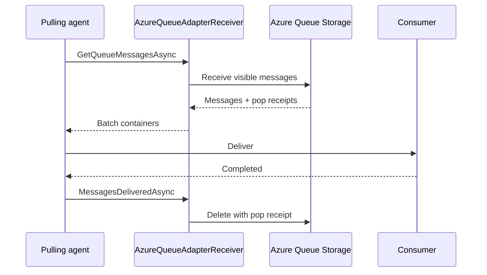

# Azure 队列流执行

[`Microsoft.Orleans.Streaming.AzureStorage`](https://www.nuget.org/packages/Microsoft.Orleans.Streaming.AzureStorage/) 套件在 Azure 队列存储处执行一个持久性流适配器。 它使用通用 [持久性流拉动结构](index.md) 和用品 Azure- 特定的队列映射、编码、接收、删除和配置行为。

## 登记证关证单 

Silo 和客户端构建器分别暴露 <xref:Orleans.Hosting.SiloBuilderExtensions.AddAzureQueueStreams*?displayProperty=nameWithType> 和 <xref:Orleans.Hosting.ClientBuilderExtensions.AddAzureQueueStreams*?displayProperty=nameWithType>。简洁的超载配置的名称是 <xref:Orleans.Configuration.AzureQueueOptions>。两种配置类型都可以替换队列数据适配器;只有 silo 配置器可以披露运行在 silos上的缓存和拉动剂组件。

应用程序可以通过配置驱动的供应商注册来提供键 <xref:Azure.Storage.Queues.QueueServiceClient> 。配置支持服务键、连接名称、连接字符串或队列服务 URI。 <xref:Orleans.Configuration.AzureQueueOptions.ConfigureQueueServiceClient*> 超载和 <xref:Orleans.Configuration.AzureQueueOptions.ClientOptions?displayProperty=nameWithType> 属性已经过时,不应在新代码中使用。

API: <xref:Orleans.Hosting.SiloBuilderExtensions.AddAzureQueueStreams*?displayProperty=nameWithType>、 <xref:Orleans.Hosting.ClientBuilderExtensions.AddAzureQueueStreams*?displayProperty=nameWithType>、 <xref:Orleans.Hosting.AzureQueueStreamProviderBuilder>和 <xref:Orleans.Configuration.AzureQueueOptions>。 履行: [silo 登记](https://github.com/dotnet/orleans/blob/main/src/Azure/Orleans.Streaming.AzureStorage/Hosting/SiloBuilderExtensions.cs)、 [由配置驱动的登记](https://github.com/dotnet/orleans/blob/main/src/Azure/Orleans.Streaming.AzureStorage/Hosting/AzureQueueStreamProviderBuilder.cs)和 [队列选项](https://github.com/dotnet/orleans/blob/main/src/Azure/Orleans.Streaming.AzureStorage/Providers/Streams/AzureQueue/AzureQueueStreamOptions.cs)。

## 适应者行为

`AzureQueueAdapter` 是读写而非可倒转的。 制作人使用 <xref:Orleans.Streams.IQueueDataAdapter`2>编码流特性、 有效载荷和请求上下文, 然后将 Azure 信件排队发送到已绘制的队列中。 接收人指定了用于交付和确认的本地序列符号 。

由于 Azure 队列存储没有显示持久的任意流偏移,所以拒绝非中继回放符。 <xref:Orleans.Providers.Streams.AzureQueue.AzureQueueDataAdapterV2> 是默认编码。版本1仍然与现有信件兼容,而不是作为新提供者首选的格式。

来源: [`AzureQueueAdapter`](https://github.com/dotnet/orleans/blob/main/src/Azure/Orleans.Streaming.AzureStorage/Providers/Streams/AzureQueue/AzureQueueAdapter.cs) 和 [`IAzureQueueDataAdapter`](https://github.com/dotnet/orleans/blob/main/src/Azure/Orleans.Streaming.AzureStorage/Providers/Streams/AzureQueue/IAzureQueueDataAdapter.cs)。

## 接收和确认

`AzureQueueAdapterReceiver` 询问 Azure 存储一次最多32个可见信息。 Azure 配置存储 [获取信件操作](https://learn.microsoft.com/rest/api/storageservices/get-messages) 暂时隐蔽了接收的信件; 它不删除它。 拉动代理解码并通过其缓存和光标交付批次。 只有报告已发送的信件才使用 [删除信件操作](https://learn.microsoft.com/rest/api/storageservices/delete-message2)移除。

在宽度队列所有权转让期间,前一个接收者使用 [更新信件信件操作](https://learn.microsoft.com/rest/api/storageservices/update-message) 使所有预发、未经确认的信息立即可见。 因此替换接收者可以在不等待可见度超时的情况下恢复发送。 证书必须授权进行此操作; 队列服务SAS包括 `u` 许可。 如果更新失败, Orleans 将释放失败登录到记录上,而 Azure 在其现有的可见度租赁到期时提供该信息。

如果接收器、代理器或 silo 失败, 完成此交接前, 可见度超时最终会过期, Azure 可以再次回复信件。 消费者必须容忍重新发送。 如果在信息处理中, 显示度将到期, 则删除可能失效, 因为流行收件已不及时 。

资料来源: [`AzureQueueAdapterReceiver`](https://github.com/dotnet/orleans/blob/main/src/Azure/Orleans.Streaming.AzureStorage/Providers/Streams/AzureQueue/AzureQueueAdapterReceiver.cs)。

## 队列绘图和默认

当 <xref:Orleans.Configuration.AzureQueueOptions.QueueNames?displayProperty=nameWithType> 不提供时, 供应商配置会从 Orleans 服务代号与提供者名中生成名称。 散列队列的绘图器默认为 8个队列。 每个所有队列在当前 silo上都有一个拖动代理和一个队列缓存 。

该供应商使用的常见的持续性流缺省是:

| 设置设置设置设置 | 默认默认 |
| --- | ---: |
| <xref:Orleans.Configuration.HashRingStreamQueueMapperOptions.TotalQueueCount?displayProperty=nameWithType> | 8 |
| <xref:Orleans.Configuration.StreamPullingAgentOptions.GetQueueMsgsTimerPeriod?displayProperty=nameWithType> | 100毫秒 |
| <xref:Orleans.Configuration.SimpleQueueCacheOptions.CacheSize?displayProperty=nameWithType> | 4 096个批货集装箱 |
| <xref:Orleans.Configuration.StreamPullingAgentOptions.MaxEventDeliveryTime?displayProperty=nameWithType> | 1分钟1分 |
| <xref:Orleans.Configuration.StreamPullingAgentOptions.StreamInactivityPeriod?displayProperty=nameWithType> | 30分钟30分钟 |

队列数量拉动平行和拥有式颗粒的边框。 更改队列名称会改变物理分隔设置, 必须作为数据迁移处理, 而不是例行调试 。

## 可见度和缓存进度 

Azure 可见度和 Orleans 缓存是不同的时钟:

- 能够再次收到未删除 Azure 信件时的可见度控制;
- 中,队列缓存控制器将拖动代理保留一组用于主动订阅光标的时间长度。

低于最坏交付情况的 <xref:Orleans.Configuration.AzureQueueOptions.MessageVisibilityTimeout?displayProperty=nameWithType> 值会增加重复接收和停止流行接收的风险。代理失败后超时延迟回收过长。选择从计量的交付延迟和故障目标中得出的数值;操作调试属于 [串流提供方指导](../../streaming/stream-providers.md)。

## 推广点和兼容点

自定义 <xref:Orleans.Streams.IQueueDataAdapter`2> 更改有效载荷编码,同时保留 Azure 运输。它保存流特性、电线合同界定的请求-通量值以及消费者使用的序列信息。在汇编实施和版本推出指南时遵循 [自定义持久性流数据格式](../../streaming/data-adapters.md) 。

配置约束行为由 [`AzureQueueStreamProviderBuilderTests`](https://github.com/dotnet/orleans/blob/main/test/Extensions/Orleans.Azure.Tests/Streaming/AzureQueueStreamProviderBuilderTests.cs)测试。适应器识别和光标行为由 [`AzureQueueAdapterTests`](https://github.com/dotnet/orleans/blob/main/test/Extensions/Orleans.Azure.Tests/Streaming/AzureQueueAdapterTests.cs)涵盖。
