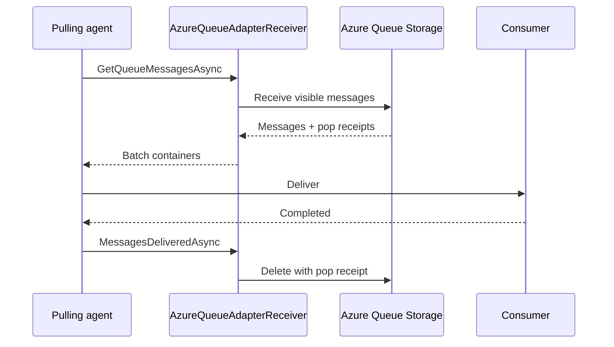

# Azure Queue 流实现

[`Microsoft.Orleans.Streaming.AzureStorage`](https://www.nuget.org/packages/Microsoft.Orleans.Streaming.AzureStorage/) 包基于 Azure Queue Storage 实现持久化流适配器。它使用通用的[持久化流拉取架构](index.md)，并提供 Azure 特定的队列映射、编码、接收、删除及配置行为。

## 注册 API 

Silo 和客户端构建器分别公开 <xref:Orleans.Hosting.SiloBuilderExtensions.AddAzureQueueStreams*?displayProperty=nameWithType> 和 <xref:Orleans.Hosting.ClientBuilderExtensions.AddAzureQueueStreams*?displayProperty=nameWithType>。简洁的重载配置命名 <xref:Orleans.Configuration.AzureQueueOptions>。两种配置器类型均可替换队列数据适配器；只有 Silo 配置器公开在 Silo 上运行的缓存和拉取代理组件。

应用程序也可以通过配置驱动的提供程序注册，提供带键的 <xref:Azure.Storage.Queues.QueueServiceClient>。配置支持服务键、连接名称、连接字符串或队列服务 URI。<xref:Orleans.Configuration.AzureQueueOptions.ConfigureQueueServiceClient*> 重载和 <xref:Orleans.Configuration.AzureQueueOptions.ClientOptions?displayProperty=nameWithType> 属性已过时，新代码不应使用它们。

API：<xref:Orleans.Hosting.SiloBuilderExtensions.AddAzureQueueStreams*?displayProperty=nameWithType>、<xref:Orleans.Hosting.ClientBuilderExtensions.AddAzureQueueStreams*?displayProperty=nameWithType>、<xref:Orleans.Hosting.AzureQueueStreamProviderBuilder> 和 <xref:Orleans.Configuration.AzureQueueOptions>。实现：[Silo 注册](https://github.com/dotnet/orleans/blob/main/src/Azure/Orleans.Streaming.AzureStorage/Hosting/SiloBuilderExtensions.cs)、[配置驱动的注册](https://github.com/dotnet/orleans/blob/main/src/Azure/Orleans.Streaming.AzureStorage/Hosting/AzureQueueStreamProviderBuilder.cs)和[队列选项](https://github.com/dotnet/orleans/blob/main/src/Azure/Orleans.Streaming.AzureStorage/Providers/Streams/AzureQueue/AzureQueueStreamOptions.cs)。

## 适配器行为

`AzureQueueAdapter` 支持读写，但不支持回溯。生产者使用 <xref:Orleans.Streams.IQueueDataAdapter`2> 对流标识、有效载荷及请求上下文进行编码，然后将 Azure Queue 消息发送到映射的队列。接收器分配用于投递和确认的本地序列令牌。

由于 Azure Queue Storage 不公开可任意定位的持久化流偏移量，因此会拒绝非 null 的回溯令牌。<xref:Orleans.Providers.Streams.AzureQueue.AzureQueueDataAdapterV2> 是默认编码。保留版本 1 是为了兼容已有消息，而非作为新提供程序的首选格式。

源码：[`AzureQueueAdapter`](https://github.com/dotnet/orleans/blob/main/src/Azure/Orleans.Streaming.AzureStorage/Providers/Streams/AzureQueue/AzureQueueAdapter.cs) 和 [`IAzureQueueDataAdapter`](https://github.com/dotnet/orleans/blob/main/src/Azure/Orleans.Streaming.AzureStorage/Providers/Streams/AzureQueue/IAzureQueueDataAdapter.cs)。

## 接收和确认

`AzureQueueAdapterReceiver` 每次向 Azure Queue Storage 请求最多 32 条可见消息。Azure Queue Storage 的[获取消息操作](https://learn.microsoft.com/rest/api/storageservices/get-messages)将收到的消息暂时设为不可见，而不是删除消息。拉取代理通过其缓存和游标解码并投递批次。只有报告为已投递的消息才会通过[删除消息操作](https://learn.microsoft.com/rest/api/storageservices/delete-message2)移除。

在队列所有权优雅移交期间，原接收器使用[更新消息操作](https://learn.microsoft.com/rest/api/storageservices/update-message)使所有预取但未确认的消息立即可见。因此，替代接收器可以恢复投递，而无需等待可见性超时。凭据必须有权执行该操作；队列服务 SAS 包含 `u` 权限。如果更新失败，Orleans 会记录释放失败，Azure 则在现有可见性租约到期时使消息重新可用。

如果接收器、代理或 Silo 在移交完成之前发生故障，可见性超时最终会到期，Azure 可以再次返回该消息。消费者必须能够容忍重新投递。如果消息仍在处理时可见性超时到期，删除操作可能因为接收回执不再有效而失败。

源码：[`AzureQueueAdapterReceiver`](https://github.com/dotnet/orleans/blob/main/src/Azure/Orleans.Streaming.AzureStorage/Providers/Streams/AzureQueue/AzureQueueAdapterReceiver.cs)。

## 队列映射及默认值

未提供 <xref:Orleans.Configuration.AzureQueueOptions.QueueNames?displayProperty=nameWithType> 时，提供程序配置根据 Orleans 服务 ID 和提供程序名称生成队列名称。哈希环队列映射器默认使用八个队列。每个已分配所有权的队列在当前 Silo 上拥有一个拉取代理和一个队列缓存。

该提供程序使用的通用持久化流默认值如下：

| 设置 | 默认值 |
| --- | ---: |
| <xref:Orleans.Configuration.HashRingStreamQueueMapperOptions.TotalQueueCount?displayProperty=nameWithType> | 8 |
| <xref:Orleans.Configuration.StreamPullingAgentOptions.GetQueueMsgsTimerPeriod?displayProperty=nameWithType> | 100 毫秒 |
| <xref:Orleans.Configuration.SimpleQueueCacheOptions.CacheSize?displayProperty=nameWithType> | 4,096 个批次容器 |
| <xref:Orleans.Configuration.StreamPullingAgentOptions.MaxEventDeliveryTime?displayProperty=nameWithType> | 1 分钟 |
| <xref:Orleans.Configuration.StreamPullingAgentOptions.StreamInactivityPeriod?displayProperty=nameWithType> | 30 分钟 |

队列数量限制拉取并行度和所有权分配粒度。更改队列名称会改变物理分区集合，必须将其作为数据迁移处理，而不是普通调优。

## 可见性与缓存进度 

Azure 可见性和 Orleans 缓存保留时间是两个独立的时间尺度：

- 可见性控制尚未删除的 Azure 消息何时可以再次接收；
- 队列缓存控制拉取代理为活动订阅游标保留批次的时长。

如果 <xref:Orleans.Configuration.AzureQueueOptions.MessageVisibilityTimeout?displayProperty=nameWithType> 的值短于最坏情况下的投递时间，会增加重复接收和接收回执失效的风险。过长的超时则会延迟代理故障后的恢复。应根据测得的投递延迟和故障恢复目标选择值；运维调优参见[流提供程序指南](../../streaming/stream-providers.md)。

## 扩展与兼容性要点

自定义 <xref:Orleans.Streams.IQueueDataAdapter`2> 可在保留 Azure 传输的同时更改有效载荷编码。它应保留流标识、传输契约定义的请求上下文值及消费者使用的序列信息。请参阅[自定义持久化流数据格式](../../streaming/data-adapters.md)，获取可编译实现及版本化发布指导。

[`AzureQueueStreamProviderBuilderTests`](https://github.com/dotnet/orleans/blob/main/test/Extensions/Orleans.Azure.Tests/Streaming/AzureQueueStreamProviderBuilderTests.cs) 测试配置绑定行为。[`AzureQueueAdapterTests`](https://github.com/dotnet/orleans/blob/main/test/Extensions/Orleans.Azure.Tests/Streaming/AzureQueueAdapterTests.cs) 覆盖适配器确认和游标行为。
