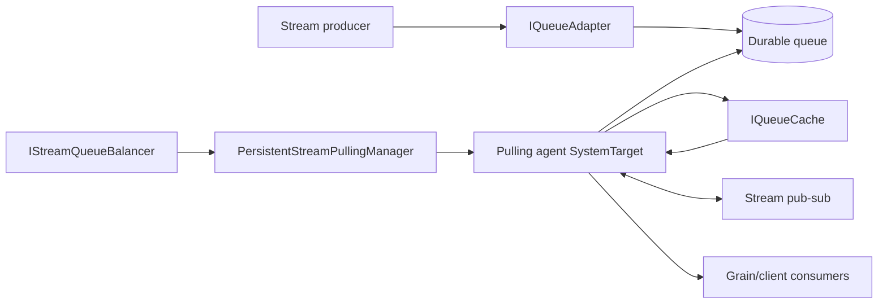
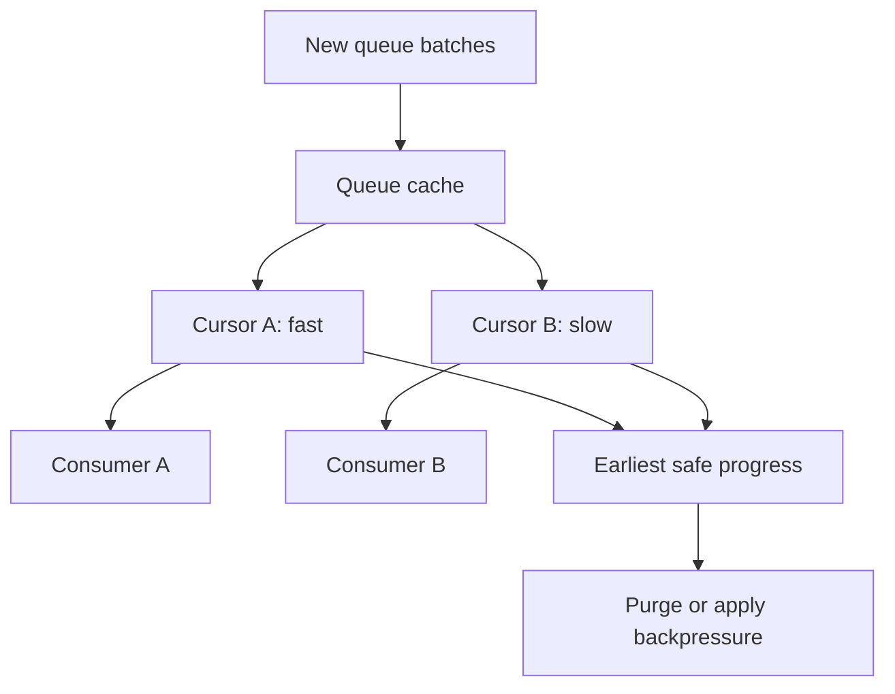

# 持久性流流拉动结构

持续流源提供者将 Orleans 流与耐久的队列技术连接。制片人通过适配器进行排队。 Silo- 本地拉动代理商拥有队列分区,阅读批量、将其缓存、发现订阅和通过普通 Orleans 电话发送事件。

本页描述运行时间机制。关于流动 API和提供者选择,请参见 [流行文档](../../streaming/index.md)。

## 提供者的组成和生命周期 

<xref:Orleans.Providers.Streams.Common.PersistentStreamProvider> is the common implementation. A provider-specific <xref:Orleans.Streams.IQueueAdapterFactory> creates:

- 用于计算和接受语义的 <xref:Orleans.Streams.IQueueAdapter> ;
- a <xref:Orleans.Streams.IStreamQueueMapper> 用于溪流至排队绘图;
- a 年 <xref:Orleans.Streams.IStreamQueueBalancer> 用于 silo 所有权;
- 用于每个试剂缓存的 <xref:Orleans.Streams.IQueueAdapterCache> ;
- 选项性故障处理器、过滤器和后端提供者。

在生命周期初始化期间,供应商解决了名为适应器厂的解决方案并创建了适应器。在活跃阶段,它启动拉动经理和启动代理商。在供应商关闭前停止代理商。

默认情况下, 拖动代理器自动启动。 明确显示 grain- 既启用基于又隐含的订阅。

API: <xref:Orleans.Providers.Streams.Common.PersistentStreamProvider>。履行: [供应商生命周期](https://github.com/dotnet/orleans/blob/main/src/Orleans.Streaming/PersistentStreams/PersistentStreamProvider.cs) 和 [服务提供选项](https://github.com/dotnet/orleans/blob/main/src/Orleans.Streaming/PersistentStreams/Options/PersistentStreamProviderOptions.cs)。

## 队列绘图和所有权 

队列映射者将指定一个串流身份到队列。 所有提供者的制片人和消费者都必须使用兼容的映射或事件可以写入没有预定代理商读取的队列 。

队列平衡器指定队列到 silos 并公布顺序所有权变更。 `PersistentStreamPullingManager` 是 a 的 silo本地系统的目标是将通知序列化,忽略陈旧的顺序,开始或停止每个自有队列中一个拉动代理。 当成员变化时,队列在管理人员之间移动;代理人本身不是虚拟的,也不迁移。

资料来源: [`PersistentStreamPullingManager`](https://github.com/dotnet/orleans/blob/main/src/Orleans.Streaming/PersistentStreams/PersistentStreamPullingManager.cs)。

## 牵引剂环 

每个 `PersistentStreamPullingAgent` 都是单行 Orleans 排程的系统目标。 它循环 :

1. 要求调适器接收器分批接收;
1. 将批量集装箱添加到队列缓存中;
1. 按流体分类的缓存物品组;
1. 解决和隐藏酒吧子公司登记;
1. 独立地为每个订阅者预发光标;
1. 通过 Orleans 信息发送事件;
1. 记录交付进展和失败;以及
1. 清除数据,但只能是缓存上说可以安全删除的数据。

默认的最大适配器批量容器批量尺寸为 1,空孔周期为 100 ms。 这些默认是运行时行为, 不是通用的输送建议 。

### 关闭和排队上传

当代理停止工作时,它关闭了新背景工作的登记并停止了投票计时器。 它等待接收器初始化、活跃的队列抽屉、接受的生产者注册、订阅握手和交付完成。 接受的工作完成了其象征性簿记和发放登记针和批量保护,而缓存和接收者仍然可以使用。 未结电话保留了其现有的短信超时和重试限制,同时接受了排水管。

代理商然后向缓存处报告最后交货进度,处置订阅光标,并关闭接收器,以便具体供应商的检查站检查完成进度。 当停止运行时尚未登记,因为其用户的位置仍然不确定,所以维持了现有的检查站。 生产者不注册后,接收者清理工作开始。 当经理重新使用代理器进行重新排列队列时,启动程序等待完全清理,并开启新运行的进入程序。

明确订阅通知立即得到确认, 而代理商则跟踪其无同步握手的完成。 这样让签名消费者能够完成当前呼叫并响应握手 。

完成握手可以建立订阅者当前光标和重放位置。 最新的握手请求拥有对账; 被取代的请求的响应保留了该所有权。 旧一代握手的交付完成和错误处理在保留替换位置的同时释放工作, 因此最后检查站的进展反映了可以接受的倒带。

失败的重新握手使订阅位置即使以前注册时也不确定。 代理保留了空闲清理中流条目,并保持现有检查站直到成功握手能够调和该位置为止。

取消订阅取消取消了飞行中握手和交付所有权,在有效所有权下发布的终端公关分公司行动完成了对订阅身份的清理,包括当光标对账与持续时间重叠时。

## 缓存和光标的变量数 

<xref:Orleans.Streams.IQueueCache> 脱钩队列读取消费者交付。 每订阅一个 <xref:Orleans.Streams.IQueueCacheCursor>, 所以慢速的消费者不会直接阻塞后一光标快速的消费者。

缓存跟踪了所有主动订阅的最早交付进度。 清除不能删除任何光标仍然需要的项目。 <xref:Orleans.Providers.Streams.Common.SimpleQueueCache> 使用压力桶来停止或减速读取, 以适应时间差的增长而不是丢弃未交付的事件。 它默认容量为 4 096 批量容器 。

缓存能力不能持久,队列仍然是持久的边界,但须符合适配者的确认合同。

## 与 Pub-sub 握手

代理器登记为每个流的生产者, 从流中公关子获取订阅记录。 它持有一个针光标, 而用户握手完成后会保持光标, 这样缓存清理无法通过请求的启动标记 。 新订阅通知更新了该代理器本地的 酒吧子缓存 。

序列牌允许可回放的调整器从支持的历史位置开始。 <xref:Orleans.Streams.IQueueAdapter.IsRewindable?displayProperty=nameWithType> 属性为 `false` 的调整器必须拒绝不支持的标记,而不是假装尊重它们。

## 交付和失败

代理通常在推进订阅光标前等待交付, 创建每个订阅的回压。 当交付失败时, 它会引用配置好的 <xref:Orleans.Streams.IStreamFailureHandler>。 根据供应商的政策, 明确的订阅会被错开或删除 。

持久性流并非完全一次性。

- 当外部队列考虑确认消息为已识别信息时;
- 适配器在接收器后或 silo 故障后能否重新投放;
- 缓冲检查站行为;
- 消费者能力;以及
- 特定供应商的序列符号 。

排队信息可以在所有权变更或失效后再次发送。 产生持久副作用的消费者应该是无能的。

## 延期合同

提供方的作者应当将责任分开:

- <xref:Orleans.Streams.IQueueAdapter> defines external queue reads/writes and rewindability.
- <xref:Orleans.Streams.IQueueAdapterReceiver> defines receive, acknowledgement, and shutdown.
- <xref:Orleans.Streams.IStreamQueueMapper> defines stable partition mapping.
- <xref:Orleans.Streams.IStreamQueueBalancer> defines cluster ownership.
- <xref:Orleans.Streams.IQueueCache> and its cursors define buffering and safe purge.
- <xref:Orleans.Streams.IStreamFailureHandler> defines delivery failure policy.

具体适应器的托管和验证模式见 [提供提供源的作者](../provider-authoring.md) ,具体适应器见 [Azure 队列流](azure-queue-streams.md) 。
