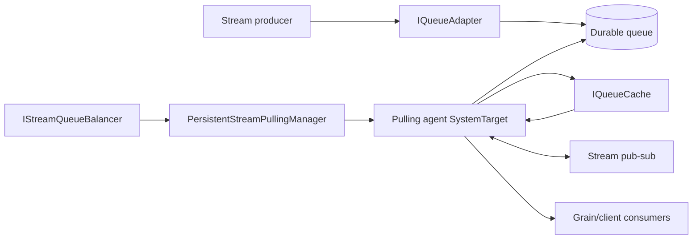
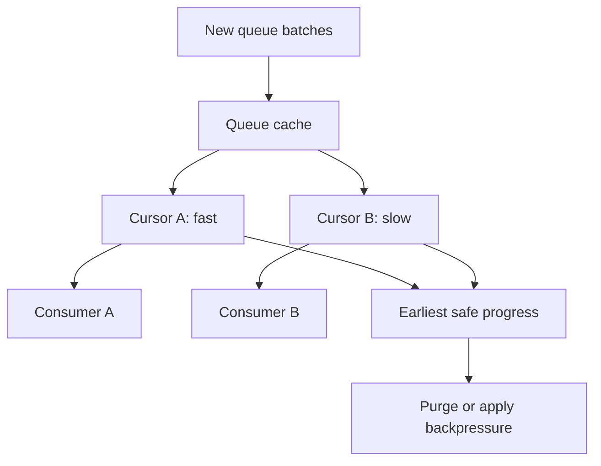

# 持久化流拉取架构

持久化流提供程序将 Orleans 流连接到持久化队列技术。生产者通过适配器入队。Silo 本地拉取代理拥有队列分区，读取批次、缓存批次、发现订阅，并通过普通 Orleans 调用投递事件。

本页描述运行时机制。有关流 API 及提供程序选择，请参阅[流式处理文档](../../streaming/index.md)。

## 提供程序组合与生命周期 

<xref:Orleans.Providers.Streams.Common.PersistentStreamProvider> 是通用实现。提供程序特定的 <xref:Orleans.Streams.IQueueAdapterFactory> 创建：

- 用于入队与接收语义的 <xref:Orleans.Streams.IQueueAdapter>；
- 用于流到队列映射的 <xref:Orleans.Streams.IStreamQueueMapper>；
- 用于 Silo 所有权分配的 <xref:Orleans.Streams.IStreamQueueBalancer>；
- 用于每个代理缓存的 <xref:Orleans.Streams.IQueueAdapterCache>；以及
- 可选的故障处理程序、筛选器及退避提供程序。

在生命周期初始化期间，提供程序解析其命名适配器工厂并创建适配器。在活动阶段，初始化拉取管理器并启动代理。关闭时，在提供程序关闭之前停止代理。

默认情况下，拉取代理自动启动。基于 Grain 的显式订阅和隐式订阅均已启用。

API：<xref:Orleans.Providers.Streams.Common.PersistentStreamProvider>。实现：[提供程序生命周期](https://github.com/dotnet/orleans/blob/main/src/Orleans.Streaming/PersistentStreams/PersistentStreamProvider.cs)和[提供程序选项](https://github.com/dotnet/orleans/blob/main/src/Orleans.Streaming/PersistentStreams/Options/PersistentStreamProviderOptions.cs)。

## 队列映射与所有权 

队列映射器以确定性的方式将流标识分配到队列。同一提供程序的所有生产者和消费者必须使用兼容的映射，否则事件可能被写入没有预期代理读取的队列。

队列均衡器将队列分配给 Silo，并发布带序号的所有权变更。`PersistentStreamPullingManager` 是 Silo 本地系统目标，串行处理这些通知、忽略过期序号，并为每个拥有的队列启动或停止一个拉取代理。成员资格变化时，队列在各管理器之间转移；代理本身并非虚拟对象，不会迁移。

源码：[`PersistentStreamPullingManager`](https://github.com/dotnet/orleans/blob/main/src/Orleans.Streaming/PersistentStreams/PersistentStreamPullingManager.cs)。

## 拉取代理循环 

每个 `PersistentStreamPullingAgent` 都是使用 Orleans 单线程调度的系统目标。其循环执行：

1. 向适配器接收器请求一个批次；
1. 将批次容器添加到队列缓存；
1. 按流对缓存项进行分组；
1. 解析并缓存发布订阅注册信息；
1. 独立推进各订阅的游标；
1. 通过 Orleans 消息传递发送事件；
1. 记录投递进度和故障；以及
1. 仅清除缓存确认可以安全移除的数据。

适配器批次容器的默认最大批量大小为 1，空轮询周期为 100 毫秒。这些默认值描述运行时行为，而不是通用吞吐量建议。

### 关闭与队列移交

代理停止时，关闭新的后台工作的准入，并停止轮询定时器。它等待接收器初始化、活动队列泵以及已接受的生产者注册、订阅握手和投递完成。在缓存和接收器仍可用时，已接受的工作完成令牌记录工作并解除注册阶段的固定保护和批次保护。已接受的工作排空期间，尚未完成的调用保留现有消息传递超时和重试上限。

随后，代理向缓存报告最终投递进度，释放订阅游标，并关闭接收器，使提供程序特定的检查点刷新能够反映已完成的进度。关闭开始时仍待处理的注册保留现有检查点，因为其订阅者位置仍不确定。生产者注销发生在接收器清理之后。当管理器为重新分配的队列复用代理时，初始化等待完整清理完成，并为新一轮运行开放准入。

显式订阅通知会立即得到确认，而代理会跟踪其异步握手直至完成。这使发起订阅的消费者能够完成当前调用并响应握手。

完成握手会确立订阅的当前游标及重放位置。最近请求的握手拥有协调修正位置的权利；已被取代的请求的响应不得破坏该所有权。较旧握手世代的投递完成和错误处理释放各自的工作，同时保留替代位置，从而使最终检查点进度反映已接受的回溯位置。

重新握手失败会使订阅位置不确定，即便该订阅此前已注册。代理在空闲清理期间保留流条目，并保留现有检查点，直到成功握手完成位置协调。

移除订阅会撤销进行中的握手及投递所有权。在有效所有权下发出的终止性发布订阅操作会完成该订阅标识的清理，包括游标协调与该操作的持久化过程重叠的情况。

## 缓存与游标不变量 

<xref:Orleans.Streams.IQueueCache> 将队列读取与消费者投递解耦。每个订阅拥有一个 <xref:Orleans.Streams.IQueueCacheCursor>，因此较慢的消费者不会直接阻塞位于后续游标位置的较快消费者。

缓存跟踪活动订阅中最早的投递进度。清除操作不得移除任何游标仍需使用的项目。<xref:Orleans.Providers.Streams.Common.SimpleQueueCache> 使用压力桶，在滞后增加时停止或减慢读取，而不是丢弃尚未投递的事件。其默认容量为 4,096 个批次容器。

缓存容量不等于持久性。持久化边界仍然是队列，并受适配器确认契约约束。

## 发布订阅握手

代理针对每个流注册为生产者，并从流发布订阅机制获得订阅记录。完成订阅握手期间，它持有一个固定游标，确保缓存清理不能越过请求的起始令牌。新的订阅通知更新代理本地发布订阅缓存。

序列令牌使可回溯适配器能够从受支持的历史位置开始。如果适配器的 <xref:Orleans.Streams.IQueueAdapter.IsRewindable?displayProperty=nameWithType> 属性为 `false`，则必须拒绝不受支持的令牌，而不是假装遵循这些令牌。

## 投递和故障语义

代理通常在推进订阅游标之前等待投递完成，从而形成每个订阅的背压。投递失败时，它调用已配置的 <xref:Orleans.Streams.IStreamFailureHandler>。根据提供程序策略，显式订阅可能被标记为故障并移除。

持久化流并不普遍提供恰好一次投递。语义取决于：

- 外部队列何时认为消息已确认；
- 适配器能否在接收器或 Silo 故障后重新投递；
- 缓存检查点行为；
- 消费者幂等性；以及
- 提供程序特定的序列令牌。

队列消息可能在所有权变化或故障后再次投递。执行持久化副作用的消费者应具有幂等性。

## 扩展契约

提供程序作者应区分以下职责：

- <xref:Orleans.Streams.IQueueAdapter> 定义外部队列读写和可回溯性。
- <xref:Orleans.Streams.IQueueAdapterReceiver> 定义接收、确认及关闭。
- <xref:Orleans.Streams.IStreamQueueMapper> 定义稳定分区映射。
- <xref:Orleans.Streams.IStreamQueueBalancer> 定义集群所有权分配。
- <xref:Orleans.Streams.IQueueCache> 及其游标定义缓冲和安全清除。
- <xref:Orleans.Streams.IStreamFailureHandler> 定义投递故障策略。

有关托管和验证模式，请参阅[提供程序开发](../provider-authoring.md)；有关具体适配器，请参阅 [Azure Queue 流](azure-queue-streams.md)。
