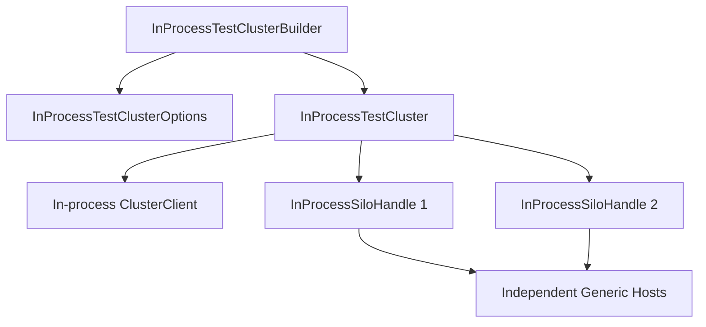

# TestingHost 结构架构

[`Microsoft.Orleans.TestingHost`](https://www.nuget.org/packages/Microsoft.Orleans.TestingHost/) 套件包含真实的 silo 和客户主机, 包括测试导向的发现、 运输、 统计、 目录和生命周期控制。 它是一种集成工具, 不是模拟的 grain 运行时间 。 Grain 启动、 时间安排、 序列化、 信息、 定位以及大多数提供者的行为, 执行的时间段与主机组相同 。

本页描述“利用内部”的图案。关于实际设置、固定模式、地形变化以及选择模型或组群的指导,请参见 [测试 Orleans 应用](../grains/testing.md)。

## 聚团对象模型 

<xref:Orleans.TestingHost.InProcessTestClusterBuilder> accumulates host, silo, and client delegates. <xref:Orleans.TestingHost.InProcessTestClusterBuilder.Build*> passes its options to an <xref:Orleans.TestingHost.InProcessTestCluster>; the cluster retains that mutable options object. <xref:Orleans.TestingHost.InProcessTestCluster.DeployAsync*> starts the configured silo hosts and initializes the client when requested. With client initialization enabled, it performs a best-effort initial membership-view check but can continue after warning that views have not stabilized. Each <xref:Orleans.TestingHost.InProcessSiloHandle> owns one Generic Host and exposes its service provider for test inspection.

过程是共享的,但主机和依赖注射容器不是。 silos生产编码不应使用静态变异状态 silo- 当地行为

API: <xref:Orleans.TestingHost.InProcessTestClusterBuilder>、 <xref:Orleans.TestingHost.InProcessTestCluster>和 <xref:Orleans.TestingHost.InProcessSiloHandle>。履行: [建筑工](https://github.com/dotnet/orleans/blob/main/src/Orleans.TestingHost/InProcTestClusterBuilder.cs)、 [组群](https://github.com/dotnet/orleans/blob/main/src/Orleans.TestingHost/InProcTestCluster.cs)和 [silo 处理器](https://github.com/dotnet/orleans/blob/main/src/Orleans.TestingHost/InProcessSiloHandle.cs)。

## 默认

<xref:Orleans.TestingHost.InProcessTestClusterBuilder> defaults to:

| 设置设置设置设置 | 默认默认 |
| --- | --- |
| <xref:Orleans.TestingHost.InProcessTestClusterOptions.InitialSilosCount?displayProperty=nameWithType> | 2 |
| <xref:Orleans.TestingHost.InProcessTestClusterOptions.ClusterId?displayProperty=nameWithType> | 新建 |
| <xref:Orleans.TestingHost.InProcessTestClusterOptions.ServiceId?displayProperty=nameWithType> | 新建生成的 GUID |
| <xref:Orleans.TestingHost.InProcessTestClusterOptions.InitializeClientOnDeploy?displayProperty=nameWithType> | `true` |
| 考试组成员 | `true` |
| 测试组 grain 目录 | `true` |
| <xref:Orleans.TestingHost.InProcessTestClusterOptions.UseDistributedGrainDirectory?displayProperty=nameWithType> | `false` |
| <xref:Orleans.TestingHost.InProcessTestClusterOptions.GatewayPerSilo?displayProperty=nameWithType> | `true` |
| <xref:Orleans.TestingHost.InProcessTestClusterOptions.UseRealEnvironmentStatistics?displayProperty=nameWithType> | `false` |
| 连接传输 | In-memory |

模拟环境统计使基于资源的测试具有决定性,但不会复制操作系统CPU或记忆压力。 只有当测试需要这些信号时,才选择将数据转换为真实统计数据。

这些缺省由 <xref:Orleans.TestingHost.InProcessTestClusterBuilder> 和 <xref:Orleans.TestingHost.InProcessTestClusterOptions>定义;见其 [建筑工](https://github.com/dotnet/orleans/blob/main/src/Orleans.TestingHost/InProcTestClusterBuilder.cs) 和 [选项](https://github.com/dotnet/orleans/blob/main/src/Orleans.TestingHost/InProcTestClusterOptions.cs) 履行情况。

### 目录选择

设置 <xref:Orleans.TestingHost.InProcessTestClusterOptions.UseDistributedGrainDirectory> 到 `true` 来选择 silo 配置代表运行后的分配默认, 替换这些代表选中的任何默认。 命名目录登记仍然可用 。

设置此选项为 `false`, 测试会籍和启用的测试 grain 目录选择共享的流程中测试目录。 如果替换不适用, 如外部成员提供商无法使用, silo 保留其配置的目录。 未配置的 silo 使用运行时分布式默认值。

要选择 `LegacyGrainDirectory`选项,设定 `false` 调和 <xref:Orleans.Hosting.CoreHostingExtensions.UseLegacyGrainDirectory*> 内 <xref:Orleans.TestingHost.InProcessTestClusterBuilder.ConfigureSilo*> 使用外部成员身份或禁用测试-指令替换。 silo 设置,由声明提供方阅读这些代表提供的配置。

## 配置层 

建筑者将三个范围区分开来:

- <xref:Orleans.TestingHost.InProcessTestClusterBuilder.ConfigureHost*> 既适用于 silo ,也适用于客户通用主机,对共享配置或有钥匙的 SDK 客户有用。
- <xref:Orleans.TestingHost.InProcessTestClusterBuilder.ConfigureSilo*> 收到每silo 选项和 <xref:Orleans.Hosting.ISiloBuilder>。
- <xref:Orleans.TestingHost.InProcessTestClusterBuilder.ConfigureClient*> 配置组客户端。

代表为每个相关东道方运行。 silo 代表注册的单吨是该 silo集装箱内的单吨,而不是整个组群,代表所捕捉的具体实例由代表分享,因为测试提供同一对象。

## 动态表层学 

<xref:Orleans.TestingHost.InProcessTestCluster.StartAdditionalSiloAsync*> 和 <xref:Orleans.TestingHost.InProcessTestCluster.StartSilosAsync*> 利用该组目前的选项和配置代表创建新的主机。 <xref:Orleans.TestingHost.InProcessTestCluster.StopSiloAsync*>、 <xref:Orleans.TestingHost.InProcessTestCluster.StopSilosAsync*>、 <xref:Orleans.TestingHost.InProcessTestCluster.StopAllSilosAsync*>、 <xref:Orleans.TestingHost.InProcessTestCluster.WaitForLivenessToStabilizeAsync*>和 <xref:Orleans.TestingHost.InProcessTestCluster.WaitForClusterManifestToStabilizeAsync*> 协调成员构成,并显示故障和弹性测试的过渡情况。

超载 `startAdditionalSiloOnNewPort` 已经过时。测试应该使用无参数 <xref:Orleans.TestingHost.InProcessTestCluster.StartAdditionalSilo*> 超载或 <xref:Orleans.TestingHost.InProcessTestCluster.StartSilosAsync*>。当测试必须提供例数或配置覆盖时,低级 <xref:Orleans.TestingHost.InProcessTestCluster.StartSiloAsync*> 超载仍然可用。

停止主机优雅的操作关闭。 不光彩的成员更新就处置或终止手柄是一种不同的失败模式, 在测试失败检测时应该故意选择 。

## 类配置测试集集和自定义 silo 创建 

<xref:Orleans.TestingHost.TestClusterBuilder> is the class-configurator-based harness. It defaults to two silos, in-memory transport, generated cluster identity, test membership, client initialization, file logging, and homogeneous-silo assumptions. It also installs `ConfigureDistributedGrainDirectory`, configuring its silos with the distributed grain directory.

<xref:Orleans.TestingHost.ISiloConfigurator>, <xref:Orleans.TestingHost.IHostConfigurator>, and <xref:Orleans.TestingHost.IClientBuilderConfigurator> are serializable configuration identities which can be applied to every host. Assigning <xref:Orleans.TestingHost.TestClusterBuilder.CreateSiloAsync?displayProperty=nameWithType> sets <xref:Orleans.TestingHost.TestClusterOptions.ConnectionTransport?displayProperty=nameWithType> to `TcpSocket`, so the built-in client uses its TCP transport instead of the harness's in-memory transport. The delegate bypasses <xref:Orleans.TestingHost.TestCluster.DefaultCreateSiloAsync*> and cannot access the harness's private in-memory transport hub, so it must configure the custom silo host with a compatible transport.

<xref:Orleans.TestingHost.TestCluster> supports suites built around <xref:Orleans.TestingHost.SiloHandle> and configurator types. It does not use separate application domains; its hosts run in-process unless a custom silo creation path provides different isolation.

API: <xref:Orleans.TestingHost.TestClusterBuilder>、 <xref:Orleans.TestingHost.TestCluster>和 <xref:Orleans.TestingHost.TestClusterOptions>。履行: [建筑工](https://github.com/dotnet/orleans/blob/main/src/Orleans.TestingHost/TestClusterBuilder.cs)、 [组群](https://github.com/dotnet/orleans/blob/main/src/Orleans.TestingHost/TestCluster.cs)和 [选项](https://github.com/dotnet/orleans/blob/main/src/Orleans.TestingHost/TestClusterOptions.cs)。

## 切分度边界 

TestingHost 故意替代基础设施。

- 模拟运输不复制插座、 TLS、 包丢失或网络缓冲;
- 成员资格测试不能证明生产成员身份提供者的交易行为;
- 测试 grain 目录可绕过生产目录边缘案例;
- 模拟统计不复制负荷叠叠;
- 一个进程共享线串库和静态状态;以及
- 优雅的停止不模拟突然过程或机器损失。

使用最小的替代方法,让变量在测试中真实存在。目录、成员资格、运输和供应商合同测试往往需要明确允许其生产成分。

## 存储库中的测试结构

仓库定着装置,如 `BaseInProcessTestClusterFixture` 包装组合和处置,而专门套件则配置正在使用的组件。例如, [`AQStreamingTests`](https://github.com/dotnet/orleans/blob/main/test/Extensions/Orleans.Azure.Tests/Streaming/AQStreamingTests.cs) 使用 `ConfigureHost`、 `ConfigureSilo`和 `ConfigureClient` 将真实的 Azure 调适器与一个在工艺 Orleans 组组合在一起。
