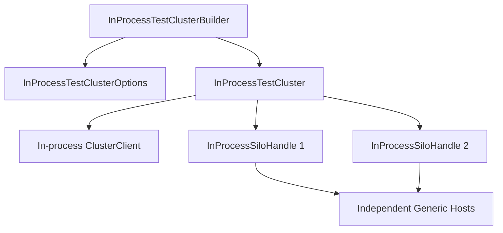

# TestingHost 架构

[`Microsoft.Orleans.TestingHost`](https://www.nuget.org/packages/Microsoft.Orleans.TestingHost/) 包将真实的 Silo 和客户端宿主与面向测试的发现、传输、统计信息、目录及生命周期控制组合起来。它是集成测试框架，而不是模拟的 Grain 运行时。Grain 激活、调度、序列化、消息传递、放置以及大多数提供程序行为，均通过与实际托管集群相同的运行时组件执行。

本页描述测试框架的内部机制。有关实际设置、测试夹具模式、拓扑变更以及如何选择模拟对象或集群，请参阅[测试 Orleans 应用程序](../grains/testing.md)。

## 集群对象模型 

<xref:Orleans.TestingHost.InProcessTestClusterBuilder> 收集宿主、Silo 和客户端委托。<xref:Orleans.TestingHost.InProcessTestClusterBuilder.Build*> 将其选项传递给 <xref:Orleans.TestingHost.InProcessTestCluster>；集群保留该可变选项对象。<xref:Orleans.TestingHost.InProcessTestCluster.DeployAsync*> 启动已配置的 Silo 宿主，并在请求时初始化客户端。启用客户端初始化后，它尽力执行初始成员资格视图检查，但在警告视图尚未稳定之后仍可继续。每个 <xref:Orleans.TestingHost.InProcessSiloHandle> 拥有一个通用宿主，并公开其服务提供程序供测试检查。

它们共享同一个进程，但不共享宿主及依赖注入容器。静态进程状态仍可能在 Silo 之间泄漏，这也是生产代码不应使用静态可变状态实现 Silo 本地行为的原因之一。

API：<xref:Orleans.TestingHost.InProcessTestClusterBuilder>、<xref:Orleans.TestingHost.InProcessTestCluster> 和 <xref:Orleans.TestingHost.InProcessSiloHandle>。实现：[构建器](https://github.com/dotnet/orleans/blob/main/src/Orleans.TestingHost/InProcTestClusterBuilder.cs)、[集群](https://github.com/dotnet/orleans/blob/main/src/Orleans.TestingHost/InProcTestCluster.cs)和 [Silo 句柄](https://github.com/dotnet/orleans/blob/main/src/Orleans.TestingHost/InProcessSiloHandle.cs)。

## 默认值

<xref:Orleans.TestingHost.InProcessTestClusterBuilder> 的默认配置如下：

| 设置 | 默认值 |
| --- | --- |
| <xref:Orleans.TestingHost.InProcessTestClusterOptions.InitialSilosCount?displayProperty=nameWithType> | 2 |
| <xref:Orleans.TestingHost.InProcessTestClusterOptions.ClusterId?displayProperty=nameWithType> | 新生成的值 |
| <xref:Orleans.TestingHost.InProcessTestClusterOptions.ServiceId?displayProperty=nameWithType> | 新生成的 GUID |
| <xref:Orleans.TestingHost.InProcessTestClusterOptions.InitializeClientOnDeploy?displayProperty=nameWithType> | `true` |
| 测试集群成员资格 | `true` |
| 测试集群 Grain 目录 | `true` |
| <xref:Orleans.TestingHost.InProcessTestClusterOptions.UseDistributedGrainDirectory?displayProperty=nameWithType> | `false` |
| <xref:Orleans.TestingHost.InProcessTestClusterOptions.GatewayPerSilo?displayProperty=nameWithType> | `true` |
| <xref:Orleans.TestingHost.InProcessTestClusterOptions.UseRealEnvironmentStatistics?displayProperty=nameWithType> | `false` |
| 连接传输 | 内存 |

模拟环境统计信息使基于资源的测试具有确定性，但不会重现操作系统的 CPU 或内存压力。仅在测试明确需要这些信号时，才主动启用真实统计信息。

这些默认值由 <xref:Orleans.TestingHost.InProcessTestClusterBuilder> 和 <xref:Orleans.TestingHost.InProcessTestClusterOptions> 定义；请参阅其[构建器](https://github.com/dotnet/orleans/blob/main/src/Orleans.TestingHost/InProcTestClusterBuilder.cs)和[选项](https://github.com/dotnet/orleans/blob/main/src/Orleans.TestingHost/InProcTestClusterOptions.cs)实现。

### 目录选择

将 <xref:Orleans.TestingHost.InProcessTestClusterOptions.UseDistributedGrainDirectory> 设置为 `true`，会在 Silo 配置委托运行后选择分布式默认目录，替换这些委托选择的任何默认目录。命名目录注册仍然可用。

此选项设置为 `false` 时，测试成员资格及启用的测试 Grain 目录会选择共享的进程内测试目录。当此替换不适用时（例如使用外部成员资格提供程序），Silo 保留其已配置目录。未配置的 Silo 使用运行时的分布式默认目录。

要选择 `LegacyGrainDirectory`，将选项设置为 `false`，并在 <xref:Orleans.TestingHost.InProcessTestClusterBuilder.ConfigureSilo*> 中调用 <xref:Orleans.Hosting.CoreHostingExtensions.UseLegacyGrainDirectory*>，同时使用外部成员资格或禁用测试目录替换。宿主配置委托在测试框架最终设置 Silo 之前运行，因此声明式提供程序读取这些委托提供的配置。

## 配置层 

构建器区分三个作用域：

- <xref:Orleans.TestingHost.InProcessTestClusterBuilder.ConfigureHost*> 适用于 Silo 和客户端通用宿主，可用于共享配置或带键 SDK 客户端。
- <xref:Orleans.TestingHost.InProcessTestClusterBuilder.ConfigureSilo*> 接收每个 Silo 的选项及一个 <xref:Orleans.Hosting.ISiloBuilder>。
- <xref:Orleans.TestingHost.InProcessTestClusterBuilder.ConfigureClient*> 配置集群客户端。

委托针对每个相关宿主运行。Silo 委托注册的单例在该 Silo 的容器内是单例，而不是整个集群内的单例。委托捕获的具体实例则会共享，因为测试提供的是同一个对象。

## 动态拓扑 

<xref:Orleans.TestingHost.InProcessTestCluster.StartAdditionalSiloAsync*> 和 <xref:Orleans.TestingHost.InProcessTestCluster.StartSilosAsync*> 使用集群当前选项和配置委托创建新宿主。<xref:Orleans.TestingHost.InProcessTestCluster.StopSiloAsync*>、<xref:Orleans.TestingHost.InProcessTestCluster.StopSilosAsync*>、<xref:Orleans.TestingHost.InProcessTestCluster.StopAllSilosAsync*>、<xref:Orleans.TestingHost.InProcessTestCluster.WaitForLivenessToStabilizeAsync*> 和 <xref:Orleans.TestingHost.InProcessTestCluster.WaitForClusterManifestToStabilizeAsync*> 协调故障及弹性测试中的成员资格与清单状态变化。

接受 `startAdditionalSiloOnNewPort` 的重载已过时。测试应使用无参数的 <xref:Orleans.TestingHost.InProcessTestCluster.StartAdditionalSilo*> 重载或 <xref:Orleans.TestingHost.InProcessTestCluster.StartSilosAsync*>。当测试必须提供实例编号或配置覆盖项时，仍可使用较底层的 <xref:Orleans.TestingHost.InProcessTestCluster.StartSiloAsync*> 重载。

优雅停止宿主可以测试关闭行为。在不进行优雅成员资格更新的情况下释放或终止句柄属于不同的故障模式，应在测试故障检测时有意选择这种方式。

## 基于配置器类的测试集群与自定义 Silo 创建 

<xref:Orleans.TestingHost.TestClusterBuilder> 是基于配置器类的测试框架。默认使用两个 Silo、内存传输、生成的集群标识、测试成员资格、客户端初始化、文件日志记录以及 Silo 同构假设。它还安装 `ConfigureDistributedGrainDirectory`，为其 Silo 配置分布式 Grain 目录。

<xref:Orleans.TestingHost.ISiloConfigurator>、<xref:Orleans.TestingHost.IHostConfigurator> 和 <xref:Orleans.TestingHost.IClientBuilderConfigurator> 是可序列化的配置标识，可应用于每个宿主。为 <xref:Orleans.TestingHost.TestClusterBuilder.CreateSiloAsync?displayProperty=nameWithType> 赋值会将 <xref:Orleans.TestingHost.TestClusterOptions.ConnectionTransport?displayProperty=nameWithType> 设置为 `TcpSocket`，因此内置客户端使用 TCP 传输，而非测试框架的内存传输。该委托绕过 <xref:Orleans.TestingHost.TestCluster.DefaultCreateSiloAsync*>，无法访问测试框架的私有内存传输中心，因此必须为自定义 Silo 宿主配置兼容的传输。

<xref:Orleans.TestingHost.TestCluster> 支持围绕 <xref:Orleans.TestingHost.SiloHandle> 和配置器类型构建的测试套件。它不使用独立应用程序域；其宿主在进程内运行，除非自定义 Silo 创建路径提供不同的隔离方式。

API：<xref:Orleans.TestingHost.TestClusterBuilder>、<xref:Orleans.TestingHost.TestCluster> 和 <xref:Orleans.TestingHost.TestClusterOptions>。实现：[构建器](https://github.com/dotnet/orleans/blob/main/src/Orleans.TestingHost/TestClusterBuilder.cs)、[集群](https://github.com/dotnet/orleans/blob/main/src/Orleans.TestingHost/TestCluster.cs)和[选项](https://github.com/dotnet/orleans/blob/main/src/Orleans.TestingHost/TestClusterOptions.cs)。

## 真实性边界 

TestingHost 有意替换基础设施。测试必须考虑这些边界：

- 内存传输不会重现套接字、TLS、丢包或网络缓冲区；
- 测试成员资格不能证明生产成员资格提供程序的事务行为；
- 测试 Grain 目录可能绕过生产目录的边界情况；
- 模拟统计信息不会重现负载削减；
- 单个进程共享线程池及静态状态；以及
- 优雅停止无法模拟进程或机器突然丢失。

在保持被测试不变量真实的前提下，采用最少的替换。目录、成员资格、传输及提供程序契约测试通常需要显式启用其生产组件。

## 仓库中的测试架构

仓库中的测试夹具（例如 `BaseInProcessTestClusterFixture`）封装集群设置与释放，而专门的测试套件配置正在测试的组件。例如，[`AQStreamingTests`](https://github.com/dotnet/orleans/blob/main/test/Extensions/Orleans.Azure.Tests/Streaming/AQStreamingTests.cs) 使用 `ConfigureHost`、`ConfigureSilo` 和 `ConfigureClient`，将真实 Azure Queue 适配器与进程内 Orleans 集群组合起来。
