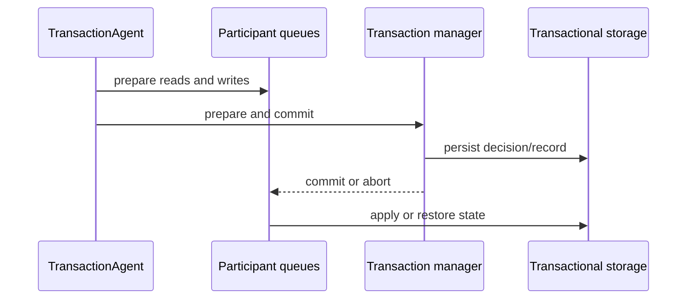

# 事务实现

Orleans 事务协调跨 Grain 的事务状态。运行时使用事务代理收集参与者并选择提交路径，使用事务管理器作出持久化决策，并在每个参与者处通过 `TransactionQueue` 对版本进行串行化处理，以及应用或恢复状态。

## 协调模型

`TransactionAgent.StartTransaction` 创建事务 ID 及因果时间戳。过载检测器在 Silo 具有安全的事务处理容量时准许启动新事务，在过载时则返回事务启动失败。当 Grain 调用访问事务资源时，事务上下文记录读写计数器，并确定事务管理器。只读事务可以直接联系资源。读写事务向其他资源发送准备消息，并请求事务管理器进行准备和提交。

事务管理器从参与者中选择；如果有明确指定的优先管理器，则优先选择它。事务代理向非管理器资源发送单向准备通知，随后等待管理器返回结果。这既减少了协调的往返次数，又保证写事务只有一个权威决策。

## 参与者队列与隔离性

`TransactionQueue` 保存事务状态的待处理事务记录、提交记录及稳定序列号。它使用访问计数器判断事务是否读取或写入了资源，在事务尚未确定结果时持有所需的锁，并按顺序应用已提交状态。因此，在管理器提交事务之前，参与者就可以拒绝存在冲突的访问。

事务存储在 Grain 持久化基础上增加队列加载、提交、还原及恢复操作。存储故障可能使事务处于已准备或结果不确定的状态，因此队列会持久化足够的信息，以便在激活或进程重启后进行恢复。

## 决策与故障行为

事务代理区分成功决策、参与者响应超时、事务管理器响应超时，以及推定中止。超时会使参与者的最终结果处于不确定状态，因为管理器可能在响应丢失前已经完成持久化提交。对于确定中止且事务代理仍负责通知的事务，代理会发送取消消息以释放参与者持有的锁。

事务管理器完成持久化本地提交时，调用方等待的事务结果即告完成。随后，管理器调度确认工作程序，以通知并收集其余参与者的确认。恢复过程根据管理器或参与者的队列记录重放待处理的提交确认及中止操作，因此在调用方收到成功结果后，仍可继续向参与者发送通知。

禁用状态的事务代理会明确拒绝事务操作。过载限流在限制排队工作量的同时返回事务启动失败。

## 激活实例关闭

正常的 Grain 停用会等待活动请求完成。事务队列还会运行后台存储周期，这些周期可能在协议请求返回后继续执行。在生命周期关闭阶段，每个队列都会发出取消信号，停止新的锁处理、存储、确认及收集周期，然后等待其存储工作程序结束。

等待存储工作程序的过程涵盖当前活动周期的持久化结果、状态更新、恢复及批处理后续回调。其等待预算来自生命周期取消令牌，该令牌反映宿主取消及配置的 Grain 停用超时。取消会结束等待，但已经启动的存储操作仍保留处理其结果的执行路径。

确认及收集通过队列的关闭信号停止。持久化的提交及准备记录使后续激活实例能够继续处理尚未完成的协议工作。队列同时参与状态设置阶段的清理以及最终生命周期阶段，因此正常关闭和仅部分完成的激活均能停止后台处理。

## 权衡与边界

相比低延迟，该协议更注重可串行化的状态转换及恢复能力。只读工作采用直接访问资源的路径，而写事务承担协调及持久化记录的开销。事务原子性仅涵盖已注册的事务资源；应用程序必须另行协调或补偿外部副作用。

有关应用程序使用指导，请参阅[事务](../grains/transactions.md)。在评估存储提供程序的恢复行为时，其实现及故障注入测试是有价值的源码依据。

源码：[`TransactionAgent`](https://github.com/dotnet/orleans/blob/main/src/Orleans.Transactions/DistributedTM/TransactionAgent.cs)、[`TransactionManager`](https://github.com/dotnet/orleans/blob/main/src/Orleans.Transactions/State/TransactionManager.cs) 和 [`TransactionQueue`](https://github.com/dotnet/orleans/blob/main/src/Orleans.Transactions/State/TransactionQueue.cs)。
