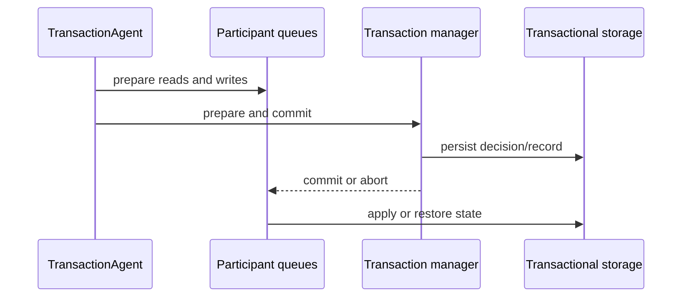

# 交易交易执行

Orleans 交易协调整个 grains的交易状态。运行时间使用交易代理来收集参与者并选择承诺路径,使用交易管理人作出持久决定,使用每个参与者的 `TransactionQueue` 进行序列化和适用或恢复状态。

## 协调模式

`TransactionAgent.StartTransaction` 创建交易标识和因果时间戳。当 silo 具有安全的交易能力并返回在超载情况下的启动失败时,过量检测器会接受新的交易。由于 grain 呼叫访问交易资源,交易背景记录读写计数并识别管理器。只读交易可以直接联系资源。阅读-文字交易将信息发送到其他资源,并要求管理员准备和进行承诺。

经理从参与者中挑选,由明确的优先主管优先负责。代理将单向准备通知发送给非管理资源,然后等待管理人员的结果。这减少了协调往返旅行,同时保留了写作交易的权威性决定。

## 参与者排队和隔离

`TransactionQueue` 保存待决交易记录、 承诺记录和交易状态的稳定序列。 它使用访问对账来确定交易是否读写资源, 在交易未解决时持有所需的锁, 并按顺序应用承诺状态。 因此参与者可以在经理实施前拒绝有冲突的访问。

交易存储延展 grain 耐久性, 包括队列负荷、 承诺、 恢复和回收操作。 存储失败可能会使交易处于准备状态或不确定状态, 因此队列会持续足够的信息, 以便在激活后或进程重新启动后恢复 。

## 决定和失败行为

代理商区分成功的决定、参与人反应超时、交易管理者反应超时和推定的中止。 超时让参与者产生不确定的结果,因为经理在失去回应之前可能已经做出了长期承诺。 对于特定中止,如果代理人保留通知所有权,它会发送取消信息以释放参与人锁。

经理的持久本地承诺完成调用人的交易承诺,然后安排确认工作人员通知和收集其余参与者。 恢复工作将重播,等待确认承诺书的兑现以及管理人员或参与人队列记录中的中止,这样在调用人获得成功后,可以继续发出参与人通知。

禁用代理器明确拒绝交易操作。 超载减速返回交易启动失败, 而将队列工作捆绑在一起 。

## 停止启动

正常 grain 取消退出会等待主动请求完成。 交易队列也会运行背景存储周期, 在协议请求返回后可以继续。 在生命周期关闭期间, 每一个队列信号都取消以停止新的锁、 储存、 确认和收集周期, 然后等待其存储工人完成 。

存储等待包含当前周期的持久性结果、状态更新、恢复和批次后续回馈。 其预算来自生命周期取消符号,这反映了主机取消和配置的 grain 停止运行超时。 取消结束等待而已经启动的存储操作保留了结果处理路径 。

校验和收藏停止在队列关闭信号中进行。 永久承诺并准备记录让随后的激活恢复未解决的协议工作。 队列既参与州立设置清理,也参加最终生命周期阶段, 以便正常关闭并部分完成停止背景处理的启动。

## 权衡取舍和边界

协议支持可以连串转换和复原而不是低潜伏状态。 只读工作使用直接资源路径,而写交易支付协调和耐久记录的费用。 交易原本涵盖已登记的交易资源;应用程序单独协调或补偿外部副作用。

应用指导属于 [交易交易](../grains/transactions.md)。在评价储存提供者的回收行为时,提供方实施和错误注射测试是有用的来源当局。

来源: [`TransactionAgent`](https://github.com/dotnet/orleans/blob/main/src/Orleans.Transactions/DistributedTM/TransactionAgent.cs)、 [`TransactionManager`](https://github.com/dotnet/orleans/blob/main/src/Orleans.Transactions/State/TransactionManager.cs)和 [`TransactionQueue`](https://github.com/dotnet/orleans/blob/main/src/Orleans.Transactions/State/TransactionQueue.cs)。
