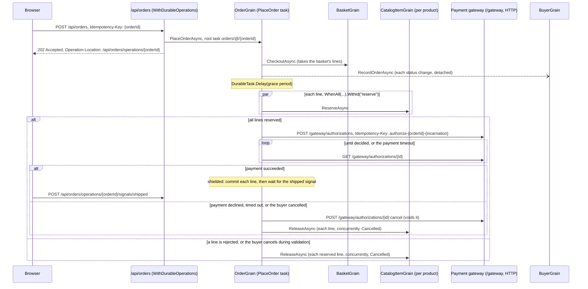

<a id="durable-order-processing-playground"></a>

# 持久化订单处理实验项目

使用 Orleans Durable Tasks 重构的[订单处理实验项目](../OrderProcessing/README.md)，通过
`Microsoft.Orleans.Durable.Http` 提供 HTTP 服务。每个订单的工作流是其订单 Grain 上的一个持久化任务，
浏览器将其作为持久化 HTTP 操作启动、观察、取消及发货。幂等性贯穿端到端流程：从
浏览器结账，经订单工作流，到模拟的外部支付网关。

```bash
dotnet run --project playground/DurableOrderProcessing
```

打开 `http://localhost:5000` 浏览商品目录、填充购物篮、结账并观察订单进度。Orleans
仪表板位于 `/dashboard`，`DurableOrderProcessing.http` 演示 API 的使用。

<a id="flow"></a>

## 流程



`OrderGrain.PlaceOrderAsync` 按上图从上到下阅读。Grain 之间的每个箭头都是持久化调用：
即返回 `DurableTask` 或 `DurableTask<T>` 的 Grain 方法。工作流通过
`WithId` 在稳定的子 ID 下等待各调用，具名 `WhenAll` 为其输入分配下属 ID，例如 `reserve/0` 和 `reserve/1`。
订单的状态就是其历史记录，即名为 `history` 的 `IDurableLog<OrderDetails>`，其中的条目是订单
及库存明细的完整快照。工作流将当前快照保存在局部变量中，并将各状态转换计算为
请求、已记录结果以及 `DurableTask.Current.UtcNow` 的纯函数，例如 `order = order.MarkPaid()`。
随后在以转换命名的已记录效果 `DurableTask.RunInline("paid", () => _history.Append(order))` 中追加快照：
无论工作流采取何种路径，每次转换的效果只追加一次，条目与该效果的记录随工作流的下一次
日志写入一同提交。重放返回已记录的序列号，不会再次追加，因此历史中各版本均只出现一次，
且保持顺序。

工作流的第一步通过 `basket.CheckoutAsync(orderId).WithId("checkout")` 获取购物篮的明细：购物篮
清空自身并返回明细，这些变更与调用结果一同提交。运行时对该订单任务仅执行此调用一次，
因此重放或重试的工作流读取相同的明细。空购物篮会使工作流失败，其
操作报告错误 `Rejected: The basket is empty.`。

订单支付之前，取消其操作会取消工作流。下一次持久化操作抛出
`OperationCanceledException`，因此验证或支付期间到达的取消也会被观察到。工作流
在已请求支付授权的情况下撤销网关授权，在受取消屏蔽的 `WhenAll` 中并发释放各明细，随后
追加 `Cancelled` 快照，其中携带 `DurableTask.Current.TaskCancellationReason`。已完成的预留
在取消后仍正常返回，因此工作流通过
`DurableTask.RunInline("cancellation-check", ...)` 记录取消是否在授权支付之前到达，已取消的订单不会访问网关。库存不足被拒绝、支付遭拒、
支付超时及支付故障都执行同样的补偿。已支付订单屏蔽明细提交以及
对 `shipped` 信号的等待 `await Shipped.WaitAsync().Shielded()`，因此无论支付后是否收到取消，
订单都会发货。

每个商品目录 Grain 按订单 ID 保留预留结果，独立于任务保留期。重复预留
会返回其已记录结果，即使已经释放或提交也是如此；同一订单指定不同数量则会发生冲突。
提交或释放仅移除活动预留一次，因此重复执行工作流不会改变商品库存总量的正确性。

<a id="idempotency-end-to-end"></a>

## 端到端幂等性

各层均为其请求命名，因此各层重试会访问首次尝试所启动的工作。

| 层 | 标识 | 重试方 |
| --- | --- | --- |
| 浏览器到 API | 结账的 `Idempotency-Key`，由浏览器为每次结账生成并持久化，直至服务器确认。该键就是订单 ID。 | 网络故障后的辅助模块；再次点击的买家；刷新后的页面。 |
| API 到订单 | 操作键 `orders/@/{orderId}`：作用域、匿名调用方的作用域及订单 ID。它是订单 Grain 上工作流的根任务 ID。 | 任何具有相同键的请求，均访问同一个工作流。将该键复用于其他工作（例如另一终结点的调用）的请求收到 `422`。 |
| 工作流到 Grain | 根 ID 下的子任务 ID，例如 `checkout`、`reserve/0` 及 `release/1`。 | 停用或故障后的重放，读取已记录结果。 |
| 工作流到网关 | 授权的 `Idempotency-Key` 为 `authorize-{orderId}-{incarnation}`，标识订单及工作流本次运行 `DurableTask.Current.Incarnation`，因此未获知授权位置的工作流（例如响应丢失后）仍可再次访问该授权并将其撤销。其他非安全请求（例如撤销）携带由 `IDurableHttpClient` 根据服务、订单 Grain、步骤任务 ID 及工作流本次运行派生的键。 | 位于键处理程序之后的支付客户端弹性处理程序，以及发生故障后的步骤本身。 |
| 信号 | 发货 ID，由浏览器按每个发货意图持久化。 | 具有相同值的重复信号会成功；其他值返回 `409`。 |

`POST /api/orders` 要求其 `Idempotency-Key` 是小写 UUID，该 UUID 成为订单 ID，因此每个针对同一订单的请求
都标识同一操作。Nexus 服务 `orders.v1` 共享 `orders` 作用域，其
`Nexus-Request-Id` 即订单 ID，因此 Temporal 工作流通过 Nexus 下单所对应的操作，与
`/api/orders/operations/{orderId}` 上的操作相同。

以下指南详细描述各层：
[从业务标识派生根 ID](../../docs/site/src/content/docs/grains/durable-tasks-identity.md#derive-references-from-business-identity)、
[从任务派生幂等键](../../docs/site/src/content/docs/grains/durable-tasks-idempotency.md#derive-idempotency-keys-from-the-task)、
[使用幂等键调用支付 API](../../docs/site/src/content/docs/grains/durable-tasks-integrations.md#call-a-payment-api-with-an-idempotency-key)，
以及[选择重试位置](../../docs/site/src/content/docs/grains/durable-tasks-integrations.md#choose-where-to-retry)。

<a id="the-payment-gateway"></a>

### 支付网关

`PaymentGateway` 是模拟的外部服务，订单工作流通过名为 `payments` 的键控
`IDurableHttpClient` 经 HTTP 调用它。它像 Stripe 一样遵循 `Idempotency-Key`：将各键与请求一同记录，
重试时返回首次响应并标记 `Idempotent-Replayed: true`，对于将键复用于不同正文的请求返回
`422 Unprocessable Content`，并且要求提供键。授权异步完成：网关响应
`202 Accepted`，带有 `Operation-Location` 状态监视器，工作流在网关指定的 `Retry-After` 后轮询它，
`POST {monitor}:cancel` 撤销授权。`GET /gateway/authorizations` 列出各授权及访问该授权的请求次数，
页面展示这些数据。[调用 HTTP 服务并等待长时间运行的操作](../../docs/site/src/content/docs/grains/durable-tasks-integrations.md#call-an-http-service-and-wait-for-a-long-running-operation)
描述了这一模式。

| 卡号末尾 | 网关行为 |
| --- | --- |
| `0002` | 拒绝支付；订单取消，原因是 `The card was declined.`。 |
| `0003` | 永不作出决定；订单的支付在 `Ordering:PaymentTimeout` 后超时，工作流撤销授权。 |
| `0004` | 针对某键的首次响应直接断开连接；弹性处理程序使用同一个键重试，账本显示两次请求产生一次授权。 |
| `0005` | 服务不可用，返回 `503 Service Unavailable`；弹性处理程序的重试全部失败后，订单取消，原因是 `Payment authorization failed.`。 |
| 其他 | 半秒后批准支付。 |

<a id="the-browser-helper"></a>

### 浏览器辅助模块

`wwwroot/js/durable-operations.js` 是页面导入的无依赖 ES 模块。它将意图及
运行中的操作持久化在 `sessionStorage` 中，因此刷新当前标签页后仍可恢复：

| 成员 | 行为 |
| --- | --- |
| `new DurableOperations({ storage, prefix, retryDelays, wait })` | 创建辅助模块。`retryDelays` 为网络错误导致请求失败时各次重试前的延迟；`wait` 为长轮询请求服务器等待的秒数。 |
| `start(intent, build, { headers, wait })` | 启动意图的操作。复用意图已持久化的键及请求，或根据新键构建请求、持久化请求并携带 `Idempotency-Key` 发送，对网络故障执行重试。服务器响应后忘记该意图，并通过 `Operation-Location` 观察运行中的操作。返回 `{ key, location, operation, result, data }`。 |
| `resume()` | 使用原有键重新发送服务器尚未确认的启动请求，例如启动期间发生刷新后的情况。 |
| `observe(location, { onStatus, signal })` | 观察操作的服务器发送事件，直至操作进入终态；事件不可用时使用 `Prefer: wait` 进行长轮询，随后停止观察。 |
| `get(location, { wait })`、`cancel(location, reason)`、`signal(location, name, value)` | 读取、取消操作及向操作发送信号。 |
| `key(intent)`、`forget(intent)` | 获取或创建以及忘记意图的持久化键，例如发货 ID。 |
| `pending()`、`watching()` | 列出未确认的启动请求及运行中的操作。 |

<a id="see-it"></a>

### 实际观察

- **双击：** 填充购物篮并点击 Checkout 两次。两次请求携带同一个结账键，Orders 和
  Payment gateway 面板显示一个订单和一次授权。
- **响应丢失：** 勾选 *Lose the checkout's first response* 并结账。服务器创建订单，随后在
  `Simulate-Lost-Response` 标头的作用下重置连接。辅助模块使用同一个键重试，收到相同的
  订单。
- **结账途中刷新：** 在结账待处理或运行时刷新。Operations 面板列出待处理的启动请求，
  页面使用原键重新发送该请求，并重新观察运行中的订单。
- **网关网络重试：** 使用卡号末尾为 `0004` 的卡结账。Payment gateway 面板显示两次请求产生
  一次授权。
- **重复发货：** 点击 Ship 两次。两个信号均携带发货 ID，订单仅发货一次。

`test/DurableOrderProcessing.Tests` 针对实验项目 API 断言以下结果：使用同一个键的并发和重试
结账只创建一个订单及一次支付授权；响应丢失的支付请求仅授权
一次；网关按键去重；支付期间取消会撤销授权并释放库存；
已支付订单在取消请求后仍发货；网关支付故障会取消订单；在
宽限期内及支付后停用的订单，每个快照只追加一次、授权只执行一次；Nexus
请求及使用同一个 ID 的结账访问同一个订单。

<a id="observe-an-order"></a>

## 观察订单

订单操作报告自身状态：`GET /api/orders/operations/{orderId}` 返回状态监视器，并
使用 `Prefer: wait=N` 进行长轮询；`GET /api/orders/operations/{orderId}/events` 将状态作为服务器发送
事件进行流式传输，直至订单发货或取消，操作随之以订单的 `OrderResult` 完成。

订单历史报告各版本：`IOrderGrain.WatchAsync` 从订单提交时开始，流式传输已提交的历史。
它在已提交模式下使用 `ReadAsync` 读取日志，在各快照持久化后产出该快照，并在
`Shipped` 或 `Cancelled` 快照后结束。`GET /api/orders/{orderId}/events` 将流作为服务器发送事件提供，
每个快照对应一行 `data:`。订单停用后，终结点观察下一个激活实例，并跳过
已投递的快照，因此客户端按顺序且仅一次收到各版本。页面的订单历史使用
此终结点上的 `EventSource`；商品目录、购物篮、订单列表及网关账本采用轮询。

```bash
curl -N http://localhost:5000/api/orders/{orderId}/events
```

<a id="endpoints"></a>

## 终结点

- `GET /api/catalog`、`GET /api/buyers/{buyerId}/basket`、`PUT /api/buyers/{buyerId}/basket/{productId}` 及
  `GET /api/buyers/{buyerId}/orders` 提供商品目录、购物篮及买家的订单。
- `POST /api/orders` 将买家的购物篮结账为其 `Idempotency-Key` 标识的订单，并返回
  `202 Accepted` 以及订单操作。`Operation-Callback` 标头注册 Webhook，订单完成后 Silo 会将其
  投递到 `/api/webhooks/orders`，并进行持久化重试。
- `GET /api/orders/operations/{orderId}`、`GET .../events`、`POST .../{orderId}:cancel` 及
  `POST .../signals/shipped` 提供订单操作，由 `WithDurableOperations("orders")` 映射。
- `GET /api/orders/{orderId}` 和 `GET /api/orders/{orderId}/events` 提供订单的最新快照和历史。
- `POST /api/orders/{orderId}/deactivate` 停用订单，使其下一次激活重放待处理的工作流。
- `POST /nexus/orders.v1/place-order` 通过 Nexus 协议创建订单。
- `/gateway/authorizations` 是模拟支付网关。

<a id="compare-with-orderprocessing"></a>

## 与 OrderProcessing 比较

| 步骤 | OrderProcessing（Messaging） | DurableOrderProcessing（Durable Tasks） |
| --- | --- | --- |
| 结账 | 购物篮在一次日志写入中将 `SubmitOrder` 暂存到发件箱并清空自身。 | `POST /api/orders` 将 `PlaceOrderAsync` 启动为结账的 `Idempotency-Key` 所标识的操作，工作流第一步获取购物篮明细。重试结账会访问相同订单。 |
| 宽限期 | 订单使用 `Envelope.DeliverAt` 向自身发送 `GracePeriodElapsed`；除非订单仍为 `Submitted`，否则处理程序忽略它。 | `await DurableTask.Delay(gracePeriod).WithId("grace-period")`。运行时发送同类定时自发消息。 |
| 取消 | `CancelAsync` 取消处于 `Submitted` 或 `AwaitingValidation` 的订单；迟到的库存确认会释放其预留。 | 在订单支付前，`POST /api/orders/operations/{orderId}:cancel` 请求以买家原因持久化取消工作流。验证期间，`WhenAll` 等待各预留的结果确定，然后抛出 `OperationCanceledException`，因此工作流能够在确认没有预留仍在运行的情况下进行补偿。 |
| 预留扇出 | 每个明细一条 `ReserveStock` 消息；`StockResult` 回复可以任意顺序到达，处理程序跟踪各明细。 | `await lines.Select(...ReserveAsync...).WhenAll().WithId("reserve")` 为每个明细并发调度一次调用，作为 `reserve/0`、`reserve/1` 等子任务，并按明细顺序返回各结果。 |
| 支付 | `AuthorizePayment` 及 `PaymentResult` 回复，通过消息 ID 关联。 | 工作流通过 HTTP 使用 `IDurableHttpClient.StartOperationAsync` 在网关启动以订单为键的授权，并通过 `WaitForOperationAsync(...).WaitAsync(paymentTimeout).WithId("await-payment")` 轮询授权。超时或取消会撤销授权。 |
| 发货 | `ShipAsync` 将 `Paid` 订单转换为 `Shipped`。 | `POST /api/orders/operations/{orderId}/signals/shipped` 投递 `shipped` 信号，已支付工作流通过受屏蔽的等待操作等待它。任务记录首次发货，因此重复信号成功，其他信号返回 `409`。 |
| 补偿 | 取消订单的转换为每个已确认明细暂存 `ReleaseStock`。 | 内联并受取消屏蔽，补偿在结束工作流的取消之后运行至完成：先撤销授权，然后通过 `lines.Select(...ReleaseAsync...).WhenAll().WithId("release").Shielded()` 并发释放明细。 |
| 投影 | `StatusChanged` 消息携带版本；买家保留最高版本。 | 工作流为每个版本投递一次 `RecordOrderAsync` 调用作为分离任务，`.WithId($"record-{transition}").Detached().Post()`，其根 ID 从订单 Grain、工作流 ID 和转换派生。更新随工作流的下一次日志写入提交，并独立于工作流运行。买家保留最高版本。 |
| 幂等性 | 消息 ID 派生自订单 ID，例如 `orders/{orderId}/stock/{productId}`；各收件箱仅处理每个消息 ID 一次。 | 结账的 `Idempotency-Key` 标识订单及其工作流，下属任务 ID 标识各步骤，网关的 `Idempotency-Key` 标识订单授权，详见[端到端幂等性](#idempotency-end-to-end)。 |
| 恢复 | 收件箱和发件箱恢复待处理消息；各处理程序从当前状态开始运行。 | 下一激活实例从头重放待处理任务；已完成的子任务和已记录效果返回已记录结果，因此工作流从停止位置继续，历史记录每个版本一次。延迟到期或完成通知到达时，Durable Jobs 唤醒订单。 |
| 可观测性 | 订单状态及仪表板。 | 支持长轮询及服务器发送事件的订单操作、作为服务器发送事件流的订单历史，以及仪表板。 |
| 非空代码行数 | Grain 414、契约 112、主机 49。 | Grain 315、契约 133、主机 229，包括 HTTP API、Nexus 服务和诊断终结点；模拟网关另增加 139 行。 |

<a id="configuration"></a>

## 配置

`appsettings.json` 中的 `Ordering:GracePeriod` 设置库存验证之前的延迟，`Ordering:PaymentTimeout` 限制
支付授权时间，`Ordering:PaymentPollInterval` 设置未公布
`Retry-After` 的授权轮询间隔。`Payments:BaseAddress` 定位由本应用提供的网关。修改后的设置适用于新
订单；重放的延迟保留其已记录到期时间。日志及 Durable Jobs 使用易失性内存存储，
日志化状态使用 JSON 日志格式及源生成的 `DurableOrderProcessingJsonContext`；持久化任务
参数和结果使用 Orleans 序列化器。
