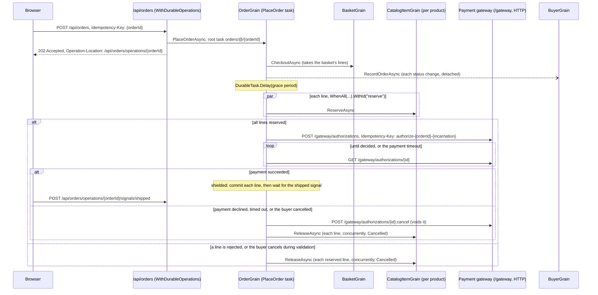

<a id="durable-order-processing-playground"></a>

# 持久秩序处理操场

下 [运动场处理命令](../OrderProcessing/README.md) 重建 Orleans 长期任务,并服务于
HTTP 和 `Microsoft.Orleans.Durable.Http`每个订单的工作流程都是其顺序上的一项持久任务 grain, 其中
浏览器启动、观察、取消和船舶,作为耐久 HTTP 操作。
浏览器通过订单工作流程向模拟外部支付网关检出。

```bash
dotnet run --project playground/DurableOrderProcessing
```

打开 `http://localhost:5000` 以浏览目录、填满篮子、检查和观察订单进度。 Orleans
仪表板位于 `/dashboard`, `DurableOrderProcessing.http` 穿过 API。

<a id="flow"></a>

## 流动



`OrderGrain.PlaceOrderAsync` 读取自上至下, 与以上流一样。 grains 之间的箭头都是耐久调用: a
grain 返回的方法 `DurableTask` 或 `DurableTask<T>`工作流量等待每个在稳定儿童身份证下发出的
`WithId`,并命名 `WhenAll` 输入ID在它自己的下面,例如 `reserve/0` 和 `reserve/1`.
秩序的状态是它的历史, `IDurableLog<OrderDetails>` 命名 `history` 条目为《公约》
流程将当前快照保留在一个本地变量中,并将每个过渡时间计算为
请求的纯函数、记录的结果和 `DurableTask.Current.UtcNow`,例如 `order = order.MarkPaid()`。
然后以记录效果 `DurableTask.RunInline("paid", () => _history.Append(order))`作为快照,并按其命名。
过渡:每次转换时,效果附加一次效果附件,无论工作流程走哪条路径,条目和效果记录与下一个工作流程一起承诺
日记写。 重放返回了录入的序列, 不附加附件, 所以历史将每个版本都保存一次,
顺序顺序。

工作流程的第一步是用 `basket.CheckoutAsync(orderId).WithId("checkout")`篮子线:篮子
运行时间运行一次
命令的任务, 所以重放或重新审取的工作流程会读出相同的行。 一个空篮子会让工作流量和它的
运行中报告错误 `Rejected: The basket is empty.`

命令支付之前,取消其操作取消时会取消工作流程。下一次持久操作将启动
`OperationCanceledException`,因此在审定或付款期间收到的注销也需遵守。
一旦工作流程要求一个, 就会在网关上取消付款授权, 然后将每一行同时释放到一个屏蔽 `WhenAll`中, 然后
附加 `Cancelled` 快照,该快照带有 `DurableTask.Current.TaskCancellationReason`。
取消后通常返回,因此工作流程记录在批准取消前是否已经实现
支付,与 `DurableTask.RunInline("cancellation-check", ...)`,和取消订单没有到达网关。拒绝的股票,拒绝的付款,
支付期过长,付款失败的付款与赔偿相同。
等待其 `shipped` 信号, `await Shipped.WaitAsync().Shielded()`,以便它不论是否取消都能够挂船
付款后到达。

每一目录 grain 都保留保留保留结果,按顺序编号,与任务保留无关。
返回记录的结果,包括释放或实施后的结果,以及该命令冲突的不同数量。
承诺或释放一次就取消了主动保留,因此重复的工作流程保存产品库存总量。

<a id="idempotency-end-to-end"></a>

## 结束对口

每个层都列出请求, 所以每个层的重试 到达了第一次尝试开始的工作。

| 层层 | 身份特征 | 由 |
| --- | --- | --- |
| 浏览器到 API | 检查退出 `Idempotency-Key`,浏览器每次检查退出都会生成该检查,并持续到服务器确认为止。关键是订单的ID。 | 网络故障后,帮助者;买方再次点击;页面刷新后。 |
| API 顺序顺序 | 操作密钥 `orders/@/{orderId}`:范围、匿名打电话者的范围和命令的代号。它是命令 grain上的工作流程根任务编号。 | 任何带有相同键的要求,只要达到相同的工作流程。重用其他工作(如另一个端点呼叫)的钥匙的请求,会收到 `422`。 |
| 流向 grains 的工作流程  | 儿童任务标识,如根底以下的 `checkout`、 `reserve/0`和 `release/1`。 | 读取记录的结果后,在停用或失灵之后重播。 |
| 向网关的工作流程 | 授权 `Idempotency-Key`、 `authorize-{orderId}-{incarnation}`, 指定了命令和工作流程运行, `DurableTask.Current.Incarnation`, 因此一个没有了解授权地点的工作流程, 如在回复失败后, 再次到达它以撤销它。 其他不安全的请求, 如空虚, 包含来自服务 `IDurableHttpClient` 的密钥, 命令 grain、 步骤任务编号以及工作流程运行 。 | 付款客户的复原力处理器,它跟随关键处理器,该步骤本身在失败后。 |
| 信号 | 船运的身份证 浏览器按船意图维持 | 重复信号,其值相等,并成功;另一个数值返回 `409`。 |

`POST /api/orders` 要求其 `Idempotency-Key` 必须是小写UUUID,成为订单的编号,因此每个请求
命令中指定相同操作的顺序名称。 Nexus 服务 `orders.v1` 共享 `orders` 范围, 及其
`Nexus-Request-Id` 是订单的 ID, 所以时间工作流程通过 Nexus 设置的命令就是同一个操作
年 `/api/orders/operations/{orderId}`.

指南对每一层作了深度描述:
[从商业身份中产生根身份](../../docs/site/src/content/docs/grains/durable-tasks-identity.md#derive-references-from-business-identity),
[产生任务中的应急关键](../../docs/site/src/content/docs/grains/durable-tasks-idempotency.md#derive-idempotency-keys-from-the-task),
[使用应急键调用付款 API](../../docs/site/src/content/docs/grains/durable-tasks-integrations.md#call-a-payment-api-with-an-idempotency-key),
和 [选择要在哪里重新尝试](../../docs/site/src/content/docs/grains/durable-tasks-integrations.md#choose-where-to-retry)。

<a id="the-payment-gateway"></a>

### 付款网关

`PaymentGateway` 是一个模拟的外部服务服务,订单工作流程通过键盘连接到 HTTP
`IDurableHttpClient` 命名 `payments`。它像条形一样荣誉 `Idempotency-Key` :它记录了每个钥匙及其请求,
重新尝试一个复答,第一个响应标记 `Idempotent-Replayed: true`,拒绝用另一个机构再使用的密钥
`422 Unprocessable Content`,并且需要一个密钥。授权自动完成:网关答案
`202 Accepted` 和 A 相 `Operation-Location` 状态监视器, 显示网关后的工作流量调查 `Retry-After`,
和 `POST {monitor}:cancel` 空了它。 `GET /gateway/authorizations` 每项授权清单,以及请求数目
所显示的。 [呼叫 HTTP 服务,等待长期操作](../../docs/site/src/content/docs/grains/durable-tasks-integrations.md#call-an-http-service-and-wait-for-a-long-running-operation)
描述图案。

| 结卡卡 | 网关行为 |
| --- | --- |
| `0002` | 拒绝付款; 命令以 `The card was declined.` 取消  |
| `0003` | 永不决定;命令的支付时间在 `Ordering:PaymentTimeout`之后到期,工作流程取消授权。 |
| `0004` | 放弃连接,而不是对钥匙作出第一次响应;复原力处理者用同一个键进行重试,分类账显示两个请求的1项授权。 |
| `0005` | 无法提供, 回答 `503 Service Unavailable`; 一旦复原力处理器的回调失败, 命令将用 `Payment authorization failed.` 取消  |
| 任何其他 | 半秒钟后批准付款。 |

<a id="the-browser-helper"></a>

### 浏览器助手

`wwwroot/js/durable-operations.js` 是一个无依赖性ES模块,页面输入该模块。
在 `sessionStorage`运行操作,所以他们活下来了标签的更新:

| 成员成员 | 行为行为 |
| --- | --- |
| `new DurableOperations({ storage, prefix, retryDelays, wait })` | 创建助手。 `retryDelays` 是指每次重试请求前的延迟,如果请求因网络错误失败; `wait` 是长时间民意测验要求服务器等待的秒。 |
| `start(intent, build, { headers, wait })` | 启动意图操作。 它会重新使用意图的持久键和请求, 或者从新密钥构建请求, 维持并发送它 `Idempotency-Key`, 重试网络失败。 一旦服务器回答, 它就会忘记意图, 并且用它的 `Operation-Location`来监视运行中的操作 。 返回 `{ key, location, operation, result, data }`。 |
| `resume()` | 发送服务器没有确认的启动程序, 并用他们的密钥发送, 例如在开始时进行刷新 。 |
| `observe(location, { onStatus, signal })` | 观察操作服务器到场事件,直到它处于终端状态,在无法进行远程覆盖的情况下用 `Prefer: wait` 进行长期覆盖,停止监视。 |
| `get(location, { wait })`, `cancel(location, reason)`, `signal(location, name, value)` | 读取、取消和信号操作。 |
| `key(intent)`, `forget(intent)` | 获取或创造,忘记意图的 持续的关键,例如货物的身份证明。 |
| `pending()`, `watching()` | 列出未确认的启动和运行操作 。 |

<a id="see-it"></a>

### 看见它

- **双击:** 填充篮子并点击两次检出。两个请求都包含检出键和命令
  付款网关板显示一个订单和一个授权。
- **错误回复:** 检查 *丢失结结关的第一个答* 并退出。服务器设置了顺序, 然后重新发送
  与 `Simulate-Lost-Response` 页眉的连接。用同一键重新发送帮助并接收相同的
  顺序。
- 刷新中检出**:** 在正在或正在运行的检查时进行刷新。 操作面板列出待查的开始时间,
  页面再次发送其密钥,并发送运行命令,该页面将再次观察这些指令。
- **网络重试到网关:** 退出时用一张卡片以 `0004`结尾处的牌片检查。支付网关面板显示一个
  两项请求授权。
- **双重船:** 点击船舶两次。两个信号都携带了装运的身份证,并且订货船也一次。

`test/DurableOrderProcessing.Tests` 声称这些结果与操场 API的:同时和重新审理
以一个关键地点的结关,有一个订单并授权一次付款,一个付款请求,但答复被拒的授权
网关一经使用钥匙重复复制,付款期间取消注销,即取消授权并释放库存,a
取消请求后,在要求取消合同、网关未能取消取消订单的付款、命令
宽限期和付款后停止使用装置的宽限期内和付款后,每份快照附上一次并授权一次,并附一份Nexus
申请和一张身份证的退房单 达到一个订单

<a id="observe-an-order"></a>

## 遵守命令

命令的运行报告其状态: `GET /api/orders/operations/{orderId}` 返回状态监视器,
长号投放,有 `Prefer: wait=N`; `GET /api/orders/operations/{orderId}/events` 流动状态为已同意服务器
直至命令船舶或取消,以命令 `OrderResult`完成操作。

命令的历史报告每个版本: `IOrderGrain.WatchAsync` 将命令的指定历史从它所在的
提交时,它以承诺方式读取日志 `ReadAsync` ,在可耐性之后,每张快照都显示结果,并结束
在 `Shipped` 或 `Cancelled` 抓图之后。 `GET /api/orders/{orderId}/events` 将流作为服务器已发事件,
单 `data:` 命令停止作用时,端点会看到下一次激活并跳过
用户收到每个版本一次, 顺序。页面的顺序历史使用
最终点的`EventSource` ;目录、篮子、订单清单和网关分类账民意测验。

```bash
curl -N http://localhost:5000/api/orders/{orderId}/events
```

<a id="endpoints"></a>

## 终点

- `GET /api/catalog`, `GET /api/buyers/{buyerId}/basket`, `PUT /api/buyers/{buyerId}/basket/{productId}`,和
  `GET /api/buyers/{buyerId}/orders` 服务目录,篮子和买主的订单。
- `POST /api/orders` 检查买方的篮子是其 `Idempotency-Key` 名称和回
  `202 Accepted` 命令的操作。 `Operation-Callback` 头头上有一个 Webhook , silo 交付交付
  至 `/api/webhooks/orders` 定单完成后,可耐久再试
- `GET /api/orders/operations/{orderId}`, `GET .../events`, `POST .../{orderId}:cancel`,和
  `POST .../signals/shipped` 为命令的作业服务,该作业是 `WithDurableOperations("orders")` 地图。
- `GET /api/orders/{orderId}` 和 `GET /api/orders/{orderId}/events` 为订单的最新快照及其历史服务。
- `POST /api/orders/{orderId}/deactivate` 撤销命令,因此下一次启动后重播尚未完成的工作流程。
- `POST /nexus/orders.v1/place-order` 通过 Nexus 协议发布命令 。
- `/gateway/authorizations` 是模拟付款网关。

<a id="compare-with-orderprocessing"></a>

## 与 OrderProcessing相比

| 步步步步步步步步步步步步步步步步步步步 | OrderProcessing (沟通) | DurableOrderProcessing (可变任务) |
| --- | --- | --- |
| 检出 | 发箱中的篮子阶段 `SubmitOrder` ,以一份日记来清除。 | `POST /api/orders` 开始 `PlaceOrderAsync` ,作为取出 `Idempotency-Key` 名称的操作,工作流程的第一步是篮子行。重新审出结果达到相同的顺序。 |
| 宽减期 | 命令自动发出 `GracePeriodElapsed` 与 `Envelope.DeliverAt`; 处理者忽略它,除非命令仍然不变 `Submitted`. | `await DurableTask.Delay(gracePeriod).WithId("grace-period")`.运行时间发送的自发信息类型相同。 |
| 注销 | `CancelAsync` 取消 `Submitted` 或 `AwaitingValidation` 命令;迟发的库存确认书解除了保留。 | `POST /api/orders/operations/{orderId}:cancel` 请求在支付订单之前,以买方的理由持久取消工作流程。在审定过程中, `WhenAll` 等待所有保留都解决,然后扔掉 `OperationCanceledException`,因此工作流程可以补偿知道没有保留仍在运行的情况。 |
| 保留扇出 | 每行一条 `ReserveStock` 信息; `StockResult` 答复按任何顺序发出,处理者跟踪每行。 | `await lines.Select(...ReserveAsync...).WhenAll().WithId("reserve")` 计划同时每行打一个电话,作为儿童 `reserve/0`、 `reserve/1`等,并按线顺序返回每一行的结果。 |
| 付款 | `AuthorizePayment` 和 `PaymentResult` 答复,由电文编号相关。 | 工作流程在HTTP的网关上启动授权,使用 `IDurableHttpClient.StartOperationAsync`,以其命令为键,用 `WaitForOperationAsync(...).WaitAsync(paymentTimeout).WithId("await-payment")`进行民意测验。暂停或取消取消授权即为无效。 |
| 装运 | `ShipAsync` 将 `Paid` 顺序移动到 `Shipped`。 | `POST /api/orders/operations/{orderId}/signals/shipped` 发送 `shipped` 信号,支付费用的工作流程等待着一个屏蔽的等待。任务记录了第一批货物,因此一次重复成功,另一次返回 `409`。 |
| 赔偿 | 取消每个经确认的线条的订单阶段 `ReleaseStock` 的过渡。 | 内嵌和屏蔽,因此补偿在终止工作流程的取消后持续到完成:授权无效,然后 `lines.Select(...ReleaseAsync...).WhenAll().WithId("release").Shielded()` 同时释放线条。 |
| 投射 | `StatusChanged` 信息含有一个版本;买方保留最高文本。 | 工作流程将每个版本的 `RecordOrderAsync` 呼叫作为独立任务, `.WithId($"record-{transition}").Detached().Post()`,其根代号来自订单 grain、工作流程编号和过渡。更新承诺使用下一个工作流程日记撰写并运行而不依赖工作流程。买方保留最高版本。 |
| 能力 | 由顺序编号(如 `orders/{orderId}/stock/{productId}`)生成的信件代号;每个收件箱一次处理一个邮件代号。 | 检出 `Idempotency-Key` 中指定了订单及其工作流程, 下方的任务标识点为每一步命名, 网关的 `Idempotency-Key` 中则列出命令的授权, 如 [结束对口](#idempotency-end-to-end) 所述 。 |
| 恢复 | 信箱和发件箱恢复待发信件;每个处理者从它找到的状态运行。 | 下一次激活从一开始就重播未完成的任务; 已完成的子和记录的效果会返回记录的结果, 因此工作流程会恢复停止的位置, 历史会将每个版本都保留一次。 持久工作会在延迟到期或完成到达时提醒命令 。 |
| 可观察性 | 命令状态和仪表板 | 订单的运作,包括长时间的投票和服务器发送事件、其作为服务器发送事件流的历史以及仪表板。 |
| 非空白代码线 | Grains 414,合同112,主机49 | Grains 315,合同133,主机229,包括HTTP API、Nexus服务和诊断终点;模拟网关增加了139个。 |

<a id="configuration"></a>

## 配置

`Ordering:GracePeriod` 内 `appsettings.json` 设定库存审定前的延误, `Ordering:PaymentTimeout` 边框
申请批准付款授权,以及 `Ordering:PaymentPollInterval` 空间空间测量
`Retry-After`. `Payments:BaseAddress` 定位此应用程序所服务的网关。
命令; 重放的延迟会保持其记录的适当时间。 日志和持久工作使用不稳定的存储, 以及
使用 JSON 源生成的日记格式 `DurableOrderProcessingJsonContext`; 持久任务
参数和结果使用 Orleans 序列转换器。
