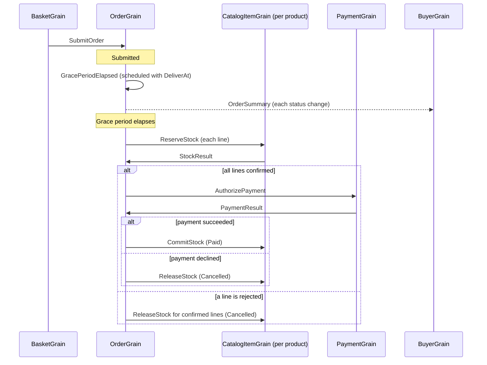

<a id="order-processing-playground"></a>

# 秩序处理操场

以 Orleans 通信和日刊方式建造的处理程序工作流程。
它遵循单项 [dotnet/eShop](https://github.com/dotnet/eShop) 的顺序流程
网站应用程序,其中主机为 silo、最小 API和浏览器界面。

```bash
dotnet run --project playground/OrderProcessing
```

打开打印的 URL 浏览目录,填满篮子,检查并观察订单进度。
Orleans 仪表板位于 `/dashboard`。

<a id="flow"></a>

## 流动



| eShop | 这个游乐场 |
| --- | --- |
| Basket.API,结关整合活动 | `BasketGrain` 阶段 `SubmitOrder` 并用一本日记写清篮子 |
| Ordering.API、 `Order` 合计和整合事件日志 | `OrderGrain` 将每个发送的信息发布顺序和阶段与每次过渡时的顺序和阶段记为日记 |
| `GracePeriodManagerService` 查询数据库 | 每个命令发送给自己的 `GracePeriodElapsed` 信息, 并有 `DeliverAt` 时间 |
| Catalog.API 库存审定 | 一个 `CatalogItemGrain` 每一产品储备、承诺和排放存量 |
| PaymentProcessor | `PaymentGrain` 授权订购总数;在 `0002` 结束的牌片被拒绝 |
| 命令状况通知 | `BuyerGrain` 工程状态信息进入买方订单列表 |

买方可以取消订单,直到其库存得到确认,船舶支付订单。

<a id="delivery-and-idempotency"></a>

## 交付和应急

- 信件至少发送一次,并处理每个邮件编号。
  顺序编号,例如 `orders/{orderId}/stock/{productId}`,答复使用请求的ID
  `result` 孩子。
- 退票申请的ID是命令身份识别号。 篮子记得7天的结关, 所以
  在此期间重新查取的结账也返回同一顺序。
- 状态信息含有版本,买方投影保持最高,因为交货
  顺序未指定。
- 提交文件处理器将给发件人发送命令的 `GracePeriodElapsed` 信件,该信件应在宽度结尾处发送
  。命令的收件箱在记录顺序及其
  处理器只预发一个 `Submitted` 命令,所以被取消的命令忽略了它。
- 取消后收到的库存确认书解除了保留。
- 该目录保留了每个订单的保留意见结果,包括释放、承诺和重新启动。
  被释放后,先到达的 记录拒绝, 所以后来的储备保留了现有库存。
- 提交书附有其订单日期,保持现状和排定信息内容在整个
  重新处理。 命令转换在应用状态前准备和播放发出的信息 。
  对于遗留划界案,订单将私人提交的时间印章印一次,并在之后再重新使用
  失败发送和重新启动,公共秩序状况一直维持到信息阶段。

<a id="configuration"></a>

## 配置

`Ordering:GracePeriod` 内 `appsettings.json` 设置库存审定前的延误。
信息使用不稳定的存储,
JSON 日记格式,使用源生成的 `OrderProcessingJsonContext`。
