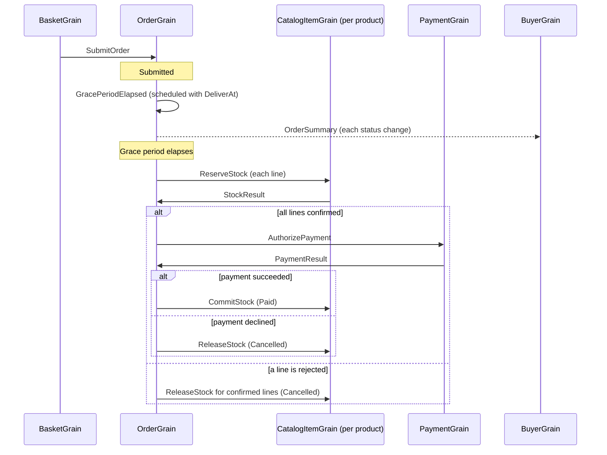

<a id="order-processing-playground"></a>

# 订单处理实验项目

使用 Orleans Messaging 和 Journaling 构建的订单处理工作流。
它遵循 [dotnet/eShop](https://github.com/dotnet/eShop) 的下单流程，在同一个
Web 应用程序中托管 Silo、最小 API 和浏览器 UI。

```bash
dotnet run --project playground/OrderProcessing
```

打开输出的 URL，即可浏览商品目录、添加购物篮商品、结账并查看订单进度。
Orleans Dashboard 位于 `/dashboard`。

<a id="flow"></a>

## 流程



| eShop | 本实验项目 |
| --- | --- |
| Basket.API，结账集成事件 | `BasketGrain` 将 `SubmitOrder` 暂存到发件箱，并在同一次日志写入中清空购物篮 |
| Ordering.API，`Order` 聚合及集成事件日志 | `OrderGrain` 记录订单日志，并在每次状态转换时暂存所有出站消息 |
| `GracePeriodManagerService` 轮询数据库 | 每个订单向自身发送一条带 `DeliverAt` 时间的 `GracePeriodElapsed` 消息 |
| Catalog.API 库存验证 | 每个商品对应一个 `CatalogItemGrain`，负责预留、提交和释放库存 |
| PaymentProcessor | `PaymentGrain` 对订单总额进行支付授权；尾号为 `0002` 的银行卡会被拒绝 |
| 订单状态通知 | `BuyerGrain` 将状态消息投影到买家的订单列表 |

买家可在库存确认前取消订单，并可对已付款订单执行发货。

<a id="delivery-and-idempotency"></a>

## 投递与幂等性

- 消息至少投递一次，每个消息 ID 只处理一次。消息 ID 由
  订单 ID 派生，例如 `orders/{orderId}/stock/{productId}`，回复使用请求 ID 的
  `result` 子级标识。
- 结账请求 ID 就是订单 ID。购物篮将结账记录保留 7 天，因此
  在该期限内重试结账会返回同一个订单。
- 状态消息携带版本号；由于投递顺序未规定，买家侧投影保留
  最高版本。
- 提交处理程序向订单发送一条在宽限期结束时到期的 `GracePeriodElapsed` 消息。
  订单收件箱在记录订单的同一次日志写入中接受该消息，并且其
  处理程序仅推进处于 `Submitted` 状态的订单，因此已取消订单会忽略该消息。
- 取消订单后才到达的库存确认会释放对应的库存预留。
- 商品目录在库存释放、提交和 Grain 重新激活期间保留每个订单的预留结果。
  先到达的释放请求会记录拒绝结果，因此之后到达的预留请求会保持可用库存不变。
- 提交消息携带订单日期，使状态和定时消息的内容在处理程序重试期间保持稳定。
  订单转换先准备和暂存出站消息，然后再应用状态变更。
  对于旧版提交消息，订单只记录一次私有提交时间戳，并在发送失败和重新激活后复用，
  使公开订单状态在消息成功暂存之前保持不变。

<a id="configuration"></a>

## 配置

`appsettings.json` 中的 `Ordering:GracePeriod` 设置库存验证前的延迟。日志以及
用于唤醒消息传递的持久化作业使用易失性内存存储；日志化状态使用
JSON 日志格式及源生成的 `OrderProcessingJsonContext`。
