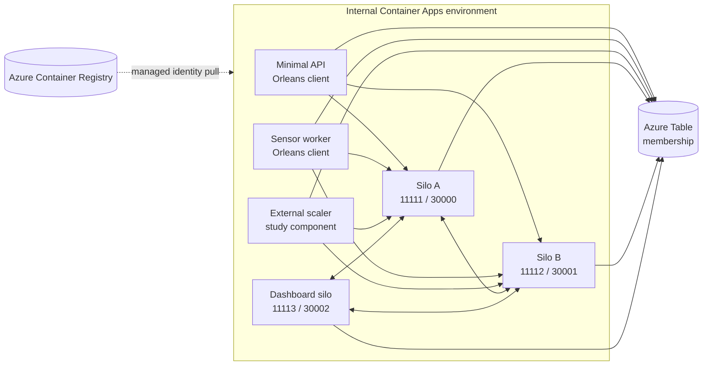

<a id="deploy-an-orleans-cluster-on-azure-container-apps"></a>

# 在 Azure Container Apps 上部署 Orleans 集群

> [!NOTE]
> 本示例位于 [`dotnet/orleans` 仓库](https://github.com/dotnet/orleans/tree/main/samples/Deployment/AzureContainerApps)中，从 [`Azure-Samples/Orleans-Cluster-on-Azure-Container-Apps`](https://github.com/Azure-Samples/Orleans-Cluster-on-Azure-Container-Apps) 导入，并在本目录保留其 MIT 许可证。

本示例演示 Azure Container Apps 上的多组件 Orleans 应用：

- 两个专用 Silo Container App。
- 同时作为 Silo 运行的 Orleans Dashboard 进程。
- 一个 Minimal API Orleans 客户端，提供键范围受限的 hello Grain 路由。
- 一个生成模拟传感器流量的工作服务 Orleans 客户端。
- 一个用于研究 KEDA 契约的 gRPC 外部缩放器服务。
- Azure Table Storage 集群成员资格管理、Application Insights 及 Azure Monitor 日志。

Bicep 部署使用与虚拟网络集成的内部 Container Apps 环境及关联的专用 DNS 区域。每个 Orleans 服务器在单独的 Container App 中运行，且恰好只有一个副本。每个服务器通告环境的专用静态 IP 地址及一对唯一的 Silo/网关端口，不依赖未公开文档的每副本地址。



<a id="important-boundaries"></a>

## 重要边界

- Azure Table Storage **仅用于集群成员资格管理**。示例中的 Grain 无状态，未注册持久化 Grain 存储提供程序。
- 已部署外部缩放器，但有意不将其关联到 Silo 缩放规则。在同一个 Container App 内将 Silo 扩展为多个副本，并不能为每个副本提供有文档支持的唯一地址。
- Dashboard 和 API 的入口是私有的，因为 Container Apps 环境为内部环境。请从虚拟网络或与其连接的专用网络访问。
- 示例中的所有运行时应用共用一个用户分配的托管标识，该标识在注册表上具有 `AcrPull`，在成员资格表上具有 `Storage Table Data Contributor`。
- 注册表和存储数据终结点仍是公开的，以便 GitHub 托管运行器和 Container Apps 访问，但需要 Microsoft Entra 身份验证。如果不能接受公共终结点，请改用专用终结点与私有运行器。
- 工作流就地更新现有应用。Container Apps 可能在评估就绪状态时同时运行新旧修订版。在生产环境升级时，应部署一个使用未占用端口的替换 Silo 应用（一个副本），等待其加入集群，再排空并移除旧应用。

有关生产拓扑、升级及验收测试指南，请参阅[在 Azure Container Apps 上托管 Orleans](https://dotnet.github.io/orleans/docs/deployment/deploy-to-azure-container-apps/)。

<a id="project-layout"></a>

## 项目布局

| 路径 | 用途 |
| --- | --- |
| `Abstractions` | Grain 接口及可序列化的传感器契约。 |
| `Grains` | hello 和传感器 Grain 实现及示例放置策略。 |
| `Silo` | 专用 Orleans Silo 主机。 |
| `Dashboard` | 在独立 Silo 中托管的 Orleans Dashboard。 |
| `Clients.MinimalApi` | 以 Orleans 客户端作为后端的 HTTP API。 |
| `Clients.WorkerService` | 模拟传感器工作负载和探针终结点。 |
| `Scaler` | 外部缩放器 gRPC 服务。 |
| `Infrastructure` | 共享遥测、标识、存储及终结点配置。 |
| `Azure` | 基础设施、特权引导、环境和 Container App Bicep 模块。 |
| `deployment/deploy.yml` | 通过 OIDC 进行身份验证的构建与部署工作流。 |

<a id="run-locally"></a>

## 在本地运行

Development 配置只接受 Azurite 快捷连接字符串 `UseDevelopmentStorage=true`。生产环境不会回退到连接字符串。

1. 安装[由 `global.json` 选定的 .NET SDK](https://dotnet.microsoft.com/download)。示例项目以 `net10.0` 为目标。
1. 启动 [Azurite](https://learn.microsoft.com/azure/storage/common/storage-use-azurite)。
1. 构建示例：

   ```powershell
   dotnet build .\samples\Deployment\AzureContainerApps\HelloOrleans.sln -c Release
   ```

1. 启动 `Silo`，再在独立终端中启动所需客户端、Dashboard 和缩放器：

   ```powershell
   dotnet run --project .\samples\Deployment\AzureContainerApps\Silo
   dotnet run --project .\samples\Deployment\AzureContainerApps\Dashboard
   dotnet run --project .\samples\Deployment\AzureContainerApps\Clients.MinimalApi
   dotnet run --project .\samples\Deployment\AzureContainerApps\Clients.WorkerService
   dotnet run --project .\samples\Deployment\AzureContainerApps\Scaler
   ```

每个启动配置文件都会设置 Development 环境。如果不使用启动配置文件，请设置 `DOTNET_ENVIRONMENT=Development`。

Minimal API 路由 `GET /hello/{grain}` 仅接受 0 至 255 的整数键。`GET /providers` 将活动 hello Grain 的键以数值形式返回。不活动 hello Grain 的回收期限为两分钟。

<a id="deploy-to-azure"></a>

## 部署到 Azure

<a id="prerequisites"></a>

### 先决条件

- Azure 订阅以及支持 Bicep 的 [Azure CLI](https://learn.microsoft.com/cli/azure/install-azure-cli)。
- 已启用 Actions 的 GitHub 分支仓库（fork）。
- GitHub OIDC 应用或用户分配的标识，其联合凭据限定于本仓库和 `azure-container-apps` 环境。请参阅[在 Azure 中配置 OpenID Connect](https://learn.microsoft.com/azure/developer/github/connect-from-azure-openid-connect)。
- 一个有权为一次性引导操作创建角色分配的主体。

部署前请检查 `Azure/bootstrap.bicep` 中的角色范围。引导仅在示例资源组上向工作流主体授予 `Contributor`，仅在示例注册表上授予 `AcrPush`。日常工作流无法创建角色分配。

<a id="run-the-privileged-bootstrap"></a>

### 运行特权引导

以特权引导操作员身份登录，选择简短的小写基础名称，并提供工作流服务主体的**对象 ID**：

```bash
RESOURCE_GROUP="my-orleans-aca"
LOCATION="eastus"
BASE_NAME="orleansaca"
DEPLOYMENT_PRINCIPAL_OBJECT_ID="00000000-0000-0000-0000-000000000000"

for provider in \
  Microsoft.App \
  Microsoft.Authorization \
  Microsoft.ContainerRegistry \
  Microsoft.Insights \
  Microsoft.ManagedIdentity \
  Microsoft.Network \
  Microsoft.OperationalInsights \
  Microsoft.Storage
do
  az provider register --namespace "$provider" --wait
done

az group create \
  --name "$RESOURCE_GROUP" \
  --location "$LOCATION"

az deployment group create \
  --name aca-bootstrap \
  --resource-group "$RESOURCE_GROUP" \
  --template-file samples/Deployment/AzureContainerApps/Azure/bootstrap.bicep \
  --parameters \
    "baseName=$BASE_NAME" \
    "deploymentPrincipalId=$DEPLOYMENT_PRINCIPAL_OBJECT_ID"
```

提供程序注册的范围是订阅，必须由特权引导操作员完成。随后引导会创建注册表、成员资格存储及表、运行时标识，并分配：

- 向运行时标识授予 `AcrPull`。
- 在成员资格表范围内，向运行时标识授予 `Storage Table Data Contributor`。
- 在示例资源组范围内，向工作流主体授予 `Contributor`。
- 在注册表范围内，向工作流主体授予 `AcrPush`。

示例注册表选择 **RBAC Registry Permissions**（RBAC 注册表权限），因此 `AcrPull` 和 `AcrPush` 角色适用。如果切换为 **RBAC Registry + ABAC Repository Permissions**（RBAC 注册表及 ABAC 仓库权限），请将这些角色替换为仓库范围的读取者和写入者角色分配。

只能通过组织用于特权访问的受治理管理流程执行引导。

<a id="configure-and-run-the-workflow"></a>

### 配置并运行工作流

1. 在自己的分支仓库中，将 `deployment/deploy.yml` 复制为 `.github/workflows/deploy-orleans-container-apps.yml`。
1. 创建名为 `azure-container-apps` 的受保护 GitHub 环境。
1. 添加以下环境变量：

   | 变量 | 值 |
   | --- | --- |
   | `AZURE_CLIENT_ID` | GitHub OIDC 登录使用的客户端 ID。 |
   | `AZURE_TENANT_ID` | Microsoft Entra 租户 ID。 |
   | `AZURE_SUBSCRIPTION_ID` | Azure 订阅 ID。 |
   | `AZURE_RESOURCE_GROUP` | 已完成引导的现有资源组。 |
   | `AZURE_BASE_NAME` | 与传入引导操作的基础名称相同。 |

1. 添加环境要求的审核者及分支限制。
1. 手动运行工作流，或将示例/源码变更推送到 `deploy` 分支。

工作流不使用客户端机密。它使用 OIDC 登录，以幂等方式更新基础设施，构建五个带 Git SHA 标签的镜像，使用 Microsoft Entra 身份验证推送镜像，并按摘要部署镜像。Container Apps 通过运行时托管标识拉取各镜像。

<a id="deployed-topology"></a>

## 部署拓扑

环境的专用静态 IP 地址在负载均衡器边界共享，但每个 Orleans 进程拥有唯一的暴露端口对：

| Container App | Silo 端口 | 网关端口 | 副本范围 |
| --- | ---: | ---: | ---: |
| `silo-a` | 11111 | 30000 | 1–1 |
| `silo-b` | 11112 | 30001 | 1–1 |
| `dashboard` | 11113 | 30002 | 1–1 |

Silo 容器监听端口 11111 和 30000。Container Apps 将各应用独有的暴露端口映射到这些目标端口。虽然 TCP 入口使用 `external: true`，但由于环境是内部环境，入口 IP 仍然是专用地址。

所有已部署应用均显式设置启动、就绪和存活探针，副本数下限非零，并具有 60 秒的终止宽限期。.NET 主机启动后可访问运行状况终结点；生产应用应扩展就绪检查，以反映自身流量排空和依赖项要求。

若要增加集群容量，请声明另一个只有一个副本的 Silo 应用，使用一对在环境中唯一的新 Silo/网关端口。不要将 Silo 应用的最大副本数提高到一以上。

<a id="storage-and-identity"></a>

## 存储与标识

`AzureTable:ServiceUri` 设置为 Azure Table 服务 URI。`DefaultAzureCredential` 使用通过 `AZURE_CLIENT_ID` 选定的、已部署的用户分配标识。存储账户禁用共享密钥访问，注册表禁用管理员凭据。

若要持久化 Grain 状态，请显式添加并配置 Grain 存储提供程序，在可行时预配独立的状态存储，并且只授予所需的数据平面角色。不要将成员资格表当作持久化 Grain 状态存储。

<a id="explore-the-deployed-sample"></a>

## 探索已部署示例

Bicep 部署会输出专用环境 IP 及 Dashboard、API 和缩放器主机名。请从环境所在虚拟网络中的计算机连接。如果使用对等互连网络，在使用输出的主机名前，还需要将 Container Apps 专用 DNS 区域关联到该虚拟网络，或使用 Azure DNS Private Resolver 配置等效的解析功能。然后：

1. 打开 Dashboard，确认 `Silo-A`、`Silo-B` 和 `Dashboard` 都处于活动状态。
1. 调用 `GET /hello/0` 和 `GET /hello/255`；这两个边界范围内的 Grain 标识都应调用成功。
1. 确认 `GET /hello/-1` 和 `GET /hello/256` 返回 HTTP 400，且非整数路由不会匹配。
1. 调用 `GET /providers` 并确认活动 hello Grain 的键以数值形式返回。
1. 观察工作服务客户端创建一组数量受限的模拟传感器标识，并将调用分配到各专用 Silo。

<a id="add-cluster-capacity"></a>

### 增加集群容量

不要增加 Silo 应用的副本数。在 `Azure/main.bicep` 的 `siloDefinitions` 中添加另一个条目，使用唯一的应用后缀、Silo 名称、暴露的 Silo 端口及网关端口。重新部署，等待新成员资格记录变为活动状态，并验证所有已有 Silo 和客户端都能访问其通告的终结点。

若要缩减容量，请先停止向该 Silo 提交新的应用工作，让 Orleans 在终止宽限期内退出成员资格，并每次仅移除一个应用。优雅关闭并非一定能完成，因此还应单独测试突然终止。

<a id="study-the-external-scaler"></a>

### 研究外部缩放器

gRPC 缩放器仍保留在解决方案中，以便研究 Orleans 管理统计信息及 [KEDA 外部缩放器协议](https://keda.sh/docs/latest/concepts/external-scalers/)。它未关联到 Silo 应用，因为 Container Apps 不会为已扩展应用的每个副本公布受支持的唯一地址。使用实测的平台指标或应用自身控制的部署控制器，以完整的单副本 Silo 应用为单位增删容量；不要将示例阈值作为生产容量规划依据。

<a id="inspect-health-and-revisions"></a>

### 检查运行状况及修订版

使用 Container Apps 修订版及副本命令，将镜像摘要、就绪状态及重启情况与 Orleans 成员资格关联起来：

```bash
az containerapp revision list \
  --resource-group "$RESOURCE_GROUP" \
  --name "<container-app-name>" \
  --output table

az containerapp replica list \
  --resource-group "$RESOURCE_GROUP" \
  --name "<container-app-name>" \
  --revision "<revision-name>" \
  --output table
```

就绪状态会将唯一副本从新入站流量的选择范围中移除，但本身不会关闭已有 Orleans TCP 连接，也不会更新成员资格。请协调就绪状态、应用排空、成员资格退出及主机关闭。

<a id="clean-up"></a>

## 清理

完成后删除专用资源组：

```bash
az group delete --name "$RESOURCE_GROUP"
```
