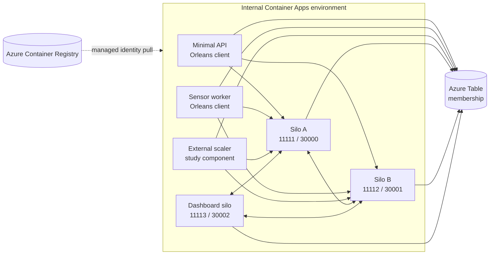

<a id="deploy-an-orleans-cluster-on-azure-container-apps"></a>

# 部署 a Orleans 组群一一 Azure 集装箱集装箱

> [!NOTE]
> 该样本存在于 [`dotnet/orleans` 仓库](https://github.com/dotnet/orleans/tree/main/samples/Deployment/AzureContainerApps)中。它从 [`Azure-Samples/Orleans-Cluster-on-Azure-Container-Apps`](https://github.com/Azure-Samples/Orleans-Cluster-on-Azure-Container-Apps)进口,其麻省理工学院许可证在本目录中保留。

样本显示一个多构件 Orleans 申请在 Azure 集装箱装货容器

- 两个专用 silo 集装箱应用程序。
- A 音 A Orleans 机头板程序 silo.
- 最小 API Orleans 客户端,有一条连接的问讯线-grain 路线。
- 工人 Orleans 客户端,可生成模拟传感器交通。
- A gRPC 研究KEDA合同的外部标尺服务。
- Azure 表格存储集、应用程序透视和 Azure 监测日志。

Bicep 部署使用内部、虚拟网络一体化集装箱应用环境以及连接的私营 DNS 区。每个 Orleans 服务器都在一个单独的容器应用程序中运行,有一个完全复制的版本。每个服务器都为该环境的私人静态IP和独特的 silo/门口端对做广告,并不取决于无文件记录的重复地址。



<a id="important-boundaries"></a>

## 重要边界

- Azure 表格储存仅用于 **组成员**。样本 grains 是无国籍的,没有耐用 grain- 存储提供者登记。
- 外部缩放器已部署,但有意不附于 silo 缩放规则。一个容器 App 中的缩放多个 silo 复制件没有为每个复制提供有文件记录的独有地址。
- 仪表板和 API 内出因是内部的集装箱应用环境,因此是私人的。从虚拟网络或连接的私营网络接触它们。
- 样本对所有运行时应用程序使用一个用户指定的管理型身份。 在登记册上有一个 `AcrPull` ,在成员表中有一个 `Storage Table Data Contributor` 。
- 登记册和储存数据端点仍然公开,因此 GitHub-- -- 接收的运行员和集装箱应用程序可以到达它们,但它们需要 Microsoft Entra认证。当公共端点无法接受时,样本将使用私人端点和一个私人端点。
- 工作流程更新现有应用程序。 集装箱应用程序可以在评估准备状态时重复旧的和新的修改。 对于生产升级,用未使用的港口安装一个替代的一次性 silo 应用程序,等待它加入,然后排水并删除旧应用程序。

生产表层、升级和验收试验指导见 [东道主主 Orleans 日期 时 Azure 集装箱集装箱](https://dotnet.github.io/orleans/docs/deployment/deploy-to-azure-container-apps/) 。

<a id="project-layout"></a>

## 项目布局

| 路径路径路径 | 目的目的宗旨 |
| --- | --- |
| `Abstractions` | Grain 接口和序列传感器合同。 |
| `Grains` | 你好和传感器 grain 实施和样本安置政策。 |
| `Silo` | 专用 Orleans silo 主机 。 |
| `Dashboard` | Orleans 板在不同的 silo内。 |
| `Clients.MinimalApi` | HTTP API 由 Orleans 客户端支持。 |
| `Clients.WorkerService` | 模拟传感器工作量和调查终点。 |
| `Scaler` | 外部比缩表器 gRPC 服务。 |
| `Infrastructure` | 共享遥测、身份、储存和终端配置。 |
| `Azure` | 基础、特权靴子、环境和集装箱应用Bicep模块。 |
| `deployment/deploy.yml` | OIDC经认证的建设和部署工作流程。 |

<a id="run-locally"></a>

## 本地运行本地

开发配置只接受 Azurite 快捷键 `UseDevelopmentStorage=true`。 生产不会返回到连接字符串 。

1. 安装 [.NET SDK 选择 `global.json`](https://dotnet.microsoft.com/download)。抽样项目的目标 `net10.0`。
1. 开始 [紫紫](https://learn.microsoft.com/azure/storage/common/storage-use-azurite)。
1. 构建样本 :

   ```powershell
   dotnet build .\samples\Deployment\AzureContainerApps\HelloOrleans.sln -c Release
   ```

1. 启动 `Silo`,然后在不同的终端中启动任何客户端、仪表板和天平缩放器:

   ```powershell
   dotnet run --project .\samples\Deployment\AzureContainerApps\Silo
   dotnet run --project .\samples\Deployment\AzureContainerApps\Dashboard
   dotnet run --project .\samples\Deployment\AzureContainerApps\Clients.MinimalApi
   dotnet run --project .\samples\Deployment\AzureContainerApps\Clients.WorkerService
   dotnet run --project .\samples\Deployment\AzureContainerApps\Scaler
   ```

每个发射简介都设置开发环境。如果没有发射简介,请设定 `DOTNET_ENVIRONMENT=Development`。

最小 API 路径 `GET /hello/{grain}` 只接受 0 到 255 之间的整数键。 `GET /providers` 返回活动 hello -grain 键作为数字。 非活动的 Hello grains 收集时间为两分钟。

<a id="deploy-to-azure"></a>

## 部署到 Azure

<a id="prerequisites"></a>

### 先决条件

- 订阅和有Bicep支持的 Azure 和 [Azure CLI](https://learn.microsoft.com/cli/azure/install-azure-cli) 。
- A GitHub 已启用动作的叉子 。
- A GitHub OIDC 应用程序或用户指定身份,其联合证书仅限该存储库和 `azure-container-apps` 环境。 [配置 OpenID 连接在 Azure](https://learn.microsoft.com/azure/developer/github/connect-from-azure-openid-connect).
- 校长,允许为一次性的靴子布设角色分配。

在部署前审查 `Azure/bootstrap.bicep` 中的角色范围。 陷阱设置只允许抽样资源组使用工作流程本位 `Contributor` ,而只有样本登记册使用工作流程本位 `AcrPush` 。常规工作流程不能创建角色分配。

<a id="run-the-privileged-bootstrap"></a>

### 运行特权靴套

以特权靴杆操作员身份签名,选择一个小写基号,并提供工作流程服务本金的 **对象编号** :

```bash
RESOURCE_GROUP="my-orleans-aca"
LOCATION="eastus"
BASE_NAME="orleansaca"
DEPLOYMENT_PRINCIPAL_OBJECT_ID="00000000-0000-0000-0000-000000000000"

for provider in \
  Microsoft.App \
  Microsoft.Authorization \
  Microsoft.ContainerRegistry \
  Microsoft.Insights \
  Microsoft.ManagedIdentity \
  Microsoft.Network \
  Microsoft.OperationalInsights \
  Microsoft.Storage
do
  az provider register --namespace "$provider" --wait
done

az group create \
  --name "$RESOURCE_GROUP" \
  --location "$LOCATION"

az deployment group create \
  --name aca-bootstrap \
  --resource-group "$RESOURCE_GROUP" \
  --template-file samples/Deployment/AzureContainerApps/Azure/bootstrap.bicep \
  --parameters \
    "baseName=$BASE_NAME" \
    "deploymentPrincipalId=$DEPLOYMENT_PRINCIPAL_OBJECT_ID"
```

供应商登记是订阅范围广的,必须由特权皮靴操作员进行。

- `AcrPull` 至运行时身份。
- `Storage Table Data Contributor` 至成员表范围内的运行时间身份。
- `Contributor` 至抽样资源组范围的工作流程本。
- `AcrPush` 至登记册范围工作流程本。

抽样登记册选择 **RBAC登记处允许**,因此适用 `AcrPull` 和 `AcrPush` 的作用。如果将其转换为 **RBAC登记处+ABAC仓库权限**,则用存储器范围广的读者和作者任务取代这些作用。

仅通过管理的行政手续来运行这些皮靴,以便贵组织享有特权。

<a id="configure-and-run-the-workflow"></a>

### 配置并运行工作流程

1. 复制 `deployment/deploy.yml` 到叉子中的 `.github/workflows/deploy-orleans-container-apps.yml`
1. 创建受保护的 GitHub 命名环境 `azure-container-apps`.
1. 添加这些环境变量:

   | 变量 | 价值值值 |
   | --- | --- |
   | `AZURE_CLIENT_ID` | GitHub OIDC 登录所使用的客户端代号。 |
   | `AZURE_TENANT_ID` | Microsoft 房客身份证 |
   | `AZURE_SUBSCRIPTION_ID` | Azure 订阅身份证。 |
   | `AZURE_RESOURCE_GROUP` | 现有装备齐全的资源小组。 |
   | `AZURE_BASE_NAME` | 同样的基名传到靴子陷阱上 |

1. 增加环境方面所需的审评员和部门限制。
1. 手动运行工作流程,或将样本/源变化推进到 `deploy` 分支。

工作流程没有客户端秘密。 它使用 OIDC 签名, 以最能干的方式更新基金会, 用 Git- SHA 标签建立五张图像, 使用 Microsoft Entra 认证推动它们, 并通过摘要方式部署图像。 容器应用程序将每个图像拖过运行时管理的身份 。

<a id="deployed-topology"></a>

## 部署的地形

环境私有静态IP在负载平衡边界上共享,但每个 Orleans 过程都有独特的对端左端端端:

| 集装箱装箱 | Silo 端口 | Gateget 端口 | 复制范围 |
| --- | ---: | ---: | ---: |
| `silo-a` | 11111 | 30000 | 1–1 |
| `silo-b` | 11112 | 30001 | 1–1 |
| `dashboard` | 11113 | 30002 | 1–1 |

下 silo 集装箱Apps绘制了每个应用程序独特的暴露港口与这些目标港口之间的独特接触点。 `external: true`环境是内部的,所以入侵方IP仍然保持隐私。

所有应用软件都有明确的启动、准备和活性探测器,无零复制层以及60秒终止宽限期。 健康端点可以在 .NET 主机启动后达到;生产应用程序应该扩大准备状态以反映其自身的交通排减和依赖要求。

要添加分组能力,请声明另一个一个复制 silo 应用程序,配有一个新的环境独 silo/开关对。不要在 silo 应用程序上加一个最大复制数。

<a id="storage-and-identity"></a>

## 储存和身份识别

`AzureTable:ServiceUri` 设置为 Azure 表格服务 URI。 `DefaultAzureCredential` 使用 `AZURE_CLIENT_ID`选定的用户指定身份。存储账户上禁用共享密钥访问,并禁用登记册管理员证书。

要保持 grain 状态,请明确添加和配置一个 grain- 储存提供者,在可行的情况下单独提供一家国家仓库,并只赋予所需的数据机作用。不要将成员表视为耐久的 grain 状态。

<a id="explore-the-deployed-sample"></a>

## 探索部署的样本

Bicep 部署输出私人环境 IP 加上仪表板、 API和缩放主机名称。 从环境虚拟网络中的机器连接。 对于同行网络, 在使用所排放的主机名之前,还将集装箱应用专用 DNS 区与该虚拟网络连接起来或配置等效分辨率为 Azure DNS 私有解析器。 然后 :

1. 打开仪表板,并核实 `Silo-A`、 `Silo-B`和 `Dashboard` 是否活动。
1. 调用 `GET /hello/0` 和 `GET /hello/255`;两个有界 grain 身份都应成功。
1. 确认 `GET /hello/-1` 和 `GET /hello/256` 返回 HTTP 400,非整数路径不匹配。
1. 调用 `GET /providers` 并核实是否以数字形式返回活动 Hello -grain 键。
1. 观察工人客户创建一组封闭的模拟传感器身份,并在专用 silos中发送电话。

<a id="add-cluster-capacity"></a>

### 增加分组能力

不要增加 silo 添加另一个条目到 `siloDefinitions` 内 `Azure/main.bicep` 带有独一的应用程序后缀, silo 名称, 曝光 silo 和暴露的网关端口。重新配置,等待新的成员行开始活动,并核查每个现有的 silo 客户可以达到其广告的终点。

要去除能力,首先停止该 silo的新申请工作,允许 Orleans 在终止宽限期内退出成员资格,一次删除一个应用程序。测试突然终止是因为优雅的关闭得不到保证。

<a id="study-the-external-scaler"></a>

### 研究外部缩放器

gRPC 缩放器仍留在解决方案中,以便您能够研究 Orleans 管理统计和 [KEDA 外部标标算协议](https://keda.sh/docs/latest/concepts/external-scalers/)。它没有附在 silo 应用程序上,因为容器应用软件不会为每个缩放应用程序复制版本发布一个支持的独特地址。使用测量的平台度量或应用程序所属部署控制器来添加并删除整个一版 silo 应用程序;不要将抽样阈值用作生产能力指导。

<a id="inspect-health-and-revisions"></a>

### 检查健康和修订

使用集装箱应用程序修订和复制命令,将图像摘要、准备状态和重新启动与 Orleans 成员相连接:

```bash
az containerapp revision list \
  --resource-group "$RESOURCE_GROUP" \
  --name "<container-app-name>" \
  --output table

az containerapp replica list \
  --resource-group "$RESOURCE_GROUP" \
  --name "<container-app-name>" \
  --revision "<revision-name>" \
  --output table
```

准备状态从新的反向选择中移除唯一的复制, 但并不关闭已有的 Orleans 协调准备、应用排水、成员离职和东道国关闭。

<a id="clean-up"></a>

## 清理

完成时删除专用资源组 :

```bash
az group delete --name "$RESOURCE_GROUP"
```
