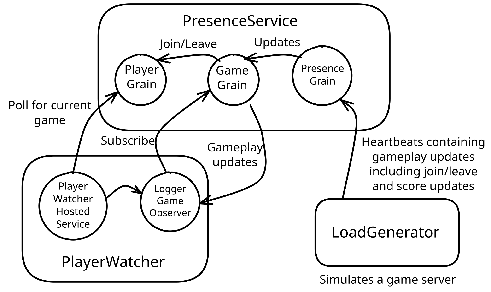

---
languages:
- csharp
products:
- dotnet
- dotnet-orleans
page_type: sample
name: "Orleans 游戏在线状态服务示例"
urlFragment: "orleans-gaming-presence-service-sample"
description: "演示游戏在线状态服务用法的 Orleans 示例服务。"
---

<a id="orleans-gaming-presence-service-sample"></a>

# Orleans 游戏在线状态服务示例

本示例演示游戏在线状态服务：游戏服务器（由 *LoadGenerator* 应用表示）定期向云服务（由 *PresenceService* 应用表示）发送心跳，其中包含所托管游戏的状态。在服务内部，相应的 `PresenceGrain` 负责解析心跳消息，并将游戏状态反映到 `PlayerGrain` 和 `GameGrain` 中。可通过客户端应用（*PlayerWatcher*）观察其效果：客户端轮询玩家当前所在的游戏会话。每当返回新的游戏会话时，客户端便创建新的 `LoggerGameObserver`，订阅游戏 Grain，使状态更新通过 `IGameObserver` 接口推送给客户端。



<a id="sample-prerequisites"></a>

## 示例先决条件

本示例使用 C# 编写，目标框架为 .NET 10。需要 [.NET 10 SDK](https://dotnet.microsoft.com/download/dotnet/10.0) 或更高版本。

<a id="building-the-sample"></a>

## 构建示例

按照以下步骤下载并运行示例：

1. 下载并解压示例。
2. 在 Visual Studio（2022 或更高版本）中：
    1. 在菜单栏中选择 **文件** > **打开** > **项目/解决方案**。
    2. 导航到存放已解压示例代码的文件夹，并打开 C# 项目（.csproj）文件。
    3. 按 <kbd>F5</kbd> 调试运行，或按 <kbd>Ctrl</kbd>+<kbd>F5</kbd> 在不调试的情况下运行项目。
3. 从命令行运行：
   1. 导航到存放已解压示例代码的文件夹。
   2. 在命令行输入 [`dotnet run`](https://docs.microsoft.com/dotnet/core/tools/dotnet-run)。

要在命令行中逐步构建并运行示例，请使用以下命令：

使用 .NET CLI 构建解决方案：

```dotnetcli
dotnet build
```

启动服务端进程：

```dotnetcli
dotnet run --project ./src/PresenceService
```

在另一个终端窗口中启动玩家观察程序：

```dotnetcli
dotnet run --project ./src/PlayerWatcher
```

在另一个终端窗口中启动负载生成器：

```dotnetcli
dotnet run --project ./src/LoadGenerator
```
